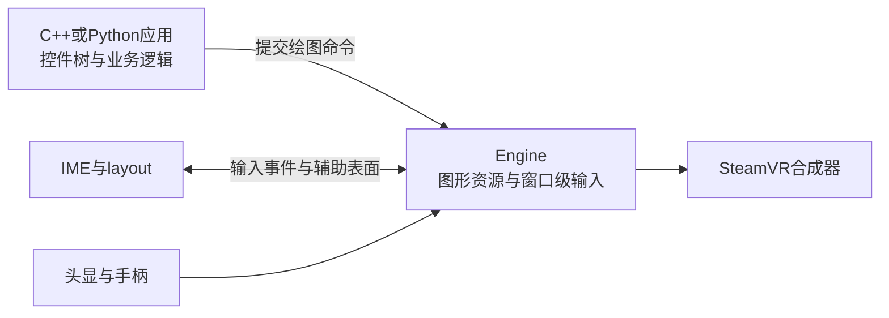

# 引擎概览与适用场景

EasyVROverlayUIEngine用于开发显示在SteamVR空间中的独立界面。应用使用C++或Python SDK组织控件和事件，Engine统一管理图形设备、SteamVR表面和窗口级输入路由。

## SteamVR叠加层

叠加层（Overlay）是由SteamVR合成到主场景中的独立表面。应用与主场景独立运行，每个`window`可设置位置、朝向、物理缩放和曲率。参考对象可选`world`、`head`、`body`、`left`或`right`。用户可以通过手柄激光操作控件，通过侧握键移动窗口，或使用控制环调整旋转。

## 应用场景

|场景|实现方式|
|---|---|
|VRChat消息与参数工具|使用`textbox`输入消息、`button`执行操作，并通过应用侧OSC接口发送数据|
|空间状态面板|使用`label`显示状态，使用`progressbar`展示确定进度，按任务选择固定空间或手柄参考|
|空间文件查看和编辑工具|使用`treeview`、`listview`、`grid`组织数据，在独立`window`中展示并处理事件|
|多语言文本编辑|使用SDK支持的输入控件，与独立IME和layout协作|
|跨设备工具|在另一台计算机运行应用，通过TCP和TLS连接渲染主机上的Engine|

## SDK与Engine职责

SDK提供控件、焦点、类型化事件和可视化窗体设计流程。Engine根据应用提交的绘图命令渲染表面，并依据当前窗口转发输入。多个应用可以连接同一Engine实例。

从[环境准备、构建与安装](/basics/01_install_and_setup)开始，再运行[第一个window](/basics/03_first_window)。
