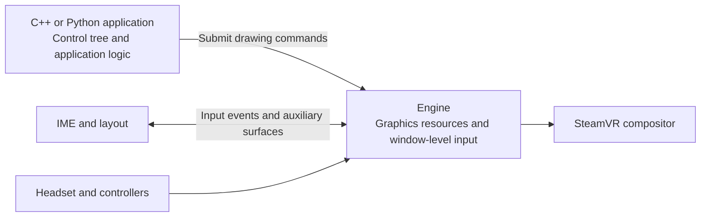

# Engine Overview and Use Cases

EasyVROverlayUIEngine is used to develop independent interfaces that are displayed in the SteamVR space. The application uses C++ or Python SDKs to organize controls and events. The Engine manages graphics devices, SteamVR surfaces, and window-level input routing.

## SteamVR Overlay

SteamVR composites an overlay as a separate surface in the main scene. An overlay application runs independently of that scene. Each `window` has its own position, orientation, physical scale, and curvature. Choose `world`, `head`, `body`, `left`, or `right` as the reference. Point and press the controller trigger to operate a control. Use the grip to move the window, or the handle ring to adjust its rotation.

## Application Scenarios

|Scenario|Implementation Method|
|---|---|
|VRChat Message and Parameter Tools|Use `textbox` to input messages, `button` to execute operations, and send data through the application-side OSC interface.|
|Space Status Panel|Use `label` to display status, `progressbar` to show confirmed progress, and select fixed spaces or controller references by task.|
|Space File Viewing and Editing Tools|Use `treeview`, `listview`, `grid` to organize data, and display and process events in the independent `window`.|
|Multilingual Text Editing|Use input controls supported by the SDK, collaborate with independent IMEs and layouts.|
|Cross-Device Tools|Run the application on another computer and connect to the Engine on the rendering host via TCP and TLS.|

## SDK and Engine Responsibilities

The SDK provides controls, focus, typed events, and visual form design processes. The Engine renders surfaces based on drawing commands submitted by the application and forwards inputs according to the current window. Multiple applications can connect to the same Engine instance.

Start with [prerequisites, build, and installation](/en/basics/01_install_and_setup), then [create and run your first window](/en/basics/03_first_window).