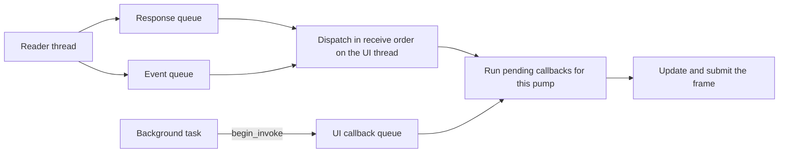

# Strongly Typed Events and Multithreading Scheduling

Applications receive interactions and state changes through strongly typed events. Windows, controls, and rendering callbacks belong to the UI thread that created them. After background work is completed, interface modifications are scheduled back to the appropriate thread using `begin_invoke()`.

## Subscriptions and Event Parameters

Both C++'s `event_container<T>` and the Python event container support `+=` and `-=`. Callbacks receive source objects and event parameters. `event.add(callback)` is used to obtain subscription identifiers, while `remove` or `-=` is used to unsubscribe. When multiple callbacks are subscribed, they are executed in registration order. Writable `handled` or `cancel` is used for subsequent event processing upon return.

`event_args_t` is a base class with additional fields. The following 18 parameters inherit from it, with Python type names omitting `_t`. For handling simple events, the state of the control after submission is read from `source`. Special events provide additional context through type fields.

|C++ Parameter Types|Field|Typical Sources|
|---|---|---|
|`cancel_event_args_t`|`cancel`|`window.on_closing`|
|`key_event_args_t`|`key`、`shift`、`ctrl`、`alt`、`meta`、`handled`|Keyboard Press and Release|
|`text_input_event_args_t`|`text`、`handled`|Text Input in Editable Controls|
|`pointer_event_args_t`|`hand`, `left/top`, `x/y`, `captured`, `cancelled`, `handled`, `has_position`, `has_local_position`, and Modifier Keys|Pointer Events. The first two groups of coordinates are relative to the surface and the control, respectively.|
|`scroll_event_args_t`|`hand`、`delta_x`、`delta_y`、`handled`|Scroll Input|
|`interaction_end_event_args_t`|`cancelled`|End of Drag, Scale, and Other Spatial Interactions|
|`property_changed_event_args_t`|`property_name`|General Attribute Changes|
|`control_collection_event_args_t`|`item`、`index`|Addition or Removal of Subcontrols|
|`menu_item_event_args_t`|`item`、`index`|Addition or Removal of `menu_container` Items|
|`tabpage_event_args_t`|`page`、`index`|Page Changes and Close Requests for `tabcontrol`|
|`listview_column_event_args_t`|`column`、`index`|Column Collections, Width, and Clicking|
|`listview_item_event_args_t`|`item`、`index`|Row Collections and Double-Clicking|
|`grid_column_event_args_t`|`index`、`width`|Header Clicking and Column Width Changes|
|`grid_cell_event_args_t`|`row`、`column`、`error`|Editing Lifecycle, Value Changes, and Double-Clicking|
|`tree_node_event_args_t`|`node`|Node Selection, Expansion, Collapse, and Activation|
|`render_error_event_args_t`|`message`|Window Drawing Failure|
|`controller_event_args_t`|`hand`、`trigger`、`grip`、`joystick_x/y`、`joystick_pressed`、`primary`、`secondary`|Handheld Input for Derived Controls|
|`control_input_event_args_t`|`type`、`hand`、`key`、`text`、`left/top`、`x/y`、`steps`、`horizontal`、`shift/ctrl/alt/meta`、`captured`、`cancelled`、`handled`、`has_position`、`has_local_position`|Derived controls of `process_input()`|

## Response and event dispatch

The receiving thread places ordinary `response` into the response queue and `event` into the event queue. Responses are found through the request ID to the corresponding asynchronous completion callback, while events enter the UI runtime via `event_callback`. Synchronous requests have their own separate waiting positions, which can wake up the caller of the synchronous request.

The UI thread records the sequence point during each processing cycle, compares the sequence numbers at the heads of both queues, and dispatches the responses and events in the order they were received. Then, it runs the UI callback queue for processing in that cycle. Background threads submit updates through `begin_invoke()` into the callback queue. When the session level changes, the current cycle stops processing work for the old session.

## The nested message loop of show_dialog

`window.show_dialog(owner)` is called synchronously on its associated UI thread. The call stack waits for results, while also entering the same nested message loop as the modal window of Win32/MFC in the same thread. Each cycle continues to dispatch responses, events, and UI callbacks, advance runtime updates, submit window screens, and then wait for activity. After the dialog box ends, exit the inner loop and return `dialog_result_t` to the caller.

- Modal interaction constraints apply to the direct owner. Other interactive windows and pending commands can still be processed by the same event loop.
- Complete shared state modifications and release the application lock before calling `show_dialog()`. The inner loop may trigger other callbacks before entering application logic.
- A modal window can be opened through a click event. Entering the modal state is prohibited during the drawing callback period.
- Rules for space focus, dialog box lifecycle, and data submission are described in the built-in dialog box](/en/guide/09_builtin_dialogs) of [.

## Update the background task submission interface

Background threads process time-consuming data or wait for timing. After preparing the values to display, pass the snapshot as callback data to `begin_invoke()`. Read or modify control properties in the callback. The SDK restricts pending updates with the control lifecycle, while the application is still responsible for stopping the working thread when closing and waiting for it to exit.

The countdown update is delivered using `begin_invoke()`. Clicking “Fill in Task Notes” enters the nested loop of `inputbox`, and the countdown update can still be executed.

### C++

<<< ../../../examples/guide/07_events_dialogs_threading/cpp/main.cpp

### Python

<<< ../../../examples/guide/07_events_dialogs_threading/python/timer_with_settings.py

Configure the SDK path and compile using `cpp/CMakeLists.txt` in the directory, or run `python/run.cmd`. When verifying the modal callback, wait for the interface to display, then open the note dialog box, observe the countdown update, and close the dialog box and owner.