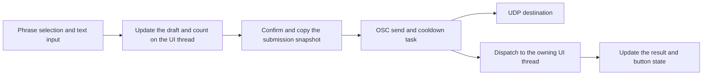

# Build a VRChat OSC Chat Tool

This project converts text input in the VR space into VRChat Chatbox messages. Users can first select common phrases, then add their own content, and after checking the word count, send the message explicitly. The application defaults to offline mode, first verifying the input, selection, and sending feedback before connecting to the actual OSC target. VRChat limits to 144 characters and a maximum of 9 display lines; both explicit line breaks and automatic line breaks will occupy display lines. [VRChat Chatbox API](https://docs.vrchat.com/docs/osc-as-input-controller#chatbox)

## Requirements and Obvious Results

From approaching the window to completing the send, users should be able to operate with one hand sequentially. The most common path is to select a phrase, adjust the draft, confirm the message, and wait for results. Occasionally, it may be necessary to switch to another window during input, but the original draft should still be visible when returning. Clearing bubbles and discarding drafts are different actions. The former affects display in VRChat, while the latter is a local editing operation. Making both into clear commands can prevent users from mistakenly thinking that the client content has been cleared; in reality, only the text in the editing area is deleted.

|Action|States to be Seen|Data Ownership|
|---|---|---|
|Open the application|Offline mode, count is 0|Window Session|
|Select a phrase|Text enters the editing area|Phrase collection and draft are saved separately|
|Edit or paste|Count matches the actual received text|Editing Area|
|Submit|Display local send results, limit repeated triggers|Snapshot of a single submission|
|Cancel clearing|Bubbles and drafts are retained|Confirm the transaction|
|Close the window|Exit confirmation and task release|Window and working thread|

Divide the acceptance into three levels: application, operating system, and VRChat. Application verification generates correct OSC fields and UI states, while the operating system reports whether UDP calls are successfully delivered to the local network stack. Whether actual bubbles appear is determined by the client; UDP transmission results do not represent whether VRChat has received or displayed them. Headless WARP screenshots only show control elements, interactions, and local simulation states. During integration, use fictional phrases to record submission numbers, word count, and targets, without copying actual player messages.

## Headset layout and one-handed operation

The routine window is 720×440 logical pixels. When scaled to 1.0 in default physical size, the expanded dimensions are approximately 0.72×0.44 meters. First, adjust the viewing distance at normal wearing positions to ensure that the editing area and hit buttons are clearly visible. If the font size is increased, also review the line height and the maximum width of mixed Chinese, English, numbers, and Japanese text. The appearance of control elements is arranged according to logical sizes, and the actual visual size is determined by physical scaling, position, and curvature.

The phrase list on the left is better arranged vertically for short phrases. The right side requires a wider editing space, with counting and send buttons placed below. Separate the send and clear functions, and place the status outside the operation area to avoid changing the hit position due to word count changes. When pressing the trigger multiple times, there should be a clear distinction between button size, adjacent spacing, and disabled feedback. Complete a round of testing with one hand, checking that the focus and laser still point to the expected control elements when the candidate interface is opened, normal buttons are restored, and Tab switching is used.

Windows suitable for long-term operation can be set to `world` or `body`, with an appropriate distance and slight downward offset to avoid blocking the main scene. The wrist reference should fit one entry point; fixing the wide editing area on the handle will cause it to move with the hand. When using `head` mode, prioritize keeping the periphery visible to avoid the interface always being in the main view when turning the head. During debugging, do not adjust physical scaling, coordinates, and reference objects simultaneously, as it will be difficult to determine which is causing changes in the hit position.

## Threads and event flow

The example performs short message encoding and UDP sending in the control callback, then delivers delayed status updates. When adding multiple targets, retrying, or sending statistics, you can assign encoding and sending to a single background work thread. The UI thread creates a snapshot, and then the work thread reads the snapshot, returning send results, submission numbers, and cooldown deadlines. The UI retains the exclusive right to modify drafts, focus, and modes.



Internally, the SDK obtains the scheduling entry for the connected connection through `connection::get_dispatcher()`, which is saved when created by `control_base`. The application's public usage is the C++ `begin_invoke()` or Python method with the same name. Background sending cannot directly read `textbox.text` or access window states; the current value must be captured during the click callback. After returning to the UI, verify the submission number, window lifecycle, and current mode. If the old return value is late, keep the most recent submission reminder. See [strong-type events and multi-threading scheduling](/en/guide/07_events_dialogs_threading) for related constraints.

## Step 1: From empty window to editable draft

First, create `window` and three basic control elements. On the left, store `listbox` for phrases; on the right, store `textbox` for drafts; `label` reflects the status. C++ is assigned through `get_control_list().add()`. The Python routine saves the control elements as members of `vrc_chatbox_window`, then adds them one by one to `control_list`. User operation events must remain consistent before and after adding control elements. Complete the default mode and empty draft configurations before the first display. After running `show()`, the SDK loop is responsible for distributing input and submission updates.

List selection is entered through `on_selection_changed`. Check if the index is negative before reading it; if the selection is empty, keep the original draft. Copy the selected text to the text area, then request focus for continued editing. List refreshing may trigger selection events, so decide whether to keep the original selected items when updating the collection. Using option indices as business keys will point to other phrases after sorting; when the configuration source is more complex, it's appropriate to maintain a stable identity for each phrase. The current routine uses fixed entries, and a string list is sufficient to complete the basic process. The phrases in the screenshots are fictional materials for verification.


## Step 2: Establish word count, line breaking, and submission rules

First enable `multiline`, then set `max_length`. These two values control line-breaking behavior and character point budget, respectively. Each text change reads the actual values accepted by the SDK and then synchronizes with `progressbar`. The current routine fills the display space with progress, and the production version can display numbers additionally. All operations such as filling in, normal input, paste, selection replacement, and clearing follow the same state update path. When setting case conversion or line-end cleaning, the count should be based on the text ready for transmission. If additional conversion is performed during submission, the converted content should be indicated in the preview to avoid users misunderstanding the transmission result.

The statistics of character points for C++ and `u32string.size()` in Python, `len(str)`, are not the number of UTF-8 bytes. An emoji may consist of multiple character points. In the production version, the available length is first limited, then it is rolled back to a safe character cluster boundary, and finally encoded. Boundary testing covers at least Chinese characters, English, accent combinations, long emojis, and sentences with line breaks. In a wide window, one line can accommodate more characters, and the same text in VRChat may automatically break into lines. The preview should separate local length checks from remote display budgets, allowing users to actively shorten messages.

Both versions intercept Enter at `on_key_down` and mark it as `handled`. If keeping normal line breaks is needed, the combination key can be used as a clear submission command. When IME confirms a candidate, it first ensures the candidate has been submitted before responding to the application's sending. Testing is done by location rather than just button names, distinguishing between candidate window activity, single-line editing, multi-line editing, and when the focus is on the send button. Successful behavior is that each operation triggers the command corresponding to the current focus, with the draft and progress bar indicating the same text.

Previewing the count after selecting a phrase and adding text for 

## Step three: Encoding and debugging OSC data packets

OSC strings use UTF-8, NUL terminator, and four-byte alignment. The address field is written as `/chatbox/input`, type markers start with commas, and string data is written separately. Immediate sending and notification are represented in the markers as `T` or `F`, with each boolean marker not carrying a value byte. C++'s `append_osc_string` is responsible for filling each segment, and Python's `encode_osc_string` returns a byte array containing the trailing padding. When adding configurable sounds and immediate submission options, two independent boolean states must be combined, and then four combinations are tested. Do not fill all strings together and then only complete the entire package; otherwise, the receiver cannot find the boundaries of each field.

Reject or normalize embedded NULs before encoding. If the message is empty but the user explicitly chooses to clear it, a separate branch is taken, not mixed with normal empty drafts. First, use a loop to check the four-byte boundaries, UTF-8 text, and packet length at the receiver, then enable client OSC. IPv4 is defaulted to send to `127.0.0.1:9000`. The program and VRChat need to run at the correct position; remote EasyVRUI sessions do not change the program's loopback address. When it needs to be separated from the rendering host, the target address should be processed separately as part of OSC configuration.

After initializing WinSock, C++ creates sockets, and finally cleans up the sockets and WinSock. Actual deployment checks the initialization results, invalid sockets, `sendto` results, and returned byte count. Python releases the socket with `finally`, and when `OSError` occurs, a brief prompt is given and the draft is retained. The status line avoids concatenating long text segments, displaying submission numbers or fixed-length results. If consecutive failures occur, return to the local demo mode first. The troubleshooting tool independently records packet length and summary, distinguishing issues with payloads, system calls, and client display conditions one by one.

## Step four: Evolving sending feedback into verifiable cooling

The source code shows that the state recovers after sending. To support rapid repeated clicks, a monotonic clock check is added to the entry shared by sending and Enter. After confirming that this input is valid, the time allowed for the next operation is recorded, controlling the availability of the send command. During the prohibition period, user editing capabilities are retained, and not every click is pushed into the pending submission queue. If clearing and sending share throttling, the verification should be rechecked after the clearing confirmation is successful. Users can prepare the next message during the cooling period.

Each submission is assigned an incremental number. The callback for delayed completion reads the current number, and only updates the state if it remains from the most recent submission. If the user changes mode, the window closes, or reconnects, the old completion results are not written to the new interface. Design choices include using a single working thread, a stoppable timer, or a queue with a deadline. In short routines, each submission has an independent delay, which is easy to understand. For long-running operations, the number of background tasks needs to be limited. Testing can involve deliberately delaying the first send and then the second send to verify that old results cannot overwrite the latest display.


## Step five: Clearing and modal confirmation

It is recommended to display confirmation before clearing. After the user accepts, perform a clear operation from the remote side. The local draft can be retained or cleared according to product strategy. When canceling, neither a null value nor the draft is sent. In the sample source code, the clear command directly submits an empty string, and another confirmation appears when the real-time mode window closes. The clearing confirmation in the screenshot is an extended scenario of the project, using the same modal API. Actual integration requires verifying how the target client handles empty text and then deciding on the appropriate prompts.

Use `cancel_event_args_t` for closing callbacks. If the user chooses not to exit, modify `cancel`. Modal waiting uses nested loops on the same UI thread, so timing updates may be received. Complete data sharing before entering the dialog box and release the business lock. When returning, perform clearing or exit based on the snapshot. When the window opens again, create a new instance; when the application closes, stop working and release resources. The design should not wait for a thread that still holds the UI lock after `run()` ends, to avoid circular dependencies in exit paths.


## Project acceptance and fault location

|Test input or operations|Expected state|Exception location|
|---|---|---|
|After selecting the third phrase, paste two lines|Draft and capacity updated simultaneously|Compare actual accepted text with event read values|
|Send after pasting long emoticons|Within server limits, truncate without breaking text boundaries|Record code points, characters, and UTF-8 byte lengths separately|
|Press Enter when converting input method|Only submit combined results|Check IME routing and application consumption conditions|
|Continuously trigger sending|Only allow the first valid submission|Verify unified entry, monotonic clock, and allowed moments|
|Return old results after changing mode|The state still belongs to the current mode|Verify the submission number and close flag|
|Try again after network call errors|Draft and retry actions are still available|Check if the error result during sending retains the draft|
|Restore editing after canceling the dialog box|The original text and current focus can continue to be operated on|Check the direct owner and modal exit process|

First verify each item through the offline UI, then check the package structure with loop listening, and finally open the actual VRChat for short sentence integration testing. Only one variable is changed at each stage. All tests use fixed phrases to compare results in both languages. After observing the preview on the same surface, enter the real space to review accessibility and auto-wrap. In the test report, distinguish between UI states, local transmission, and remote visibility, which can help subsequent maintainers accurately reproduce the source of the failure.

## Implement the submission process as a testable state machine

A single send can be broken into four actions: "Preparation", "Confirmation", "Submission", and "Throttling Recovery". Preparation receives input snapshots and the current mode, checking for empty values, word count, explicit line breaks, and prohibited control characters. The business strategy requires user confirmation to enter the confirmation stage, displaying content summaries instead of full long texts in narrow dialog boxes. The submission stage holds a read-only snapshot, allowing the local draft to continue changing. The Throttling Recovery stage uses the deadline to calculate whether to re-enable the command. State changes only occur on the UI thread, with asynchronous tasks responsible for obtaining time and sending system results. This way, when modal dialog boxes, old callbacks, and user clicks overlap, each update can be identified by its source.

In practice, the model can store the current draft, recent operation number, current mode level, next sendable time, and brief feedback. Also define how each field changes between two commands. Regular editing only changes the draft, while using phrases writes to the same draft field. The latest result displayed in the status bar can be retained. Clearing the command first obtains confirmation according to business rules, then generates an empty string snapshot. If sending fails, do not return the failure reason to the editor. When a failed operation already occupies the send quota, either retain a brief delay or immediately allow the user to correct and retry, the key is to provide clear rules.

|Stage|Entry check|Data retained after completion|
|---|---|---|
|Prepare the draft|Window ownership is valid, text has been submitted and combined|Standardize word count before and after, original draft|
|Wait for confirmation|Snapshot and window identity are fixed|Operation type and level when opening the dialog box|
|Send data|Target configuration is valid, cooling deadline has arrived|Submission number and start time|
|Processing failed|Return to the task that matches the current task|Draft and error categories|
|Recovery|The current generation still matches, deadline has passed|New availability and recent results|

### Code evolution one: converge duplicate reading logic to the submission entrance

C++ obtains content from `button_send->on_click` and `textbox_chat->on_key_down`, Python has two corresponding methods. When expanding, first find the order of "reading text, checking if it is empty, sending, and cleaning" in two places, then extract it into a unified `submit_chatbox`. The entrance receives different types of operations and uses the same budget function to generate verified content. The Enter branch is only responsible for identifying modifiers and setting `handled`, while the button branch is only responsible for triggering commands. If submission is prohibited in the current state, the entrance returns a clear result. The caller should not empty the content unconditionally after a failed result.

In C++ implementations, a structure can be used to store text and serial numbers. When creating this structure, copy `u32string`. This string can then be safely transferred to the asynchronous task. In Python, only immutable strings and numbers need to be passed. Neither implementation allows access to `textbox` during the asynchronous transmission process. If a persistent transmission queue is used, the capacity should be set, and decisions should be made about which tasks to reject or overwrite when the queue is full. The semantics of chat messages are clearly defined by the user. Multiple records waiting in sync should not be silently merged. Compared to continuous processing, chat merging is usually more conservative. A simple engineering choice is to allow only one task to wait at a time; after editing, the user can submit the message again.

### Code evolution two: maintain a consistent budget report before and after length limits

The budget function can return four items: normalized text, original code point count, submitable count, and truncation reason. The `max_length` of the editing control provides the first layer of limit. The business entrance then processes phrases, external scripts, and coding methods from the configuration file, ensuring that the entrance that bypasses the editing area still uses the same constraints. If the text contains multiple line endings copied from the clipboard, first unify the line break format, then check the number of lines and length. Only when a truncated value is obtained, calculate the UTF-8 byte count. Do not cut bytes first and then convert the truncation result back to text. Any truncation across character boundaries will result in undecryptable strings.

Prepare fixed text combinations for boundary cases. Treat ordinary Chinese characters as a visible unit for basic measurement, then add characters composed of different code points to observe the separation of length and visual quantity. During testing, record how many code points the input content has prepared, how many are accepted by the SDK, and the number of bytes actually prepared for sending. Compare C++ and Python entrances with the same set of samples. When a long punctuation sequence is included, it may have a greater impact on line breaking at the remote end than ordinary phrases, so check the feedback of the maximum displayed line length. Displaying the remaining space as "used / budget" can immediately detect measurement differences, and the progress bar remains as a quick visual feedback. When explaining the actually truncated part with an independent prompt, there is no need to repeat all text in the status bar.

### Code evolution three: isolate message errors with local receiving end

The extended sending function can be injected with a target, and by default, it is still set by the application to VRChat. During testing, select a temporary loopback receiving end separate from the actual game, and save individual datagrams for assertion. Verify the start and end positions of the address field, then check each character of the type marker, and finally read the UTF-8 message before the terminator. Recode the expected message and compare it with the captured value. Use three samples of fixed single-byte text, four-byte boundary text, and multi-byte text to cover and fill the situation one by one. The receiving end does not need to recognize the game state to detect address writing errors, incorrect order of boolean markers, and incorrect filling.

Simultaneously check how local network exceptions affect the draft. Python simulates `sendto` throwing an exception, asserting that the interface state can still be retried. C++ allows the sending service to return a failure and check whether the calling end mistakenly shows a success. State updates are best performed at the location where task results are processed uniformly. Log local system error numbers and current request numbers, without showing internal details of sockets on the UI. Actual game verification is only done after local encoding and decoding pass, for example, by sending a short phrase composed of recognizable visual markers first, then testing the settings for immediate sending and notification sound. The test report clearly marks this step as client display verification.

### Code evolution four: order related to modal dialog boxes, mode switching, and closing

When opening and confirming the clear operation, save the current submission number and the window's identity as belonging to the current session. During the waiting period for user action, the background state callback can continue to enter the UI. If the user closes the window from another entrance or switches to non-real-time mode, recheck the executable conditions after confirmation. When proceeding with the operation, create a new submission number to ensure that the cleared submission is not overwritten by the last ordinary draft completion message. When canceling, do not change the lifecycle of the current editor; maintain the original focus and allow the user to continue editing. When recording business events, distinguish between "opening the clear confirmation" and "submitting the clear command."

When exiting, stop accepting new messages first, then end existing background tasks. Use stop markers and bounded waiting to ensure that work threads do not remain indefinitely. Due to the runtime protection control's lifecycle, expired callbacks may no longer execute, but the application still needs to release held sockets and threads. Do not cram all final task cleanup into the UI callback; otherwise, the window will be closed and release cannot be performed. The asynchronous sender is responsible for having threads and sockets, and the UI is responsible for sending the stop intent and handling the final visible state. Release the lock before the calling thread waits to exit. If residual data needs to be retained, write it into a local draft; do not save pending confirmation history as sent messages.

## Delivery verification records

Manage tests using a short record table, with fields including test number, operation path, input type, budget, whether the network is actually enabled, result source, and screenshot location. First, verify the layout against the four diagrams in this chapter, then proceed step by step according to the state migration. The same input can be submitted via both button and keyboard paths, and the behavior after confirmation failure is consistent. Use offline demonstrations to verify long texts, phrase replacements, and cooling; loop verification only looks at the packet structure, and finally, connect to the real client to verify the bubbles. If it has passed the loop check but VRChat does not display it, prioritize checking the port, protocol parameters, and client settings. Do not modify the UI logic or repeatedly send messages due to this phenomenon. Final acceptance should be able to trace from "what the preview content is" to "what was sent out," and also explain which step only verified local results.

The clear confirmation has two acceptance and rejection paths. After the user enters an unsent draft, open the clear dialog box, choose cancel, then check the text, count, and focus selection. After the second confirmation, check that what is sent is an empty string operation, not the draft text. During the dialog box waiting period, switch devices or change modes; it is expected that the old operation will not cross the new state limits. Use long pauses and window reuse scenarios to observe whether the timing callback has updated the destroyed objects. The above tests have independent visual effect judgment conditions, making it easy to write results as automated checks.

## Complete project and build

First, install according to [and configure the environment with](/en/basics/01_install_and_setup) to start the Engine. In the root directory of the tutorial repository's x64 developer CMD, execute the following command, replacing the SDK path with the actual installation location. When using the Visual Studio generator, the executable file is located in the Release subdirectory.

```bat
cmake -S examples/projects/01_vrc_chatbox/cpp -B .work/vrc_chatbox -DEASYVRUI_ENGINE_INTERFACE_ROOT=D:/Tools/EasyVRUI/sdk
cmake --build .work/vrc_chatbox --config Release
.work\vrc_chatbox\Release\vrc_chatbox.exe
set "EASYVRUI_SDK_ROOT=D:\Tools\EasyVRUI\sdk"
examples\projects\01_vrc_chatbox\python\run.cmd
```

### C++

<<< ../../../examples/projects/01_vrc_chatbox/cpp/main.cpp

### Python

<<< ../../../examples/projects/01_vrc_chatbox/python/vrc_chatbox.py