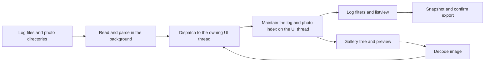

# Manage VRChat Instance Logs and Photos

This project combines room events and local photos into the same VR workspace. Logs and photos use separate pages. The former focuses on incremental collection and conditional filtering, while the latter focuses on indexing and thumbnail previewing. After entering the window, users can view recent events without leaving the headset, confirm whether to export, and then switch to the photos section. The directory, username, player name, and photos may contain personal information. The screenshots in this document use fictional events and synthetic photos; choose your own file sources when running. VRChat's default log location and retention behavior on Windows are described in the client documentation.  [VRChat Local Storage](https://docs.vrchat.com/docs/local-vrchat-storage)   [VRChat Output Logs](https://help.vrchat.com/hc/en-us/articles/9521522810899-Where-do-I-find-my-Output-Logs-and-Crash-Dumps)

## Requirement Breakdown and Interface Contract

The first set of requirements is for recent events. When opening the page, it should display the source and current count, with new events added. After switching log files in the background, reading continues. The second set of requirements is for quickly zooming out of the view within the space. Users should be able to distinguish all events, entry, exit, and whether they are limited by room or player. The third set of requirements is for viewing photos. The album tree is grouped by month or directory, and when selecting a file, a preview, name, and reason for failure are displayed. The fourth set of requirements is for export and deletion. Export uses a frozen collection, and users can cancel saving. Deletion requires file authentication and independent confirmation; it cannot be triggered by regular preview actions.

Existing complete C++ and Python routines provide filtering, directory tree, image loading, and export mainly for entry and exit. The base rows they read consist of time, action, and player. The room and player combined filtering graph in the manuscript shows the extended model, with room sources must be obtained from verified client logs of this version. When no associated room records are found, retain "Unknown Room" or only allow player filtering. Deletion is an independent extension operation; this section uses an export modal window to show the confirmation stage before actual saving.

|State|The log page should display|The album page should display|
|---|---|---|
|Directory does not exist|Source not found, still allow loading samples or switching directories|Explanation path unavailable, retain file selection entrance|
|Waiting to be written|Existing records remain readable|Photos remain on the current page|
|Parsing failed|Other valid rows continue to be added; count can be used for diagnosis|Keep the previous one, prompt unable to decode|
|Filter results are empty|Conditions retained, display 0 items|Independent browsing|
|User is saving|Freeze will deliver a snapshot of recorded data|Still retain the current selection after page switching|

By default, missing records between entry and exit are not interpreted as users leaving the room. Only observable entries are used to construct the timeline. The original parsing results should be separated from the display labels, for example, model saved as `Joined`, and the interface displays "Join". Filters should compare model values, not display texts that change with language. Sorting should also be based on time or collection sequence, not directly on nickname and time format. When there are duplicate names, players with the same name need to be distinguished by stable identifiers available in the logs. When a stable identity cannot be determined, the filter condition is clearly called "Display Name".

## VR Layout and Fonts

Placing multiple lists and images on the same plane in two tabs makes them easier to read. The log page prioritizes displaying minutes, seconds, actions, and player names. When adding room columns, determine the limit per column first. Left-aligned names help with scanning, and fixed row height ensures users can easily focus on the selected rows. The album is arranged in a narrow tree with a wide preview, maintaining a proportional display of photos. The height of the tabs determines the hit area within the headset; if too low, it’s easy to click on the first filtered item. The original routine of 820×520 logical pixels corresponds roughly to an expanded size of 0.82×0.52 meters, suitable for fixed placement on one side of the view. Physical dimensions are calculated by multiplying the logical width by `physical_scale` and then converting to meters. One logical width cannot be directly described as the viewing size for everyone.

When operating with one hand, it’s common to filter near the header. No cross-operations are required when switching tabs. Adjusting the font should check punctuation, Latin names, and multi-byte characters in narrow columns. When it’s necessary to see full long names, they can be displayed in a dedicated area below to avoid relying on horizontal scrolling to see both the full time and names. The preview occupies a large area; delete and export options can be placed in a separate command area without covering the screen. It’s recommended to verify from `body` or `world`. The window remains stable during list filtering and directory tree expansion. When using the controller for quick page turning, actions must have independent focus feedback to distinguish between opening photos and selecting photos.

## Threads, Data, and Ownership

Reading directories, tracking logs, and decoding large images incur different delays. The receiving model can be divided into log collection batches, photo indexing batches, and single photo preview results. The UI thread holds the application model and all controls, accepting only immutable results. Each result includes the source level, such as date, active files, and current photo selection number. Increasing the level when switching paths, and discarding old data obtained during waiting periods. Do not allow asynchronous completion to continue writing to lists that have been replaced by another directory.



The original C++ routine uses `jthread` to read incremental files and `window->begin_invoke()` to merge batches. The Python routine uses a background thread to read logs, delivering each parsing result to the UI callback in `listview`. The SDK internally saves ownership scheduling entries through `connection::get_dispatcher()`, and applications access them through `begin_invoke()`. Do not operate on any `tree_node` ownership, `listview_item` collections, or ordinary properties of the window in the work thread, including reading the window close flag from the work thread. In production versions, set `stop_token` or `threading.Event` in the UI close path; the background only observes this thread-safe signal. After decoding, check the level in the UI and allocate resources when the control still exists.

## Step 1: Build two tabs with controllable fake data

First, construct `menubar`, `tabcontrol`, log `tabpage`, and album `tabpage`. `window.menu` receives the menu, and the side tab is managed by `page_list`. Ordinary controls in the tab enter the corresponding `control_list`. The window frame will arrange command entries according to the menu row height, while the page rectangle is still configured by the application. Reserve space for table titles, filtering conditions, and scroll bars. Fill the table with four fixed data entries first, confirm the layout of scrolling and titles, then proceed with actual file scanning. The fixed data should include two actions, two rooms, and two fictional names, making it easy to observe changes in filtering.

Column definitions are created as `listview_column`, with each row holding string cells in `listview_item`. When writing a batch of data, first construct a new set of items, then replace them uniformly. Single additions are suitable for infrequent updates; during high-frequency updates, there’s no need to repeatedly clear and restore selections line by line. Both languages can first retain the application data model, then map the filtered objects to the display set. When asynchronous batch updates are needed, handle them once and request one interface refresh to avoid repeatedly recalculating scroll positions.


## Step 2: Reliable tracking of new logs

The routine searches for `output_log_*.txt`. C++ code divides directory iteration, recent file checks, and parsing into `find_latest_log` and `parse_log_row`. Each round checks the most readable files, closes the old stream when changing files, and establishes a new stream. When reaching the last line without a terminator, back off, and read the full line in the next round. The Python short routine selects the latest log and reads from the file header. In actual deployed systems with rotation, the C++ ideas for file identity checking, stream closing, and offset restoration can be transferred to Python. Files are not written atomically; it’s impossible to assume that a single read will get the complete event.

Reading from the file header is convenient for backing up the latest records, but the file may be very large. The application should decide whether to review a limited window when starting or wait for new events from the end. Setting a fixed limit also constrains the number of bytes to scan, the number of rows to process, and the number of rows cached in the UI. All three are calculated separately. If all historical records are retained before the large file is finished, and then old records are removed from the UI, it may still exhaust background memory. C++ currently retains 100 displayed data, and the production version should also limit the number of batches added per round. Read the next data according to a reasonable time budget so that exit signals and path changes can take effect in time.

Log line parsing focuses only on verified event markers. When extracting time, retain the time information within the original line; do not use the file modification time to replace the event occurrence time. If a coding error occurs, a single line can be skipped and the failure count increased. Python demonstration tolerates illegal characters in decoding, and C++ accepts complete string conversion before adding records. The two strategies have different impacts on identity. If a damaged part is in the player name, it is better to display it as an incomplete record rather than use it to create a stable player key.

The rotation lifecycle can be broken down into discovering new files, opening, continuing reading, discovering truncated files, and reselecting. If a file has the same name but smaller size, it may be invalid due to offset issues. Rebuild the stream and decide whether to skip to the end. When the file is locked for a short time, maintain the status of records to be processed and retry in the next round. The status area can display the current file name and number of reads. Record the most recent successful offset during troubleshooting. After selecting a new directory, clear the old source status. The UI only accepts batches marked with the current source. Do not continue marking records in the previous file as results of new files when opening fails.

## Step three: Filtering order and room association

The existing code uses `combobox` to select "all," "only add," or "only leave." The refresh function filters out lines belonging to the current action from the original records. The original lines are retained, and no further disk reading is needed if the conditions change. In a compatible implementation, optional predicates can be applied to actions first, then an intersection with the parsed room ID and player ID can be applied. Setting any item to "all" only removes that condition without affecting other conditions. Save the stable key of the current selected object before sorting or filtering, and restore it after refreshing. Some filters may reduce the number of records to zero. After switching back to all, it should still be available.

Some logs contain context events of entering instances, which may occur before player lines. The parser can maintain active rooms at session levels and then attach recognizable room keys to new events. When a room changes, update the associated status first, then record subsequent player actions. Late events from old log files cannot be attached to new session rooms. During verification, prepare at least two rooms with the same player name, then add a record with only name and action, without room context. If the filtering result is correct, unknown rooms will remain in the all view and will not be incorrectly assigned to two known rooms.


## Step four: Building photo index and high-resolution preview

Create `treeview` and `image` on the album page. The directory group uses `tree_node` to display month or folder names, and the photo node's `tag` saves rewritable paths. After receiving a selection notification, the application checks if it is a leaf node, and whether the file extension and path comply with allowed sources. The existing example fills nodes through directory scanning. Both language versions update the description after image reading fails. A more complete implementation should have time-consuming directory enumeration and downsampling outside the UI thread. Pass the parsed directory description back to the UI as a regular list, then focus on creating tree nodes. Since image resource creation depends on SDK interfaces, pixel data can be generated in the background and assigned to the control in the corresponding thread.

High-resolution photos may be compressed very small in the file, but the decoded memory is calculated by multiplying pixels by channels. A 1600×900 RGBA image requires approximately 5.76MB, and 4K images require more resources. When switching quickly, do not permanently save all large images in the control. Adopt a two-tier strategy of thumbnail and preview images, limiting the number of simultaneous decodes. At the start of an asynchronous task, record the node identifier and the last modification data of the source file. At the end, check if the selection still points to the same file. Display an error when the file is moved or damaged, preventing background results from replacing the just-selected photo. The interface can continue to display the previous photo and indicate this status to avoid incorrect materials looking like the currently selected item.

`image.stretch_mode.contain` is suitable for full-frame viewing, while `cover` is suitable for thumbnail previews within a full viewport. When using the former, the edge blanking is subject to proportional adjustment. A good acceptance criterion is to load 16:9 horizontal, vertical, and square images separately, and check whether the pixels maintain their original proportions, there are no out-of-bounds areas, and the titles are still readable after switching. After receiving image errors, retain the command area and tab switching functionality. WARP screenshots use a 1600×900 composite image to reproduce the expected effects of decoding and scaling layouts.


## Step five: Export snapshots and confirm dangerous operations.

Before opening `file_save_dialog`, copy the current filtering results and condition descriptions. The dialog uses nested UI loops, and background logs may continue to be generated. Reading the list directly from the return will yield different results. Clear export behavior means exporting the snapshot of the data batch that the user sees when they click. The UI can prompt the number of records, time range, and columns. In the original example, full cache was used for export; if filtering is extended to export, the data source must be switched. The same applies to deleting scenes: save the selected file identifier and recheck the path to ensure it still points to the same object when confirming.

When serializing to TSV, clean the tabs and line breaks in the fields, or define clear escape rules. If export writing fails, provide a status description and retain the interface. To prevent semi-finished states, first write to temporary files in the same directory, verify completeness, then perform the target replacement. Do not create files if the user chooses to cancel. Overwriting should follow both the dialog and application's rules; cannot bypass subsequent file identity checks just because one confirmation was done. If deletion has a recovery strategy, provide a recoverable path first and display the file name before confirmation. The application should only operate on files within the album directory authorization range; showing shortened names does not mean that file identities can be compared using shortened names.


## Acceptance, maintenance, and fault reproduction

|Reproduction actions|Observation items|Location methods|
|---|---|---|
|Write some log lines first, then write the rest later|No missing lines before the completion|Check the offset of unsubmitted tail lines and decoding|
|Restart VRChat|Switch active files in the application|Compare the original path, file time, and actual opening status|
|Switch filter items while adding records|Conditions still apply, quantity correct|Count data separately from view filtering|
|Quickly click on two large images|Keep the last one|Check if the preview level overwrites old results|
|The directory or photos have been removed|Old selections are cleared, showing source status|Verification error handling only affects the current resource.|
|Continue collection after the export dialog box opens.|The written content still corresponds to the snapshot at the time of clicking.|Compare the counts at freezing time with the two counts before submission.|
|Reopen the directory after closing the tool.|The old task has been exited.|Observe the stop signal, file handles, and session release.|

To troubleshoot, first confirm the file identity, then check event parsing and the submission queue, and finally examine the control layout. Use short samples to repeatedly switch pages; pass each item before using the actual local logs. Check whether user directories, real players, or image content have been introduced before sharing screenshots. In actual deployment, configure log directories and photo directories, and clearly indicate three independent feedbacks: "data still being read", "no matching records", and "path unavailable". Maintain a repeatable test sample to compare the consistency of two languages in pagination, filtering, image scaling, and error prompts.

## Let the data model support long-term reading.

A maintainable event model requires at least four types of information. The first type is the original identity, including session files and byte positions, used for deduplication and reproduction. The second type is display data, including event time, actions, player names, and identifiable rooms. The third type is associated information, including the current active room and the source of parsing rules. The fourth type is processing status, including success, ignored, partially readable, or loading failed. When switching filters by reading the same list, the UI only modifies query conditions, not the original records. Retaining event identity also facilitates restoring selected rows and confirming whether exports and current displays come from the same batch of data.

If multiple sources are read in the same log file, parsing should retain context within the file level, initializing when the file is switched or opened for the first time. When missing information, empty fields can be saved, and "unknown" can be displayed uniformly in the visible columns. This prevents records from being lost because content is not visible in the room column. Initializing and re-scoring should follow the same strategy to avoid seeing certain events when opening a session for the first time, only to lose their identity after refreshing. A combination of file position and row content summary can be used to create a deduplication identifier. For the same nickname from different log files, it should not be considered the same event just because the descriptions are the same. When merging, first verify the time and session identity, then determine whether it is indeed duplicate.

### Batches, capacity, and refresh limits

The work thread of C++ first generates `added`, then moves the entire batch to the UI callback. When scaling, it can be submitted in fixed row counts or time slices. When suspended, record the offset and return to stop checking as soon as possible. The Python example currently delivers lines one by one, which is sufficient for infrequent use. If it is for continuous writing, it can be changed to batches. Batches should include source identifiers and readable row counts. After the UI receives them, update the model and statistics in a single callback. When switching filter conditions, set the conditions first, then use the submitted model to calculate the new view. The next batch in the queue still uses the latest filter conditions at that time. The background does not need to know the current scrolling position of the list, nor adjust the collection range based on UI filtering results.

Capacity limits should distinguish between file bytes, work to be submitted, and displayed items. Only keep the last hundred rows, but this does not limit the memory used to collect all matching items in the first five hundred megabytes of logs. The background should read in segments, parse incrementally, and cache only a limited number. The UI model can use a bounded queue to save the last few items, and the export range is determined by explicit selection. A separate loading path and progress should be provided when historical data needs to be viewed. The export action should not automatically write only the last screen because the user is only looking at the last screen. Use the number of items, current filter conditions, and time range to specify the content of the deliverable file.

### Thread merging and view anchors

After the real-time list is updated, the scroll bar may stop at different positions. It is appropriate to automatically follow the bottom when the user is viewing the latest data, and maintain a visual anchor when checking previous records. The current top event identity or selected item can be used as an anchor. After applying the batch, check if it is still visible in the results. If an old event is eliminated by capacity, display a brief explanation and choose a suitable new anchor. List scrolling and log collection do not share the same thread. Only the UI thread reads the status related to selection and scrolling, and the parsing callback should not directly determine the cursor position in the background.

When the query is complex, it’s possible to have the snapshot generated by the backend to create candidate keys. However, the final result is determined by the UI application. The level of the query and the version of the input data must be returned along with the result. When switching to another page, don’t clear the filter conditions that are already being edited. When returning to the log page, it’s important to indicate whether it’s still the previous view or if a new batch has been applied. Test with two filter requests that are intentionally ordered in a random manner to see if the first result incorrectly overwrites the second one. Although this doesn’t cause a crash, it will display a fake “current filter” status, making it more difficult to troubleshoot than an explicit error message.

## From directory information to preview resources

The album node should not contain a large number of decoded images. The description object can include a display name, actual path, modification time, and whether it is a directory. The indexing work thread returns these descriptions, and the UI writes the keys that can be used for business association into `tree_node` when creating `tag`. The path itself can also be used as the initial key, but this key will become invalid after the file is renamed or moved. Verify again before opening the path to ensure it exists and belongs to the selected root directory. Use the file name for path display and the full path for actual reading; these cannot be interchanged. Photos with the same name in different directories can be displayed in the tree, while the models remain independent.

Parsing and decoding maintain timeout or cancellation intentions separately. Check the size and extension before reading the file to indicate that the format may be supported; the actual support is confirmed by the decoder. Distinguish between file absence, loading failure, format incompatibility, and file being overwritten when preparing for error branches. When retaining the previous image, indicate in the text that it is the previous one to avoid users thinking that the delete command applies to this image. After the actual preview result arrives, first check the current selection and then load the display object. When quickly selecting two test samples, the final visible name, pixel, and source identity must correspond to the same photo.

When changing the preview size in the backend, the original aspect ratio should be retained, and GPU resources should be reclaimed to prevent the continuous retention of large images. Ordinary photo previews do not need to copy each pixel to multiple caches. If necessary, maintain a low-resolution thumbnail and one current preview, and decode larger resources in detail mode. Set the maximum edge length and total pixel budget to be consistent to avoid extremely long images occupying a lot of resources even if the other side is narrow. For uncommon image orientations, check whether the decoder has applied orientation information; the coordinates in the image are unrelated to the target rectangle in `image`. Maintain the current selection in the album tree when the preview mode changes; users are only comparing the cutting effect.

## Acceptable implementation for extended scenarios

Room filtering can be completed in two small submissions. First, add a key for empty rooms and display labels to the model, and verify the predicate with static examples. Then, integrate real log parsing and prepare a room status map before new data arrives. When a switch occurs, fill in the expected identity and ignore the old context caused by file rotation. The ordinary "only add" filter should still be available, and the number of available basic queries should not be reduced because rooms cannot be associated. Use a streamlined log to cover unknown rooms, players with the same name, and two entry events. Record the expected number for each selection and compare automatically, rather than guessing from screenshots.

Exporting and deleting should be implemented using a transaction model. First, cache the record snapshot and title during export, and write them in the backend after confirmation. After completion, return to the UI to report the result. When starting export with an empty collection, display a clear number of items, allowing either saving a file with only the header or direct refusal, which should be defined in advance. For deletion, save the current identity of the file and open for confirmation. After user approval, re-verify the path and source status. When multiple selections intersect, the old dialog box cannot delete the new selection. If a recycling path is added, refresh the directory model after execution, and keep the preview valid or reset it to empty. When a read/write error occurs, retain the selection and provide a retry; silently remove file items from the table.

Reproducible tests should start with small samples. When constructing log files, write the last line twice to simulate half-write. When reading the first paragraph, the page should not be created in advance with incomplete players. Prepare a damaged PNG and a normal image, and verify the error message and selected identity when switching. Use a one-time directory for saving tests, first testing without a file, then testing successful writing and branches that are not writable. Do not use the actual username of the directory as an assertion. The scenario should show that the album tool works even without user photos, facilitating maintenance personnel to reproduce the scenario in a separate environment.

## Complete project and build

First, install according to [and configure the environment with](/en/basics/01_install_and_setup) to start the Engine. In the root directory of the tutorial repository's x64 developer CMD, execute the following command, replacing the SDK path with the actual installation location. When using the Visual Studio generator, the executable file is located in the Release subdirectory.

```bat
cmake -S examples/projects/02_vrc_log_and_gallery/cpp -B .work/vrc_log_and_gallery -DEASYVRUI_ENGINE_INTERFACE_ROOT=D:/Tools/EasyVRUI/sdk
cmake --build .work/vrc_log_and_gallery --config Release
.work\vrc_log_and_gallery\Release\vrc_log_and_gallery.exe
set "EASYVRUI_SDK_ROOT=D:\Tools\EasyVRUI\sdk"
examples\projects\02_vrc_log_and_gallery\python\run.cmd
```

### C++

<<< ../../../examples/projects/02_vrc_log_and_gallery/cpp/main.cpp

### Python

<<< ../../../examples/projects/02_vrc_log_and_gallery/python/vrc_log_and_gallery.py