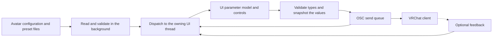

# Inspect VRChat Avatar OSC Parameters and Presets

This project is aimed at developers who need to observe, adjust, and save Avatar parameters within the headset. The left side, `grid`, lists parameter names, types, and current local values. The right side provides interfaces for continuous adjustment, precise adjustment, real-time sending, and saving presets. When real-time sending is not enabled, the panel can run independently and display sample data. Avatar configurations after VRChat release are stored by local users and Avatar identifiers. The address and type defined in the input determine the data accepted by the client. [VRChat Avatar OSC Parameter Description](https://docs.vrchat.com/docs/osc-avatar-parameters)

## Requirements and Data Semantics

The panel should separate editable parameters from read-only identities. Each parameter has a configuration declaration, current value in use, value to be sent, and possible feedback from remote. A number left in the table cell only indicates that it has been locally accepted. After enabling real-time sending, editing and submission can generate OSC data packets. Remote states are kept unknown if there is no independent source. In the basic routine, there is only a sending path, and displayed values come from local editing and samples. During extended reception, the latest remote values and time can be displayed on the UI to avoid using unconfirmed local assignments to pretend to be device states.

|Tasks|Start Conditions|Observable Results|
|---|---|---|
|Load Configuration|Source exists and at least one item is editable|Display declaration types by visible name|
|Edit a value|Select the cell allowing editing|Update the local model after verification|
|Continuous adjustment|Select the appropriate Float parameter|The application accepts the new finite value|
|Enable real-time sending|The user explicitly turns on the switch|Generate data packets only after valid submission|
|Save preset|Enter a valid name and confirm|Save a consistent local snapshot|
|Switch Avatar|Obtain a new identity and load new configuration|Prevent the values from old conversations from being written into new objects.|

Players in the room may use multiple published Avatars. The panel's diagnostic task should clearly indicate the currently loaded avatar. The basic routine selects the first readable configuration file; if none is found, fixed parameters are used. The official panel should allow users to select an Avatar or handle the client's `/avatar/change` messages, verifying the file name and declared identity before replacing the model. Before switching, invalidate the current edit and pending states. Do not use “latest modified file” as the only trusted active avatar, especially when multiple accounts share the Windows user directory.

## VR layout and operations.

The original routine window has a logical pixel size of 740×480. With a default zoom of 1.0, it is approximately 0.74×0.48 meters. On the left side, parameter names, types, and values can be seen simultaneously, helping to distinguish between floating-point, integer, and boolean values. There is no need to search for labels on different pages each time the settings are adjusted. On the right side, there are real-time switches, `slider`, `numericupdown`, and preset operations displayed from top to bottom. Controls for real-time adjustment should have a large hit area, with spacing between the two value entry areas to avoid accidentally selecting real-time sending when adjusting with the hand. Long parameter names can take up more space in an English environment. If real configurations are used, test the longest names first, then decide whether horizontal scrolling is allowed or a separate full name indicator area is set up.

The panel is suitable for `world` or `body`, avoiding the operator's debugging from moving along with the controller. When increasing the font size, adjust the line height, header height, and column width simultaneously, leaving space for decimal points, negative signs, and value ranges. Double-clicking a cell reduces the number of triggerable controls near the target. The status descriptions in the right column can be fixed on one line, with error details placed in additional explanations. For one-handed acceptance, start by selecting a row, then operate on the right column, ensuring that the current parameter name is always visible. Actual scenarios use close-range testing, and users should be able to directly compare the differences between enabling and disabling real-time sending.

## Architecture and thread interaction.

The UI has a parameter model, selection, draft, and current Avatar level. Directory reading and writing, OSC encoding and decoding, and optional feedback reception can be processed in the background. Background tasks receive verified values and target addresses, returning structured results to the UI. Different tasks only relate to the corresponding Avatar and parameters, first checking the level and then updating the display. In short routines, file scanning occurs before opening the window, and sending is synchronized in the control callback, making it convenient to test individual data. When performing multiple file scans, frequent updates, or receiving OSC, thread boundaries are more important.



Inside the SDK, when constructing `control_base`, the scheduling entry for the connected connection is saved through `connection::get_dispatcher()`. Applications call `begin_invoke()` in C++ or Python to send UI updates. The background reads parameter configurations and only delivers ordinary data, updating tables and controls within UI callbacks. Even if the parser reads only one value, it cannot read `grid.selected_index` to guess the current parameter in the background. Batches should include business identifiers, sources, and time. When the user pauses real-time sending, new tasks can be stopped from entering the send queue, and tasks already in the queue but not sent can be processed according to the strategy.

## Step 1: Read configurations and prepare compliant examples.

First, verify the layout and editing starting from static rows. Example data uses `EarFlop`, `TailWag`, and `CoatToggle` to represent floating-point, boolean, and integer values, respectively. C++'s `load_avatar_rows` scans the OSC configuration in the user directory and captures file or parsing errors. Python's `load_avatar_params` finds files under `Avatars` and extracts input definitions. Formal implementations should distinguish between missing directories, unreadable files, parsing structure errors, and no editable parameters. Upon receiving any error, a safe offline state should be maintained, clearly marked as a demonstration row or valid configuration.

Configuration reading should distinguish between identities, display names, OSC addresses, and types. Example concatenation of `/avatar/parameters/` and parameter names applies to default names with the same address. Advanced configurations can specify different `input.address`s; in this case, the display name cannot be used to reconstruct the address. Only select entries with input definitions to avoid treating configurations used only for sending feedback as editable parameters. After reading, verify that the type is `Bool`, `Int`, or `Float`; other fields should display as non-operable. Input addresses should be valid and conform to OSC conventions. Error messages should be given for entries with embedded NULs and missing addresses to prevent generating half- addresses.

If there are many cached configurations, the backend can first enumerate candidate paths and times, and the UI will only display necessary indicators. The complete file will be parsed after the user makes a selection. When the window starts, it renders an empty state or preset demonstration lines. After the loading is completed in the same round, the atomic replacement model is carried out. When a row is selected and the second read is initiated, do not leave the old row pointer for the new asynchronous callback. The parsing result can be represented using file identifiers, avatar identities, and collection levels. If the game configuration is being written during reading, a retry can be delayed, and diagnostic information can be displayed for files that fail repeatedly. The permissions and content of the original file are left to the user and VRChat management.


## Step two: Table skeleton and editable boundaries

After creating `grid`, set three columns for parameter name, type, and current value. In C++, `grid_column_t` allows setting `editable` for columns. The basic C++ routine sets the first two columns as read-only, and the Python example rejects non-value columns through a verifier. In actual projects, restrictions can be imposed in two places to ensure that interface feedback is consistent with data rules. Save the parameter object in an independent model, and the reader of `set_data_provider` returns values according to rows and columns. The reader will be called multiple times during layout repainting, so it only performs table lookups without opening files or performing socket operations.

Submitting values goes through editing, standardization, verification, writing, and business notification. The Python example uses `set_edit_validator` to check column and numerical types, and returns errors with binary values for diagnosis. The data writer in C++ calls `encode_avatar_packet` to verify types before updating the model, or it can use a dedicated verifier. Both methods must ensure that the old value is retained in case of verification failures. When an error position needs to be displayed, read the rows and columns of `grid_cell_event_args_t` and the error text, and provide a re-editing entry. The business layer sends data only in `on_edit_committed`, not from each edited character. For boolean cells, clear and on controls can be used to make users aware that the current value is a logical quantity rather than a string.

When submitting verification, pay attention to the differences between integers and floats. Integers require the string to be fully parsed and fall within the signed 32-bit range. Floats accept a limited number and can be represented as 32-bit floats. Submissions of `NaN` and infinite values are rejected. Boolean values use a controlled set of characters, such as accepting `0`, `1`, `false`, and `true`, and then convert to actual boolean data. Python's `bool` is a subclass of `int`, so the coding branch first checks booleans. In C++, integers are checked with `from_chars` at the end to avoid treating inputs with extra characters as valid prefixes. Values that have been standardized can be displayed, compared, and saved for preset purposes.

## Step three: Establish real-time paths using adjustments and switches

The right side of `slider` uses a logical range of 0 to 100, which is converted to floating-point values of 0.0 to 1.0. Then, `numericupdown` expresses the fine step size. Dragging applies only to the currently selected Float parameter; integers or booleans should use entry types that match. Before adjusting the slider, display the current parameter and allowed range. Separate programmatic controls from user modifications. When switching rows, temporarily suppress sending of updated values and upper and lower limits for the right column, or retain a synchronization status marker. Otherwise, updating the slider and numerical fields will produce a result similar to real user operations.

The basic routine connects `slider.on_value_changed` to `numericupdown`, which then updates the model. If the numerical field is used to update the slider in reverse, manage the feedback loop caused by bidirectional updates. Only write the truly changed values after standardization back to the model, and use a one-time local context during synchronization. When making changes, colors and error messages also need to be reset according to the new parameters. For short control actions, users can use clear confirmations of integers or booleans. For large continuous changes, first present the latest values on the UI, and merge button presses to wait for the updated data to be sent.

When sending data, the OSC address and type tag should be aligned in sequence. Boolean types are marked as `T/F` without value bytes. Integer values use 32-bit signed big-endian, while floating-point values use 32-bit IEEE big-endian. C++ uses `bit_cast` to obtain floating-point points, then writes four bytes in order. Python uses `struct.pack`'s big-endian format. Before sending, compare the value type with the configured input type. When the UI enables real-time options, only valid changes are sent to the sending function. Successful transmission only indicates that the local interface has received the data; the status area cannot show that the remote side has executed the operation.

For high-frequency interactions with sliders, the production version can merge trailing parameters. The queue key consists of the avatar level and parameter address. Only the latest value is retained for consecutive changes of the same key. The last value is refreshed when dragging stops. Boolean switches that require order should be processed separately; clear on and off operations should not be merged into one. If a failure occurs, the local value is retained, indicating that it has not been sent. Users can try again. If continuing to read client feedback, distinguish between interface synchronization caused by feedback and user submissions to avoid sending remote feedback back unchanged, leading to a cycle.


## Step four: Preset snapshot, naming, and application

The basic routine uses a modal window to edit the preset name. When the user clicks “Save,” the dialog box ends with `dialog_result_t::ok`. The outer function then checks the name and writes the current parameter snapshot to the JSON Lines file in the user’s directory. C++ writes a row of records using `save_avatar_preset`. After that, Python constructs a mapping between the name and parameter values. If saving fails, an error is reported, and the current parameters are retained. In the screenshots in this chapter, `combobox` is used to show the scalable selection of presets. “Custom” indicates that the values being edited are being distinguished from those already named. The actual code can currently be saved, and loading and switching between packages should be done according to the instructions in this section.

Before opening the preset modal, choose the timing for freezing based on business requirements. If other callbacks are allowed to update parameters during the pop-up, freeze a snapshot and clarify the meaning when the pop-up appears. If you want to save the latest value when clicking "OK," check the current Avatar level and editing status after returning to the outer function. When the user cancels, the preset collection does not change. The name should be cleaned of leading and trailing spaces and its length should be limited. If there are multiple names with the same, indicate whether it is creating a new version, overwriting, or rejecting. Separate the stable identifier from the display name to avoid using the name as a direct path. Entering a name does not mean that the file has been successfully written; only records after successful writing become available for selection as a preset.

When reading a preset, triple-check based on avatar identity, parameter address, and type. Applying a preset can first construct a list of differences, showing missing parameters, mismatched types, and values to be modified. After confirmation, update the model in bulk, with up to one send per parameter. Keep issue reports for unknown parameters; do not automatically create options that the client does not have. Parameters that depend on order should be clearly defined in the application, such as enabling a mode before setting values. Operations that truly depend on receipts should wait for independent confirmation from the interface; UDP sending queues cannot replace transactions. If the preset file is damaged, skip unreadable lines and provide a readable backup; do not delete all historical data.


## Step five: Disconnection, echo, and restoring state

OSC uses UDP, and basic sending does not establish a persistent connection. The term "disconnection" here has two meanings. After the EasyVRUI session is disconnected, the application needs to re-establish a connection with the Engine and restore UI-related states. When the OSC target is unavailable, the current message has no remote confirmation, and it can be determined that the other party may be unreachable based on client feedback timeout. Both are displayed for diagnosis separately. After restoring the Engine, interface data can be rebuilt, but real-time operations remaining from the previous generation cannot be resent by default. When restoring the OSC target, the user must explicitly decide whether to synchronize the current state.

To avoid sending again after receiving one's own echo, record the source of updates when entering the model, such as user editing, preset application, remote feedback, or session initialization. Only operations approved by the user are allowed to generate sending tasks. If there are updates pending locally when feedback arrives, decide which rules to use to compare values and time. When a reliable sequence number is missing, feedback is only suitable for reference. The panel should clearly indicate the source of the displayed values to avoid overriding operations explicitly performed by the user with the last received color or switch.

## Project acceptance

|Input or operation|Expected results|Diagnostic points|
|---|---|---|
|Opening an existing configuration|Display demonstration lines, send messages in real time with disabling|Distinguish between missing directories and parsing failures|
|Entering numbers beyond the range in Int column|Retain the original value and report an error|Check complete parsing, symbols, and ranges|
|Entering invalid values in Float column|Cancel submission without any sending task|Verify limited values and single-precision range|
|Quickly drag the slider|Continuous feedback on the interface, retaining the latest value in the background|Check merge rules and final submission|
|Return old tasks after switching Avatar|Still maintain the new avatar model|Compare tasks with UI levels|
|Cancel after preset naming|No changes in disk writing or dropdown status|Check modal return and write point|
|Disable real-time sending before editing|Only modify the local model|Check unified sending entry and switch judgment|

Test various types with static examples, then check the address, type tag, and byte order of messages at the loopback receiving end. Use an observable and easy-to-resolve parameter for actual client integration. Record the local values before and after sending, client behavior, and whether manual restoration of the original values is needed. Preset persistence and real-time sending can be verified separately; successful file writing does not equal successful network synchronization. After clarifying these boundaries, the debugging panel can also provide interpretable results when changing avatars or connection methods.

## Break parameter verification into independent functions

The writing entry should not determine the actual type of parameters based on a display string. First, convert the input into three controlled branches, then encapsulate the parsing results as typed data. In C++, the model can represent valid results with values with type tags or `variant`, with errors returned as separate results. Python must explicitly exclude boolean values from parsing ordinary integers, and check the packaging range at the output end. Keyboard editing, dragging, and preset applications ultimately call the same verification, resulting in the same valid values. If the control only allows positive numbers, but the configuration allows negative values, either adjust the mapping in the right column or only let the right column handle applicable ranges, and cannot directly set valid negative values to zero and send them.

Successful parsing does not automatically mean that the value can be written back to the target. For example, a parameter exists in the current table, but it has not yet been confirmed to belong to the current active Avatar. Business entries must check not only format, but also avatar identity, target address, sending mode, and parameter constraints. Graphical controls can reflect reasons, such as parameters being offline, configured as read-only, or the currently selected type not supporting dragging. Displaying restrictions separately can help users understand whether the change is due to a verification failure or because the correct object has not been selected. The status label length is fixed, and the complete parameter name is placed in a dedicated text column. Errors should not overwrite confirmed model values.

### Specific editing process

First, use three valid samples to check if type conversion can be executed. After clicking on the Boolean, a real Boolean value is generated. Verify that the OSC tag does not carry extra bytes. For integer samples, use the minimum and maximum endpoints, then try out out-of-bounds strings. For floating-point samples, use multiple decimal places and unusual text to ensure format verification can recognize them. For floating-point scaling, confirm that the rounding precision displayed on the UI is consistent with the normal saved values and the binary floating-point meaning sent. If higher precision is needed for debugging, the original record can be displayed in the details area, and the common list should remain readable with short values. Just because the numbers are the same after rounding cannot be used to determine that two business values are exactly equal.

Test the program’s writing path again. First, select a row, and synchronize the input controls in the right column. Make sure that no automatic submission occurs. Enter the same values in the same row. Only when the status changes will the business submission be triggered. If a value changes due to interactions with other controls, mark the source of the change and prevent the original source from triggering again. Write this determination in a unified submission entry, rather than distributing it across each button. This way, when adding new preset applications or restoring default values, the validations and error handling can be reused. When updating in batches, record which parameters should be sent. Only after all values are confirmed can the scheduling be carried out again. Avoid sending incomplete configurations to the client when updating the first column.

## Combined status: browse, edit, send, save

The panel can manage one "selected parameter" and one "preset selection," both saved separately. When selecting an existing preset, the preset summary can be displayed first, and only after the user clicks apply are the items updated one by one. After dragging the current parameter, switch the preset status to custom to avoid showing new values with old names. Only after the new preset is successfully saved can the custom status be changed to the new named preset. The status being edited by the user should be independent of the preset list, and unexpected input should not be canceled due to dropdown reloading. Click the dropdown and select the same item that should not be sent repeatedly. When researching feature expansion, you can first complete only the selection and summary, then implement the actual application branches, and finally add network synchronization.

|Action|Status change|Strategies that need to be set|
|---|---|---|
|Switch table rows|The right-side editor follows the current parameter|Whether program synchronization triggers sending|
|Select a preset|Display content summary|Apply immediately or confirm by a separate command|
|Modify a single value|Become a custom status|How to feedback on save and send|
|Save failed|Continue retaining the work snapshot|Whether to retain the preset name for retrying|
|Change Avatar|Presets and queues are limited by identity|Whether to retain the local snapshot of the old identity|
|Reconnect with Engine|The UI resumes with a new session|Is it necessary for the user to explicitly resynchronize?|

At the configuration file level, preset values should preserve consistent versions, avatar identities, as well as addresses and types. If single-value logging and comparison features are added later, do not mix them with preset snapshots. When the old record lacks a type, verify according to the actual current configuration during reading, and provide explanations for items that may not be migrated. The drop-down list is refreshed only after each successful write. When used concurrently, write serialization should be performed by file to avoid overlapping between two saves. If JSON Lines addition is chosen, reading should allow for the last line to be incomplete and report it. If the entire file is replaced, a temporary file should be created in the same directory and replaced with the target after the write is complete. Both methods should be tested using separate test directories to simulate space shortages and permission denials.

## Repeatable experiments with the sending queue

Use time-division snapshot testing for floating-point adjustments, which is easier to stabilize and compare than continuously dragging the handle. Input multiple fixed samples within one second, each with a continuous serial number, and verify with a slower sending interval. The UI should show immediate response to sampling, and the queue should only retain the latest values that should be sent. Confirm the final value to the sending queue when dragging stops. Then switch to another line and drag another parameter to ensure that the background key dimension is the parameter address and session level, with the first line of history not covering the second line. After stopping real-time, wait for a period before the capture end should stop receiving new packets according to the defined cleanup strategy.

Record the address and type of each packet at the loopback receiver. Compare the packaging results of Python with the C++ displacement output, using unified input data to avoid unnecessary format noise. It is possible to record time, number of data packets, and the last service value, without needing to retain the entire game session content. If the client display is inconsistent with local sending, first check whether the input configuration specifies a custom address, then check the target mode. Only when the server confirms to accept the address can the issue be attributed to the adjustment control. When multiple data sources are updating simultaneously, pause the suspicious source and observe the selected line to avoid the debugger overwriting valid feedback.

## Migration and recovery drills before going live

Test level changes with a fake Avatar switching event to ensure that save or write callbacks during operation do not modify the new model. Prepare an old preset that includes normal parameters, deleted parameters, and parameters with changed types. After loading, a verifiable difference list should be obtained. Users can choose to apply the valid parts or cancel the entire transaction. Verification should not clear the old file; the original snapshot can be retained for repair. If a write failure occurs, check whether the current state is still marked as custom, and whether the user can change the name and try again. Data files for simulated index documents can use very short paths, and error status text should be able to contain the data source name without exposing the entire personal path.

After successful debugging, calibrate the line width and current type identifier that need continuous observation in the headgear. Test alternating hand-dragging and selection actions. If the control is prone to accidental clicks at a distance, prioritize expanding the focus area and safety distance. Check whether the status, current value, and pending send prompts can be recognized simultaneously. The confirmation button for preset operations should include clear verbs, such as "save named snapshot" or "apply selected parameters." Users should not guess what mode the current application is in to determine whether the game character will change. Recording acceptance conditions and visible effects allows others to reproduce most of the logic without real game data.

## Complete project and build

First, install according to [and configure the environment with](/en/basics/01_install_and_setup) to start the Engine. In the root directory of the tutorial repository's x64 developer CMD, execute the following command, replacing the SDK path with the actual installation location. When using the Visual Studio generator, the executable file is located in the Release subdirectory.

```bat
cmake -S examples/projects/03_vrc_avatar_osc/cpp -B .work/vrc_avatar_osc -DEASYVRUI_ENGINE_INTERFACE_ROOT=D:/Tools/EasyVRUI/sdk
cmake --build .work/vrc_avatar_osc --config Release
.work\vrc_avatar_osc\Release\vrc_avatar_osc.exe
set "EASYVRUI_SDK_ROOT=D:\Tools\EasyVRUI\sdk"
examples\projects\03_vrc_avatar_osc\python\run.cmd
```

### C++

<<< ../../../examples/projects/03_vrc_avatar_osc/cpp/main.cpp

### Python

<<< ../../../examples/projects/03_vrc_avatar_osc/python/vrc_avatar_osc.py