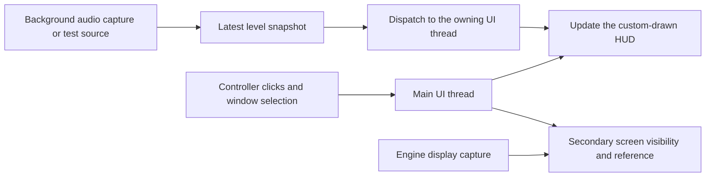

# Build a Wrist HUD, screen, and Audio Level Meter

This project consists of two native `window` components for VR monitoring workspace. One moves with the left hand, displaying a compact microphone level and sub-screen entry. The other shows computer output, which can maintain readable spatial position relative to the body and bend according to configuration. The base routine handles anchoring, visibility, monitor selection, and custom controls. Level displays are shown with sample values. WARP images use 32% and 78% test samples, showing layout changes after refresh. Headless sub-screens use placeholder content; real output is provided by an Engine with capture capability.

## Requirements, main and secondary windows, and interaction considerations

Separate "viewing a state" from "reading a screen." The arm HUD should be suitable for short-term scanning, capable of displaying a level, a source state, and a sub-screen command. The sub-screen is for longer viewing periods, requiring greater physical width, more stable pose, and independent display and sleep strategies. When the user only wants to see the arm, the sub-screen does not need to be continuously visible; when opened again, the layout should be predictable. Monitor switching, tracking loss, and microphone absence are handled separately, with no exception blocking other operations.

|Usage scenarios|Arm window|Sub-screen window|
|---|---|---|
|View level after entering VR|Compact display of current samples and availability|Keep hidden|
|Select to display the desktop|Entrance provides visible state|Display in set pose|
|Quick left-hand movement|Controls move with reference|Positioning with independent reference object|
|Change monitor|Prompt for changes in capture status|Retain target area, wait for new image|
|Tracking unavailable|State readable or return according to strategy|Reference can be recalculated after recovery|
|Close main tool|Stop sampling and pending update tasks|Hide or turn off according to the application lifecycle|

The surface on the left hand is mainly operated by the right hand laser. Place the switch away from the wrist joint. First, test the three positions: releasing, lifting, and naturally lowering the hand. Left-handed users can refer to the mirror image and position, and verify that both gripping positions are clearly visible before moving the button. The control on the wrist should not have multiple layers of tabs, and users should not be allowed to enter long texts in a moving window. Combine clear text with graphics, and use bar lengths to indicate level changes, with text explanations for whether data is collected. There should be a distinction between sampling received and sampling equal to zero in the status; the former is a source status, and the latter is a measurement value.

## Physical dimensions, font size, and anchors

The logical dimensions of the wrist surface in the example are 260×220. When scaled by 0.65, the expanded width is approximately 0.169 meters, and the height is about 0.143 meters. The logical font size of 16 results in a nominal physical height of about ten millimeters at this ratio; the actual visible height of the font is affected by the font and viewing angle. Bringing the window closer to the wrist and tilting it slightly allows the natural line of sight to just sweep over the level. The display screen has approximately 960×560 logical pixels; when observing from a distance, the text needs to be larger. If the secondary screen's initial scaling is inherited from the source, it may decrease as the wrist scales to 0.65. To obtain a clear target size for the secondary screen, explicitly set your `physical_scale` before the first display.

`left` and `right` follow the position and orientation of the controller. The `position` of the wrist is in meter-based position relative to the reference object. The example uses three components to leave space for hand geometry and viewing direction. Rotation is specified in degrees, and `vec3_t` of C++ uses the same units as Python's `vec3`. During configuration, first calibrate single-axis rotation, then combine it. The secondary screen can follow human body translation with `body` and retain the calibrated orientation, or be fixed as `world`. `head` is suitable for brief proximity to the user, while large secondary screens should avoid long-term following of the head, which may block the world.

During debugging, set the position, scale, rotation, and curvature step by step. First, check if the physical width and height are appropriate from a flat perspective, then adjust the target distance. Check whether curvature affects the relative position of the mouse or laser through the side edge of the secondary screen. The appearance can be first verified with a non-curved WARP image, but the three-dimensional position, reachability with both hands, and readability in different poses need to be confirmed in the headset. The title of the headless screenshot will indicate the spatial attribute values. The flat bitmap only records the surface rendered by the SDK; tracking and curved surfaces in SteamVR need to be checked separately.


## Architecture and thread responsibilities

The sampling source can be either the audio capture callback or the test generator. The capture thread reads the audio blocks and calculates the levels compressed between 0 and 1. It packs the data, timestamps, and source details into snapshots. The UI thread maintains the current source and display window, periodically reading the latest snapshots to update the self-rendered controls. Screen capture is handled through the Engine side path. The SDK sends `screen_id` and the target rectangle. The audio data modifies its own state, while the desktop texture is provided by the rendering service. Neither the sampling thread nor GPU resources are shared between them.



The application uses the public `begin_invoke()` to schedule updates to the UI thread. Internally, `connection::get_dispatcher()` provides a callback entry for the connected connection, and the control saves functions that can be submitted to this entry during construction. This interface is part of the SDK implementation. Example extensions should use the public delivery interfaces of C++ or Python controls, rather than binding the application to the internal connection queue. A sampling block may only correspond to a few milliseconds of audio, and UI updates cannot be sent once for each block. Atomic latest slots or mutually exclusive records can be used to limit the number of updates that exist simultaneously in the queue. During actual updates, read the snapshot that matches the current source, then the UI modifies the level, state, and color.

## Step 1: Use blank for reserved layout

First, use `window` to configure the title, size, and position, then place `blank` at the predetermined position as the coordinate source for the self-painted area. The Python example creates `blank_meter`, reads its local rectangle, and passes it to the actual `mic_meter_control`. The C++ example directly constructs a self-painted instance using the same rectangle. When using the form designer, you can encapsulate the layout output as a composite object, read the placeholder rectangle and index after initialization, and replace it with the actual control. SDK's `blank` does not participate in drawing and focus. Controls inherit custom drawing types, and can continue to use composite writing when assembling windows.

When copying by position, read the local `rect`. Do not write the absolute position back to the same parent container. The placeholder rectangle is responsible for width, height, and relative position, while the actual level control is responsible for style, refresh trigger, and hit rules. Leave space for the title bar, safe margins, and secondary screen button positions. The buttons should be separated from the progress bar. First, run a fixed level verification to ensure the border and font can fully accommodate. If the window width is reduced, check the available internal width and height of the custom area. In limited cases, it is allowed to downgrade to only displaying the status. The model should not rely on hard-coded absolute coordinates in the template.

## Step two: Implement custom drawing and value changes

Customize `control` to override `render(context)`. In C++, obtain the drawn rectangle through `context.get_rectangle(*this)`. In Python, read the corresponding geometry before creating the background and level bar. Use a uniform inner margin to calculate the track length, and multiply the normalized level value by the maximum length. First, check that the track width and height are positive. When the level is zero, only draw the background and text. Draw a rounded background first, then the active bar, and finally the numbers. The text should be readable and not rely on the color of the active bar for recognition. If necessary, use a stable background for the text to ensure contrast at both full and zero ranges.

Currently, Python's `set_level` will clamp values between 0 and 1 and request `invalidate()`. The basic example of C++ retains static values and example text. You can add an entry to update the same values for the class and construct percentages based on the actual level. Only request redrawing when the visible values or states change. The UI can consume the latest level at a fixed rhythm to reduce the coupling between collection and redrawing. Using inappropriate units for updates will cause all values to approach full scale. First, verify the normalization and display mapping, and test boundaries of 0, 1, and non-finite values. Any illegal number should be identified before entering the drawing calculation.

 after higher test levels.

### Sampled engineering implementation

When creating a real audio version, clearly calculate whether it is peak or root mean square. Peaks respond quickly to short impacts, while root mean square is closer to continuous energy. Within an audio block, you can first take the absolute peak by channel or average and take the square root of the sum. The sampling rate, sample format, and number of channels in the source capture configuration are separate from the display logic. When the input format changes, create a new source level and discard the previous generation of samples, retaining a clear initial state. Do not request the audio device, block read buffers, or access a variable array that is being written during the drawing callback.

Reading can improve readability with a strategy of rapid rise and slower fall. Thresholds are calculated based on actual sampling periods rather than rendering frames, otherwise the fall speed will change at low frame rates. Before switching to decibel display, clearly handle zero values. Only positive amplitudes can be logged. Reserve different status texts for devices not connected to avoid misunderstanding "0%" as mute. During debugging, cover low, medium, high, and mute with a fixed sequence, and record the delay from input to UI change. Before testing on real devices, verify that the interface will switch to wait state after sampling stops. Expired values will not stay at high levels forever.

## Step three: Manage the lifecycle of screen and secondary screen

Create a second `window`, with `screen` as its content. The actual display address depends on the output number of the computer where the Engine is located. The file path of remote applications or the number of monitors cannot be inferred from the Engine's output. Convert `screen_available` and two change events into concise states. When there is no real display image, retain the same layout and display in the preview area in wait, without changing the positions of other commands. The example selects output 0, and WARP capture uses an invalid number to avoid capturing the real desktop. Refer to the availability and number handling section of `screen`.

The secondary screen can use `show()`, temporarily hiding it with `hide()`. When hidden, the layout state defined by the application can still be saved. After actually closing, a new window needs to be created. The example buttons switch according to `visible`. During deployment, also confirm how the secondary screen handles when the main window exits, as the visibility and closure of regular windows will affect the application's loop exit conditions. You can define that when the main window closes, sampling ends first, then the secondary screen is explicitly hidden or closed, to avoid only closing the wrist surface while the secondary screen remains independent in space. If the secondary screen is used as a long-term tool, it should provide its own independent closing behavior and reopening entry.

The secondary screen of .

## Step four: Switch reference objects and curvature

When the window is initially positioned using `startup_position.none`, the locally configured position and orientation are used. The reference objects for the wrist and the secondary screen should be set separately. If the window is already in the scene and you want to maintain its current position after switching, use `reparent(reference, keep_world = True)` instead of reinterpreting the old local coordinates. If the target reference is not available, query `is_tracking_available()` first and provide a prompt. Wait until the device is restored before proceeding. The example mainly configures the initial reference. In a larger scenario, buttons or dropdown menus can be added. Keep the current reference object and the mode prompt in a place where the user can easily see them.

`curvature` is the reciprocal of meters. Multiply it by the expansion width to obtain the arc angle constraint in radians, with the range handled separately according to `window` attributes and interactions. At the same expansion width, an increase in curvature value will tighten the horizontal cylindrical surface. Before setting, calculate the logical width and current scale, and confirm that the values are acceptable. Set 0 if you need to restore the plane. After changing the curvature, use the handle to check the edges on both sides and the central button, and recheck the hit area and shape. In scenarios where the anchor point changes, move the body or turn the head to confirm that the translation and orientation match the selected reference. The screenshot only compares internal attributes; actual spatial behavior needs to be tested in a tracked environment.

 configuration.

## Step five: Resources, recovery, and Desktop registration

The level control retains a few states, and the background maintains the sampling source. For hidden states, you can reduce the UI update frequency, but whether to stop sampling depends on business needs. When the switch reappears, refresh with the latest value of the current source to avoid residual expired levels. When the device is removed or the number is switched, reestablish the source state. Do not modify the new window in the last callback of the old session. When closing the window, use a work thread to stop the signal, and clean up the control ownership after resources are released. For sources being loaded, include the source level in the return value to discard expired work.

When registering through Desktop, the manifest is responsible for names, icons, and startup methods, while the spatial orientation is configured by application code. The executable file or script and manifest can be placed in `app/wrist_watch/` at the installation root directory, with the entry configured relative to the manifest path, and then the manifest path added to Desktop user configuration. When launching Python versions through SDK on Desktop, use `sdk/api/python/`. The same installed SDK is used when running directly in CMD. The remote Engine uses independent connection parameters, and the screen number belongs to that Engine. See [for spatial positioning, custom drawing, and Desktop registration;](/en/guide/08_spatial_drawing_deploy) for more details.

## Acceptance and fault reproduction

|Environmental changes|Check the target|Processing direction|
|---|---|---|
|Fixed samples jump from low to high values|Both the length and numbers change simultaneously|Confirm that the UI consumes the latest samples and redraws effectively|
|No audio block was obtained|Display is waiting or the source is abnormal|Distinguish between missing and zero signals|
|Open and close the secondary screen twice|Visibility is restored and the configuration is retained|Check if the lifecycle has closed the reusable surface|
|Output device exits|Display status of the collection area|Verify `screen_available` and numbers|
|Move the window to another reference|World pose is maintained or reinterpreted as expected|Compare the coordinate reference before and after the call|
|It's difficult to hit the button edge after increasing the curvature|The actual layout is accessible|Separate calibration of zoom, position, and curvature|
|Check the background after ending the program|Exit promptly, and collection stops|Check if there are any tasks waiting to be delivered and resource references|

First verify the rectangle, drawing, and status text in WARP, then confirm amplitude, spatial tracking, and sub-screen content with the actual device. Record the audio level input, GPU screen status, and reference object status separately, which can help determine if the device stopped, the connection changed, or the UI was not submitted. After clarifying the location, device, and observation distance, users can reproduce the problem with the same sequence, without having to guess which movement caused the window jump.

## Convert amplitude into stable and readable feedback

Determine the display target before completing sampling. Whether short-term spikes need to be shown, whether a continuous average level needs to be seen, or whether only a distinction between silent, normal, and overlimit is needed. A HUD for teammate communication usually needs to show whether one is speaking, without having to refresh continuously like a measuring instrument. Clearly define the unit of the input signal and the output model when designing the normalization layer. First generate one-minute fixed samples, rising from low level to high level, then back to silent, with an insertion of a state of losing the source in between. Use these samples to verify that display is easier to repeat than adjusting the actual device.

### From static values to the latest value slot

The basic routine gives a fixed value to the self-drawn type. The first step is to add an independent value setting function, receiving normalized data and sampling validity. In this function, compare the last displayable value; only call `invalidate()` if the change exceeds the display accuracy. The second step is to place the source data in the background, saving only the latest snapshot. Maintain active source serial numbers, sampling completion time, values, and whether they are valid for the snapshot. The UI consumes the current snapshot at its own pace, rejecting old serial number data after changes in the source. The third step is to add an upper limit on the update frequency, measuring based on actual consumption, without hard-coding the block size of a certain sampling device as the visual update frequency.

If the UI is updated with a monotonic clock, values are taken from the snapshot slot when it expires. It's normal for the sampling thread to read faster than the UI, and keeping every record increases latency and retains unnecessary intermediate values. The latest value slot is suitable for representing the current level. If historical line charts need to be displayed, a fixed-length sampling queue can be created, regularly calculating historical sets for graphics, without letting historical storage determine the current level feedback. After pausing the source, check if the interface promptly switches to an unknown state. The background only records device diagnostics, sampling counts, and amplitude, without saving the original audio to complete most of the debugging.

C++ should perform lightweight numerical calculations in device callbacks to avoid long lock holds. After handing over the values to be updated to the worker thread or independent queue, send them back to the UI through control scheduling. Python can use lock-protected data objects or thread-safe queues to save snapshots, then call `begin_invoke()`. Do not directly pass a variable array that is being reused by audio callbacks using event objects. When a batch of states needs to be refreshed, first submit the actual values within the UI, then refresh multiple controls. When the update frequency is reduced due to current window visibility, read the latest snapshot once before redisplaying it, so it immediately corresponds to the current source.

### Experiment with filtering and sampling changes

Use a unified time scale for spikes and drops. A fixed response from 0 to high values can verify whether a faster rise is needed. A gradually decreasing sequence can test whether the drop time conforms to observational habits. If low-amplitude jitters always trigger repainting, users will only see position shaking back and forth. You can round to the display accuracy before deciding whether to update, without affecting the actual background sampling. Device state changes should be immediately fed back to avoid being swallowed by amplitude filtering. For values above 1.0 or negative values, report data as invalid first if they are not finite. Present device unavailability and zero level independently. The drawing callback only reads the unified UI value; the colors, bar lengths, and numbers passed through rendering are all determined by the same state.

## Treat spatial positioning as a second state machine

Ordinary apps face default tracking, user movement, controller loss, and reference object switching. Choosing `left` means "binding to the left hand reference," but it doesn't mean that left-hand information is available at this moment. A complete tool recommends maintaining the expected reference object, the last resolvable pose, and the current recovery strategy. When the left hand is temporarily unavailable, you can hide the wrist or temporarily freeze the last state as needed. After recovery, re-verify the availability of the reference and decide whether to retain the world position. If the same local coordinate is immediately applied to a new reference, the window may jump from one side of the hand to the other side of the room. Users need to be clear about whether they just chose to maintain the original position or switch to a new reference.

|Action|Need to read|Expected changes|
|---|---|---|
|Set initial follow-up|Target reference availability and local pose|Establish a clear first positioning|
|Switch to stay in place|Old world pose and new reference|Only change the interpretation reference, keep the world appearance as stable as possible|
|Switch to repositioning|New reference and new local offset|Apply the predetermined layout|
|Device loses tracking|Source status and last available value|Downgrade to hidden or stable waiting|
|Restore flat display|Current width and curvature|Change shape while maintaining business layout|

When testing users approaching the window, turning their wrists, and switching views, observe whether the window remains in the correct position. During development, start with the world reference, first verify the window content, then add left-hand and body references, and finally add the curved surface. This allows for separate elimination of UI coordinate errors, track position calculations errors, and spatial tracking errors. The "body" or "world" text in the example screenshots reporting the current configuration does not mean that a flat PNG can represent the real three-dimensional local pose. When accepting spatial positions, record the headset and handle status, and repeat the steps with the same initial pose.

### Life cycle and observation cost of the sub-screen output

Screen output has states: started, available, temporarily unavailable, and source changed. When the sub-screen is first opened, it is in a waiting state; update the description only after receiving a source recovery message. After switching output numbers, do not keep the old screen displayed with the new number. When retaining the previous frame for user reference, clearly mark it as "previous screen". Prioritize retaining layouts that are not affected by the source, with the operation entrance still available, and enter the screen content area separately for placeholder. Reduce the number of screens hidden based on business needs, and the SDK and Engine manage real textures. The application only displays which output is needed at the time.

The space occupied by the sub-screen and observation cost can easily exceed that of the wrist HUD. A reasonable debugging approach is to first display only one desktop content, and then check the impact of curvature on the left and right areas after the text is readable enough. If the width is estimated too large, users will frequently turn their heads or fail to find edge commands. If the width is estimated too small, the desktop content will be unreadable. Use a common line of text to check the theme contrast and target size. Test the main wrist switch, monitor loss, reappearance, and window life cycle when it is operable. Stop audio work before the program exits and close both windows according to the design. Clearly define the responsibilities of background threads and both surfaces; do not default the work to the last window received.

## Build order for the extended version

Starting from the existing C++ implementation `mic_meter_control` and Python counterparts, the first round only introduces stable level states. Provide the same approximate value update entry for both controls. The second round connects to the test generator, simulates a fixed sequence, and verifies the update rules. The third round adds actual device initialization and release, retaining the test input switchability. The fourth round connects independent commands to the display sub-screen, flat restoration, and reference switching. Finally, handle differences in remote Engine and monitor selection. Introduce only one new interface each time, first run headless rendering, then verify the new function in the headset to avoid simultaneously calling several unknown systems during testing.

If "the graphics are active but the values remain unchanged," first compare whether the display level and model level come from the same snapshot. If "the values change but the bar does not move," check whether track calculations and clipping are processed from 0 to 1. If the window can display but there is no actual screen, check whether the current Engine can capture the corresponding number, and confirm which target host it is. When the wrist space is incorrect, temporarily switch to `world` to verify the two-dimensional content, then return to another reference system to compare the pose. This order ensures that diagnostics are carried out along clear paths in data, rendering, capture, and spatial transformation.

## Complete project and build

First, install according to [and configure the environment with](/en/basics/01_install_and_setup) to start the Engine. In the root directory of the tutorial repository's x64 developer CMD, execute the following command, replacing the SDK path with the actual installation location. When using the Visual Studio generator, the executable file is located in the Release subdirectory.

```bat
cmake -S examples/projects/04_vrc_wrist_hud/cpp -B .work/vrc_wrist_hud -DEASYVRUI_ENGINE_INTERFACE_ROOT=D:/Tools/EasyVRUI/sdk
cmake --build .work/vrc_wrist_hud --config Release
.work\vrc_wrist_hud\Release\vrc_wrist_hud.exe
set "EASYVRUI_SDK_ROOT=D:\Tools\EasyVRUI\sdk"
examples\projects\04_vrc_wrist_hud\python\run.cmd
```

### C++

<<< ../../../examples/projects/04_vrc_wrist_hud/cpp/main.cpp

### Python

<<< ../../../examples/projects/04_vrc_wrist_hud/python/vrc_wrist_hud.py