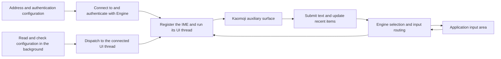

# Remote Deployment and Kaomoji Input

This project involves running a lightweight input component on another computer, which is then displayed in SteamVR by the Engine on the rendering host. The user opens the input area in a regular application, switches to the kaomoji IME, selects predefined text, and submits it. The computer running the component, the computer where the Engine is located, and the application being edited may vary. During deployment, ensure the data path is correct, then design window interactions and connection recovery. The complete routine implements minimal kaomoji submission and normal input forwarding. The remote configuration window, group tabs, and recent usage in the chapters are replicable extended scenarios.

## Requirements and Boundaries

Three independent verifications must be completed. First, the remote application must establish an authenticated session with the Engine. Second, the session must be registered as an IME and selected as the current input component. Third, a single click must submit text to the input area of the current application. If any one of these fails, the status of the corresponding stage must be displayed. After a successful remote session, there may be no application being edited, so the kaomoji interface can be hidden. Connection establishment does not replace the selection of the input component, and clicking to submit cannot be used as the sole criterion for maintaining a remote session.

|Stage|Dependencies|Observable Results|
|---|---|---|
|Location Service|Correct Engine Host and Port|The network can reach the target|
|Identity Verification|Server Public Key Fingerprint and Access Credentials|Client accepts the target and completes session authentication|
|Registration|The same session role is fixed as IME|The component appears in the applicable switch item|
|Activation|The regular application has opened the input area|The Engine sends the current status, and the auxiliary surface displays|
|Submit|A clear kaomoji operation|Submitted to the input route through `ime_submit`|
|Draining or disconnected|Stop accepting new tasks|Old results are completed through handshake or rejected|

Working with only fixed kaomoji selection is sufficient. The component can provide forwarding for other key presses, allowing the regular input logic of the host application to continue to work. The minimal routine saves kaomoji in a fixed set, and the scope of background tasks is defined by the submission action. Further grouping and recent usage functions must maintain clear meaning in local operation records. What is suitable for saving is the preset identifier selected by the user, not the text seen in the target input area. After closing the input area, the application draft is not retained, nor are key presses collected further.

## VR Layout and Auxiliary Surface

The component window is a supplementary surface. The Engine arranges it according to the position and scaling of the input area; no additional ordinary application windows should be selected within the component, nor should the current input owner be moved. The original example has a logical pixel size of 520×150, so 520 wide divided by 4 buttons results in approximately 118 logical pixels per item. The font size needs to be adjusted to account for the cross-character shapes of different fonts, as some kaomoji contain Japanese kana, special punctuation, and combined characters. The actual display size is affected by the proportion of the attached application window; shorter button widths are more suitable for placing shorter entries. The grouped tabs compress the number of entries on the current page, allowing users to avoid scanning all kaomoji at once.

A single-handed operation can be completed in the order of "pointing to the input area, selecting the input component, choosing a group, and selecting an item." The grouped tabs are placed at the top but should not cover the original input area; the input position is negotiated between the host and the Engine. When users quickly switch target windows, the supplementary surface of the old input area will be hidden, allowing the handle laser to continue selecting the new application. When increasing the history area, it should appear on a small independent page or at the bottom to avoid competing with the "just submitted" feedback. When maintenance or connection configuration is needed, use the independent interface in the ordinary application as the tool entry. Sessions that have been registered as IME belong to the input component role; the configuration tool should not impersonate an ordinary application in that session.

## Connection architecture and thread flow

The rendering host holds SteamVR and the Engine, while the remote host runs application processes or input components. The client connects to the Engine for certificate fingerprint verification and authentication, then registers roles. The first deployment uses fingerprints and credentials obtained from known addresses and trusted methods. Status and input events are routed by the Engine, and kaomoji components submit structured events through the SDK. Processing current tasks records corresponding connections and working stages. After disconnection, old callbacks become invalid, and after re-establishing the session, they are registered in order and wait for activation.



Internally, the SDK creates a scheduling entry for the connection through `connection::get_dispatcher()`. Applications submit UI modifications from the publicly accessible `begin_invoke()` in C++ or Python. The background can read configuration files, check network reachability, or prepare local indexes, returning addresses, diagnostics, and task levels. `window` status cannot be read or written directly in the background. Handshake results and input component status should be processed separately, as normal sessions and the surface currently displayed are not the same conditions. When receiving late background results, first confirm that it still belongs to the current connection, and prohibit modifying already closed or replaced supplementary panels.

## Step 1: Confirm dual-machine connection configuration

First, start the Engine on the rendering host according to the installation section, and verify that the service is normal on that machine using the ordinary example. Then, start a similar example on another computer, adding an address, port, access credentials, and server public key fingerprint. The parameters defined in the repository are `--easyvrui-host`, `--easyvrui-port`, `--easyvrui-access-credential`, and `--easyvrui-public-key-fingerprint`, respectively. Fill in according to your own address and configuration file in the working environment. Avoid writing actual parameters into screenshots, shared code, or diagnostic command lines. User names, access credentials, and fingerprints have different purposes, so data sources and error messages should be designed separately for them.

The following two diagrams use fake addresses and local status events to show the interface. The configuration interface indicates which information is needed to establish a connection and does not attempt to connect to the test domain in the diagram. "Session connected" indicates the demonstration state injected into the local fixture. Actual program integration requires checking whether network ports can reach the destination, whether the service certificate matches the known fingerprint, and whether authentication is successful. Receiving a TCP response does not mean the application is connected. When a connection error occurs, retain the form content and clearly indicate whether the host cannot be found, connection timeout, fingerprint mismatch, or access credential error.

Local demonstration of 


If the program on the other computer also runs VRChat, OSC receives communication with EasyVRUI as two separate paths. Remote connection only determines the target for the SDK to send drawing commands and input events; it cannot automatically forward the application's local loopback UDP. To allow additional applications to send OSC, clearly define the location of the VRChat process and select its actual target, avoiding using the Engine service address as the OSC port. For deployment acceptance, you can first run a minimum window and add the input component after seeing normal input and exit on the remote side.

## Step 2: Register roles and wait for actual input area

C++ is used to derive the routine `input_provider`, construct the auxiliary `window`, and set `auxiliary = true`. Python also uses derived objects of `input_provider` to store interface instances and callbacks. Both implementations register IME before entering the loop, and then the SDK reports the language and name to the Engine. The component state is represented by `active`. When the application input area is closed or switched to another input component, the state callback hides the auxiliary surface. When switching back to kaomoji IME, the same surface is displayed. Typically, the regular application input area is not actively opened; activation is handled by the host window and the Engine.

During development, prepare a regular application with `textbox` as the target. Switch the input mode to the desired language, select the new IME, and observe whether the component name appears on the input bar. If not, check if it is correctly registered as an IME and whether the current language is within the adaptation range. If the name appears but the surface is not displayed, check if the state event has a true value of `active` and verify if the auxiliary window is hidden due to the current application switch. Do not combine all issues into a single "disconnected" status. If the network session is normal but the current input area does not allow the component to operate, the interface remains in standby.

The window layout should include regular controls at construction time, and binding should be completed before the input event starts. Each time `process_state` is used, the entire tree does not need to be rebuilt; existing windows can be reused, maintaining grouped and recently used states as defined by the application. Local tasks are stopped when a cancellation or timeout occurs to avoid the candidate UI reappearing briefly after a switch. The actual position of the input area is determined by the Engine. The component only submits the surface and layout content, without needing to save the world coordinates of the target window.

## Step three: Expand from button collections to groups and history

The minimum routine uses four `button`s. Each entry saves its own text value. In a C++ loop, values are captured, and Python calls the default parameters to fix the value for each loop. Otherwise, multiple anonymous functions may read the last object of the loop, and clicking any button sends the same one. The display text can be in a shortened version, while the business submission value remains complete. Each set of optional content is modeled as a record with a stable identifier, and then classified as "greetings" and "responses" using `tabcontrol` and `tabpage`. Tab switching only changes the optional set and does not trigger submission.

After the user clicks on a candidate item, a submission task is created while the input is still valid. Recently used can record the item identifier and number of selections, limiting the list length. Historical updates are only recorded after a local submission request is actually accepted; historical feedback indicates it is a local record. If the session is lost during transmission, the candidate selection state is retained and prompted. After reconnection, the same sentence should not be automatically sent to another input area. The recently used interface allows users to re-select actively; when a record appears repeatedly, it can be merged in the recent order. The long-term storage strategy is independent of actual input logs; cleaning history should not delete preset data.


## Step four: Submission and normal input forwarding

In the callback for candidate buttons, first call `begin_input_task()`, then construct `input_event` or C++'s `input_event_t`. Set `event_type` to `ime_submit`, write the complete text into `text`, and submit through `send_event()`. Python uses `try/finally` to ensure the pairing ends task. C++ calls `finish_input_task()` in both successful and exceptional paths. This pairing is part of the connection emptying protocol and cannot be missed after an exception is thrown. No speculative text is sent before entering the actual input state.

`process_input` is responsible for unconsumed input of the component. The minimum example forwards received regular events, with a implementation for candidate navigation that can consume key presses for word selection, and forward other `key_down` and `key_up` according to rules. Pressing and releasing should be consistent; only one of them should be filtered. For actual text submission, use `ime_submit`; do not reconstruct combined characters by simulating multiple keyboard presses. During acceptance, test regular letters, Enter, Delete, and one-time kaomoji selections separately, focusing on whether regular input is repeated and whether selections are inserted only once.

After local testing of 

## Step 5: Make emptying and reconnection clear stages

The input path should be processed in serial during emptying. After the old layout is completed, the tasks queued by the old IME and pending results are then processed by the Engine using the new path. Once components enter emptying mode, they stop accepting new clicks and new work. For already initiated submissions, either complete the scheduled event transmission or end the task according to the protocol. If the connection times out or disconnects, the sending qualification of the old connection is revoked. In this case, late callback requests should be treated as invalid tasks and cannot be continued with the new connection. Based on this constraint, history can be distinguished into "user selection," "local submission completion," and "whether the input area has been received."

Test the reconnection by keeping the old window visible before disconnecting the service. The interface state should switch to waiting or hidden, and the old task stops. After the connection is restored, roles are re-established and a new activation state is awaited. The previous generation of submissions cannot be resumed before receiving the new `active`. Actual reconnection can use a limited backoff mechanism, providing users with a cancel button. For changes in certificate fingerprints, the deployer should verify the new fingerprint source, not treating identity errors as ordinary network timeouts and retrying repeatedly. For credential errors, clearly indicate configuration mismatches to avoid being masked by incorrect state during input method switching failures.

## Registration, operation, and acceptance

During installation, components are placed in `app/layout/` or `app/ime/`. The Engine reads roles, languages, and program entries from `bin/config.json`'s `provider_list`, with relative paths based on `bin/`. Ordinary applications are managed by Desktop, with built-in list registrations in `app/desktop/config.json` and custom list registrations in `%USERPROFILE%\easyvrui\desktop\config.json`. Desktop merges the two configurations in memory by application ID, adding and removing only user configurations. When debugging this chapter's Python components, use `python/run.cmd` or CMD to prepend the local `sdk/api/python/` to `PYTHONPATH`, then run the script directly with remote parameters. First, check connection and runtime registration, then verify input component switching. Logs from two computers can be compared by time and connection stage, with only necessary states recorded for diagnosis. Installation paths and registration rules are found in [installation instructions,](/en/basics/01_install_and_setup), and [Engine protocol,](/en/reference/engine_protocol).

|Scenario|Acceptance results|Priority diagnosis|
|---|---|---|
|Incorrect host name or port|Connection not established, configuration can still be corrected|Check network reachability and target service|
|Fingerprint or credential mismatch|Clearly report the authentication stage|Verify configuration and trusted sources|
|Connection successful but input area not enabled|Panel remains hidden|Check component selection with `active`|
|Switch groups but no candidate selected|Only change available items|Check tab events and submission entries|
|Select a kaomoji|Submit once and update local history|Check callback capture and task pairing|
|Old tasks when switching windows|Complete emptying or reject old results|Verify connection and task phases|
|Re-enable components after network recovery|Wait for new input area activation; history remains independent|Check re-registration and status levels|

First verify roles, activation, and submission on one machine step by step, then use the same samples to verify deployment on two machines. Only change one condition among network, identity configuration, or input routing each time. This separates troubleshooting for connection failures, inactive interfaces, and unsubmitted texts, and facilitates evolution from the minimal button panel to grouped and historical tools.

## Configuration and diagnostic phases

A complete remote deployment tool can break settings into three small objects: service address, authentication, and component configuration. The address describes the target host and port. Authentication includes service fingerprint and access credentials. Component configuration includes language, display name, role, and local kaomoji directory. When saving the form, the operating system network status is not part of user configuration. The address can be reused when opening the form again, avoiding direct use of last-time connection results as the current state. A valid one-time connection result should include connection level and completion time to prevent late results from overwriting user-modified forms.

Separating "configuration verification" from "establishing actual connection" helps with testing. Configuration verification checks if the host string, port range, required credential fields are complete, and if the input fingerprint format meets client requirements. Network probing only determines if the host is reachable. Service authentication is completed through SDK handshake. After users modify any identity field, the old authentication state should be invalidated. If multiple host configurations are allowed, names must be bound to identity content. Do not use an alias to map multiple certificates while continuing with old verification. Authorization information should be distributed through trusted channels, avoiding display of sensitive fields when copying to the brief status area.

|Diagnostic status|Evidence sufficient for judgment|Interface behaviors to prioritize|
|---|---|---|
|Configuration is valid|All necessary fields have passed checks|Target can still be changed|
|Target is reachable|Basic network connection completed|Continue waiting for identity confirmation|
|Session authentication successful|Connection layer accepts verified service|Displays whether roles are registered|
|Component registration successful|Engine accepts role and language|Wait for input area to open|
|Current component activated|Valid `input_ui_state.active`|Accept the operation and display the auxiliary area|
|The submission request has been completed|The local sending process is ended and still at the current level|Update the locally most recently used|

If the interface does not clearly indicate these states, users may mistakenly think the input has been forwarded after seeing the name on the remote host. Components sometimes need to check the connection status through other ordinary applications, such as starting a minimal window to exclude input method selection. Both machines should be able to exit the dedicated test, and the test path should only open necessary monitoring, without leaving additional debugging interfaces active during actual operation. Record the evidence of session creation and role status separately, and do not include real credentials in log identification information. If the troubleshooting information is too long, keep the short status in the headset and attach a stage code for users to view on the desktop.

## How the layout model evolves into grouping and most recently used

The first implementation can store four strings in a fixed array, with their display labels matching the submission text. The second implementation writes each candidate as a stable identifier, category, display label, and submission text. The display label can be shortened when the font is insufficient or the length exceeds the current button, and the submission value uses the original controlled text. Do not overwrite one candidate just because the characters look similar. When a user selects a language, the application can first choose the corresponding candidate directory and then map each group to a `tabpage`. Changing the category only updates the list and focus, without constructing `ime_submit`. If no category is selected at first display, the first item can be determined by configuration to avoid misusing historical selections for automatic input.

Then add most recently used, recording the item identifier, order, and number of times available. During persistence, only store the application's preset identifier and necessary time; minimize data based on actual needs. When a user explicitly selects an entry with records, first parse its submission text from the current preset library. If the user deletes the original preset, historical entries can be shown as invalid, or removed from the list. Changes in historical sequence should be distinguishable from text sending status. For example, a single failure to send cannot be counted as a success, but the last viewed category can still be retained. When a submission preview needs to be displayed, place the status area below the tab or at the bottom of the window to avoid squeezing the button being targeted out of its position after new rows are added to the history.

Placing the most commonly used candidates in the same row helps achieve predictable positions during one-handed operation with the controller. If emoticons contain two lines or are too long, use shorter descriptions and provide highlighted previews. Retaining the most recent category when the input area is repeatedly opened can reduce operations, but the sending action from the previous selection should not be resumed before switching to another application. Observe the actual space occupied by the auxiliary window against the input area of the host application. When the editing area is close to the bottom edge of the screen, the Engine may need to rearrange the auxiliary surface. In some positions, users can only see part of the candidate content, so testing with background and width is necessary. After headset testing is passed, check low-resolution captured screenshots or normal display effects to avoid difficulties in operation on the desktop.

## Code evolution: Submission tasks are not part of the window callback lifecycle

Minimum C++ and Python code calls `begin_input_task()` and `finish_input_task()` within button callbacks. If the selection is extended to asynchronous work, such as reading term content or writing local history, the lifecycle of the input task needs to cover the entire pending result, not just the checked button. After starting the task, save which input level the selection belongs to. When the background returns, check if the current task can still be completed, then call sending. Whether it ends normally, is actively canceled, or encounters an exception, the already started task must be ended. If the background fails to read the history, text submission can continue, but the history area should report an error or maintain the original record. If actual text submission fails, do not display successful sending just because the history has been successfully written.

C++ can be ensured to end the task with a local object responsible for destruction and cleanup. Python uses `try/finally` to ensure that any exception, whether from construction, sending, or local state handling, is properly cleaned up. Any task state shared in UI asynchronous callbacks must be modified uniquely by the UI or passed through thread-safe cancellation markers. Old level callbacks should not continue working with new connection handles. If content is saved before confirmation to prepare for sending, ensure that the content is independent of the current active page. After the user clicks another group again, previous operations still only belong to the clearly selected old group. When cancellation occurs, unsend requests from the queue to avoid replaying them when subsequent users trigger them.

### Verification of normal and combined inputs

When extending candidate navigation, define which operations belong to components first. For example, changes in direction will highlight candidates, confirmation selection will submit text, while regular characters will continue to be routed. Consider handling button presses and releases; do not let one direction key be consumed and the release be handed over to a regular application. When switching input areas, restore control over the old button states. Text submission should be passed in its original Unicode value without needing to simulate the keyboard word by word. Test whether the same kaomoji characters are fully delivered in both language interfaces, and ensure that regular Enter keys still follow the existing rules of the target application.

During debugging forwarding, record the type of event, routing stage, and number of waiting tasks to avoid recording input bytes. To capture faults, only need to judge one press and one release, one candidate selection and one `ime_submit`. If the target window is a regular application, prepare a test control that only displays text to observe results. Use fictional inputs and do not record actual edits made by users in shared reports. For asynchronous exceptions, it's best to check whether there is no continuous input indication after the old input area is hidden. Only after confirming that it's not a test host routing error, check whether there is a timeout or disconnection between two real machines.

## A set of tests for disconnection, waiting, and recovery.

Testing reconnection can be designed as two independent stages. Stage one simulates a port being unreachable or service stopping, checking if all pending tasks are cleaned up and if the auxiliary surface is hidden. Stage two restores the same service and creates a new session, checking re-registration, reselection, and reopening of the input area. Even if users click on old buttons displayed during recovery, they should not be delivered to the new window. According to Engine rules, the sending eligibility of the old session may need to be replaced. Do not attempt to send to two different sessions using the same outbound queue. Users can retry their current selection, but new business operations must be generated.

Certificate errors and regular disconnections require different recovery paths. Regular network disconnections are suitable for limited waiting or retries, while identity mismatches require stopping to check deployment configurations. A clear short message can indicate "service identity needs verification," without obscuring the stage with vague communication errors. Even after reconnection, there may still be no active input area, so wait for the new real state before allowing buttons to be operated. During testing, place two different host windows in different positions, switch them repeatedly, and measure the active window identifier. Only when submission targets correspond to the currently open input area can the link be considered stable.

Case studies suitable for automation include whether different options in the same group send their respective contents, whether submission stops after the input area is closed, and whether old results are recorded in the new generation after a disconnection. Injecting state changes in a loopback environment can verify layout and callbacks; real remote integration requires independent confirmation that the rendering host uses the correct application and session. Before opening a session, check fields like address and port against deployment steps, then verify state transitions and local history. Test the preservation of preset history separately from connection reconstruction to ensure that a single session error does not lose preset settings or cause old inputs to be incorrectly submitted.

## Complete project and build

First, install according to [and configure the environment with](/en/basics/01_install_and_setup) to start the Engine. In the root directory of the tutorial repository's x64 developer CMD, execute the following command, replacing the SDK path with the actual installation location. When using the Visual Studio generator, the executable file is located in the Release subdirectory.

```bat
cmake -S examples/projects/05_remote_and_kaomoji_pad/cpp -B .work/kaomoji_pad -DEASYVRUI_ENGINE_INTERFACE_ROOT=D:/Tools/EasyVRUI/sdk
cmake --build .work/kaomoji_pad --config Release
.work\kaomoji_pad\Release\kaomoji_pad.exe
set "EASYVRUI_SDK_ROOT=D:\Tools\EasyVRUI\sdk"
examples\projects\05_remote_and_kaomoji_pad\python\run.cmd
```

### C++

<<< ../../../examples/projects/05_remote_and_kaomoji_pad/cpp/main.cpp

### Python

<<< ../../../examples/projects/05_remote_and_kaomoji_pad/python/kaomoji_pad.py