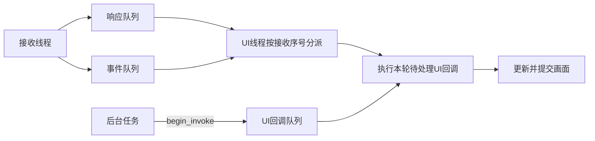

# 强类型事件与多线程调度

应用通过强类型事件接收交互和状态变化。窗口、控件以及渲染回调属于创建它们的UI线程。后台工作完成后，通过`begin_invoke()`把界面修改调度回所属线程。

## 订阅与事件参数

C++的`event_container<T>`与Python事件容器均支持`+=`和`-=`。回调接收来源对象和事件参数。使用`event.add(callback)`可得到订阅标识，使用`remove`或`-=`退订。订阅多个回调时，按注册顺序执行。可写的`handled`或`cancel`在返回时用于后续事件处理。

`event_args_t`是无附加字段的基类。以下18种参数全部继承它，Python类型名省略`_t`。处理简单事件时从`source`读取提交后的控件状态。专用事件通过类型字段提供额外上下文。

|C++参数类型|字段|典型来源|
|---|---|---|
|`cancel_event_args_t`|`cancel`|`window.on_closing`|
|`key_event_args_t`|`key`、`shift`、`ctrl`、`alt`、`meta`、`handled`|键盘按下和松开|
|`text_input_event_args_t`|`text`、`handled`|可编辑控件的文本输入|
|`pointer_event_args_t`|`hand`、`left/top`、`x/y`、`captured`、`cancelled`、`handled`、`has_position`、`has_local_position`和修饰键|指针事件。前两组坐标分别相对于表面和控件|
|`scroll_event_args_t`|`hand`、`delta_x`、`delta_y`、`handled`|滚动输入|
|`interaction_end_event_args_t`|`cancelled`|拖动、缩放和其他空间交互结束|
|`property_changed_event_args_t`|`property_name`|通用属性变化|
|`control_collection_event_args_t`|`item`、`index`|子控件增加或移除|
|`menu_item_event_args_t`|`item`、`index`|`menu_container`项目增加或移除|
|`tabpage_event_args_t`|`page`、`index`|`tabcontrol`页面变化及关闭请求|
|`listview_column_event_args_t`|`column`、`index`|列集合、宽度和点击|
|`listview_item_event_args_t`|`item`、`index`|行集合和双击|
|`grid_column_event_args_t`|`index`、`width`|表头点击及列宽变化|
|`grid_cell_event_args_t`|`row`、`column`、`error`|编辑生命周期、值变化及双击|
|`tree_node_event_args_t`|`node`|节点选择、展开、折叠和激活|
|`render_error_event_args_t`|`message`|窗口绘制失败|
|`controller_event_args_t`|`hand`、`trigger`、`grip`、`joystick_x/y`、`joystick_pressed`、`primary`、`secondary`|派生控件的手柄输入|
|`control_input_event_args_t`|`type`、`hand`、`key`、`text`、`left/top`、`x/y`、`steps`、`horizontal`、`shift/ctrl/alt/meta`、`captured`、`cancelled`、`handled`、`has_position`、`has_local_position`|派生控件的`process_input()`|

## 响应与事件分派

接收线程把普通`response`放进响应队列，把`event`放进事件队列。响应通过请求ID找到对应异步完成回调，事件通过`event_callback`进入UI运行时。同步请求匹配的响应有单独的等待位置，可以唤醒同步请求的调用方。

UI线程每轮处理时记录序号截点，并比较两个队列头部的序号，按接收顺序分派该轮的响应和事件。随后运行这一轮可处理的UI回调队列。后台线程通过`begin_invoke()`提交的更新进入回调队列。会话代次改变时，本轮停止处理旧会话工作。

## show_dialog的嵌套消息循环

`window.show_dialog(owner)`在所属UI线程同步调用。调用栈等待结果，同时在同一线程进入与Win32/MFC模态窗口相同的嵌套消息循环。每轮继续分派响应、事件与UI回调，推进运行时更新，提交窗口画面，再等待活动。对话框结束后，退出内层循环并把`dialog_result_t`交还给调用方。

- 模态交互约束应用于直接所有者。其他可交互窗口和待命令仍可由同一事件循环处理。
- 调用`show_dialog()`前完成共享状态修改并释放应用锁。内层循环可能触发其他回调，再进入应用逻辑。
- 通过点击事件可以打开模态窗口。绘制回调执行期间禁止进入模态等待。
- 空间焦点、对话框生命周期和数据提交的规则见[内建对话框](/guide/09_builtin_dialogs)。

## 后台任务提交界面更新

后台线程处理耗时数据或等待计时。准备要显示的值后，将快照作为回调数据传入`begin_invoke()`。在回调中读取或修改控件属性。SDK以控件生命周期约束待执行更新，应用仍负责在关闭时停止工作线程并等待它退出。

下列例程的倒计时更新用`begin_invoke()`投递。单击“填写任务备注”会进入`inputbox`的嵌套循环，计时更新仍然可以执行。

### C++

<<< ../../examples/guide/07_events_dialogs_threading/cpp/main.cpp

### Python

<<< ../../examples/guide/07_events_dialogs_threading/python/timer_with_settings.py

用目录中的`cpp/CMakeLists.txt`配置SDK路径并编译，或运行`python/run.cmd`。在验证模态回调时，先等待界面显示，再打开备注对话框，观察倒计时更新并关闭对话框和所有者。
