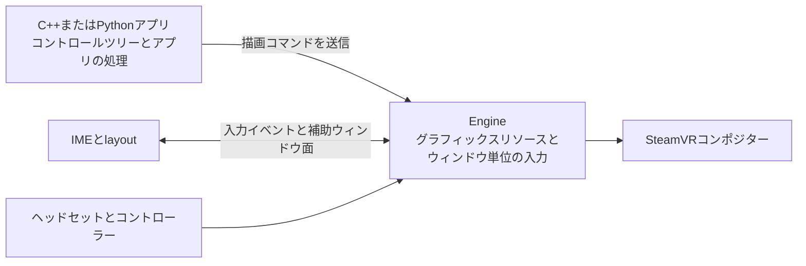

# Engineの概要とユースケース

EasyVROverlayUIEngineを使うと、SteamVR空間に表示する独立したUIを開発できます。アプリはC++またはPython SDKでコントロールを配置し、イベントを処理します。Engineはグラフィックスデバイス、SteamVRのウィンドウ面、ウィンドウ単位の入力ルーティングをまとめて管理します。

## SteamVRオーバーレイ

オーバーレイ（Overlay）は、SteamVRがメインシーンに合成する独立したサーフェスです。アプリはメインシーンから独立して動作します。`window`ごとに位置、向き、物理スケール、曲率を設定でき、参照対象には`world`、`head`、`body`、`left`、`right`を指定できます。コントローラーのレーザーでコントロールを操作し、グリップボタンでウィンドウを移動し、操作リングで回転を調整できます。

## 用途

|用途|実装方法|
|---|---|
|VRChatのメッセージとパラメーターを扱うツール|`textbox`にメッセージを入力し、`button`の操作を受けて、アプリ側のOSCインターフェースから送信します。|
|空間に表示するステータスパネル|`label`で状態、`progressbar`で進捗を表示します。用途に応じて固定空間またはコントローラーを参照対象にします。|
|空間に配置するファイル閲覧・編集ツール|`treeview`、`listview`、`grid`でデータを整理し、独立した`window`に表示してイベントを処理します。|
|多言語テキスト編集|SDKの入力コントロールを、独立したIMEおよびlayoutと連携させます。|
|複数のコンピューターにまたがるツール|別のコンピューターでアプリを動かし、TCP/TLSで接続したホスト側のEngineでUIを描画します。|

## SDKとEngineの役割

SDKはコントロール、フォーカス、型付きイベント、ビジュアルフォーム設計の仕組みを提供します。Engineはアプリから受け取った描画コマンドでウィンドウ面を描画し、現在のウィンドウに応じて入力を転送します。複数のアプリが同じEngineインスタンスに接続できます。

[環境構築・ビルド・インストール](/ja/basics/01_install_and_setup)を済ませたら、[最初のwindow](/ja/basics/03_first_window)を実行してみましょう。
