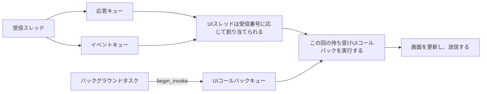

# 型付きイベントとマルチスレッド実行

アプリは、操作や状態の変化を型付きイベントで受け取ります。ウィンドウ、コントロール、描画コールバックは、作成元のUIスレッドに属します。バックグラウンド処理を終えたら、`begin_invoke()`でUIの変更を所有スレッドに委ねます。

## イベントの登録と引数

C++の`event_container<T>`とPythonのイベントコンテナーは、`+=`と`-=`に対応します。コールバックはイベントの発生元と引数を受け取ります。`event.add(callback)`で登録の識別子を取得し、`remove`または`-=`で登録を解除できます。複数のコールバックは登録順に実行されます。書き込み可能な`handled`や`cancel`の値は、コールバックの復帰後にイベント処理で参照されます。

`event_args_t`は追加フィールドを持たない基底型です。次の18種類の引数型はすべてこの型を継承します。Pythonの型名では`_t`を省きます。追加引数のないイベントでは、`source`から更新後のコントロールの状態を取得します。それぞれのイベントに固有の情報は、派生型のフィールドを参照します。

|C++の引数型|フィールド|代表的な発生元|
|---|---|---|
|`cancel_event_args_t`|`cancel`|`window.on_closing`|
|`key_event_args_t`|`key`、`shift`、`ctrl`、`alt`、`meta`、`handled`|キーの押下と解放|
|`text_input_event_args_t`|`text`、`handled`|編集可能コントロールのテキスト入力|
|`pointer_event_args_t`|`hand`、`left/top`、`x/y`、`captured`、`cancelled`、`handled`、`has_position`、`has_local_position`、修飾キー|ポインターイベント。座標は最初の組がウィンドウ面、次の組がコントロールを基準とします。|
|`scroll_event_args_t`|`hand`、`delta_x`、`delta_y`、`handled`|スクロール入力|
|`interaction_end_event_args_t`|`cancelled`|ドラッグ、スケーリング、およびその他の空間インタラクションの終了|
|`property_changed_event_args_t`|`property_name`|一般的なプロパティの変化|
|`control_collection_event_args_t`|`item`、`index`|子コントロールの追加または削除|
|`menu_item_event_args_t`|`item`、`index`|`menu_container`項目の追加または削除|
|`tabpage_event_args_t`|`page`、`index`|`tabcontrol`ページの変化および閉じる要求|
|`listview_column_event_args_t`|`column`、`index`|列集合、幅、およびクリック|
|`listview_item_event_args_t`|`item`、`index`|行集合とダブルクリック|
|`grid_column_event_args_t`|`index`、`width`|表頭のクリックおよび列幅の変化|
|`grid_cell_event_args_t`|`row`、`column`、`error`|編集ライフサイクル、値の変化、およびダブルクリック|
|`tree_node_event_args_t`|`node`|ノードの選択、展開、折りたたみ、およびアクティブ化|
|`render_error_event_args_t`|`message`|ウィンドウの描画に失敗|
|`controller_event_args_t`|`hand`、`trigger`、`grip`、`joystick_x/y`、`joystick_pressed`、`primary`、`secondary`|派生コントロールで扱うコントローラー入力|
|`control_input_event_args_t`|`type`、`hand`、`key`、`text`、`left/top`、`x/y`、`steps`、`horizontal`、`shift/ctrl/alt/meta`、`captured`、`cancelled`、`handled`、`has_position`、`has_local_position`|派生コントロールの`process_input()`|

## 応答とイベントのディスパッチ

受信スレッドは、通常の`response`を応答キューに、`event`をイベントキューに入れます。応答はリクエストIDに対応する非同期完了コールバックを呼び出し、イベントは`event_callback`からUIランタイムに届きます。同期リクエストに対応する応答には専用スロットがあり、待機中の呼び出し元を起こします。

UIスレッドは各周回の開始時に受信連番の上限を記録します。2つのキューの先頭を比較し、その周回の応答とイベントを受信順に処理してから、処理可能なUIコールバックを実行します。バックグラウンドスレッドが`begin_invoke()`で渡した更新も、コールバックキューに入ります。セッションの世代が変わると、その周回では旧セッションの処理を打ち切ります。

## show_dialogの入れ子のメッセージループ

`window.show_dialog(owner)`は、そのウィンドウを所有するUIスレッドで同期的に呼び出します。呼び出し元は結果を待ち、同じスレッドではWin32/MFCのモーダルウィンドウと同様にメッセージループが入れ子で動きます。各周回で応答、イベント、UIコールバックを処理し、ランタイムを更新してウィンドウの描画を送信し、次の処理を待ちます。ダイアログが閉じると内側のループを抜け、`dialog_result_t`を呼び出し元に返します。

- モーダル状態による操作の制限は、直接のownerに適用されます。ほかの操作可能なウィンドウやキュー内の処理は、同じループで引き続き扱います。
- `show_dialog()`の前に共有状態の更新を済ませ、アプリ側のロックを解放します。内側のループが別のコールバックを実行し、アプリの処理に再入する場合があります。
- クリックイベントからモーダルウィンドウを開けます。描画コールバックの実行中はモーダルの待機に入れません。
- 空間内のフォーカス、ダイアログの寿命、変更を確定する手順は[組み込みダイアログ](/ja/guide/09_builtin_dialogs)を参照してください。

## バックグラウンド処理からUIを更新する

時間がかかるデータ処理やタイマーの待機は、バックグラウンドスレッドで行います。表示する値がそろったら、そのスナップショットを`begin_invoke()`に渡すコールバックのデータとして保持します。コントロールのプロパティの読み書きは、そのコールバックで行います。SDKはコントロールの寿命に合わせて更新の実行を制御します。アプリを閉じる際のワーカースレッドの停止と終了待ちは、アプリ側で行います。

次の例では、`begin_invoke()`でカウントダウンの更新をキューに入れます。タスクのメモを入力するボタンを押すと`inputbox`の入れ子のループに入り、その間もカウントダウンは進みます。

### C++

<<< ../../../examples/guide/07_events_dialogs_threading/cpp/main.cpp

### Python

<<< ../../../examples/guide/07_events_dialogs_threading/python/timer_with_settings.py

SDKのパスを`cpp/CMakeLists.txt`で設定してビルドするか、`python/run.cmd`を実行します。モーダル動作を確かめるには、サンプルの表示後にメモのダイアログを開き、カウントダウンが進むことを確認してから、ダイアログとownerを閉じます。
