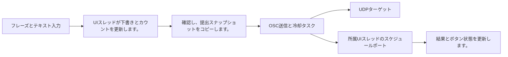

# VRChatのOSCチャットツール

本プロジェクトでは、VR空間内のテキスト入力をVRChat Chatboxメッセージに変換します。ユーザーは、よく使うフレーズを選択した後、自分の内容を追加し、文字数を確認した後に明示的に送信します。アプリはデフォルトでオフラインモードに入り、入力、選択、送信のフィードバックを検証した後、実際のOSCターゲットに接続します。VRChatは144文字と最大9行の表示を制限し、明示的な改行と自動改行はすべて表示行を占有します。[VRChat Chatbox API](https://docs.vrchat.com/docs/osc-as-input-controller#chatbox)

## 要求と観察可能な結果

ユーザーは、送信を完了するまでに、片手で順番に操作できるようにする必要があります。最も一般的なパスは、フレーズを選択し、下書きを調整し、メッセージを確認し、結果を待つことです。時々、入力中に他のウィンドウに切り替える必要があり、戻った時には元の下書きが見えるようにする必要があります。吹き出しのクリアと下書きの破棄は異なるアクションです。前者はVRChat内の表示に影響を与え、後者はローカル編集操作です。これらを明確なコマンドにすることで、ユーザーがクライアントの内容が削除されたと誤解することを避け、実際には編集エリアのテキストが削除されるだけです。

|操作|表示されるべき状態|データの帰属|
|---|---|---|
|アプリを開く|オフラインモード、数値は0|ウィンドウセッション|
|フレーズを選択|テキストが編集エリアに入る|フレーズの集合と下書きを別々に保存|
|編集または貼り付け|数値と実際に受け取ったテキストが一致する|編集エリア|
|送信|ローカル送信結果を表示し、重複トリガーを制限する|一度の送信のスナップショット|
|クリアをキャンセル|吹き出しと下書きを保持|トランザクションを確認|
|ウィンドウを閉じる|確認とタスクの解放|ウィンドウとワークスレッド|

受け入れをアプリ、オペレーティングシステム、VRChatの3つのレベルに分ける。アプリは正しいOSCフィールドとUI状態を生成し、オペレーティングシステムはUDP呼び出しが本機ネットワークスタックに成功して配信されたかどうかを報告する。実際の空気泡の表示はクライアントが判断し、UDPの送信結果はVRChatが受信したか表示したかを代表しない。ヘッドレスWARPのスクリーンショットは、コントロール、インタラクション、ローカルシミュレーションの状態のみを表示する。連携時には、送信番号、文字数、ターゲットを記録する架空の短いフレーズを使用し、プレイヤーの実際のメッセージをコピーする必要はない。

## ヘッドアップレイアウトと片手操作

例程ウィンドウは720×440ロジックピクセルです。デフォルトの物理スケーリング1.0では、展開サイズは約0.72×0.44メートルです。まず、通常の装着位置で視距離を調整し、編集エリアとヒットボタンが同時に見えるようにします。フォントを大きくすると、行の高さと中国語、英語、数字、日本語が混在する最大幅も同時に確認する必要があります。コントロールの外観はロジックサイズに基づいて配置され、実際の視覚サイズは物理スケーリング、位置、曲率の組み合わせによって決定されます。

左側のフレーズリストは、短い文を縦に並べるのに適しています。右側には広い編集スペースが必要で、下にはカウントと送信ボタンが置かれます。送信とクリアを区別し、状態は操作エリアの外側に置き、文字数の変化によってヒット位置が変わらないようにします。トリガーを連続して押すとき、ボタンのサイズ、隣接する間隔、無効化のフィードバックには明確な違いがあるべきです。片手で一連のテストを完了し、候補画面を開いたり、通常のキーを使用したり、Tabキーで切り替えたりするときに、フォーカスとレーザーが依然として予想されるコントロールを指しているかを確認します。

長期にわたって開放可能なウィンドウは`world`または`body`に設定でき、適切な距離とわずかに下方のオフセットを使用して、メインシーンを遮ることを避けます。手首の参照は一つの呼び出しポートに適しており、広い編集エリアをハンドルに固定すると、手元で動かされます。`head`モードを使用すると、周囲が見えるように優先し、頭を回すときに画面が常にメイン視野に入ることを避けます。デバッグ時には、物理スケーリング、座標、参照対象を同時に調整しないでください。そうすると、どの要素がヒット位置の変化を引き起こしたかを判断するのが難しくなります。

## スレッドとイベントフロー

例では、コントロールのコールバック内で短いメッセージのエンコーディングとUDP送信を実行し、遅延状態の更新を送信します。複数のターゲット、再試行、または送信統計を増やすときは、エンコーディングと送信を単一のバックグラウンドスレッドに任せることができます。UIスレッドでスナップショットを作成し、その後バックグラウンドスレッドはスナップショットを読み取り、送信結果、送信ID、クールダウンの終了時刻を返します。UIは下書き、フォーカス、モードに対する唯一の変更権限を保持します。



SDK内部では`connection::get_dispatcher()`を使用して所属接続のスケジュールポートを取得し、`control_base`は作成時にそれを保存します。アプリケーションの公開使用法はC++の`begin_invoke()`またはPythonの同名メソッドです。バックグラウンド送信は`textbox.text`を直接読み取ったり、ウィンドウ状態にアクセスしたりできません。クリックコールバック時に現在の値をキャプチャする必要があります。UIに戻った後、提出番号、ウィンドウのライフサイクル、現在のモードを確認します。以前の返値が遅れた場合は、最近提出されたトリガーを保持します。関連する制約は[強制型イベントとマルチスレッドスケジュール](/ja/guide/07_events_dialogs_threading)を参照してください。

## 第一ステップ：空のウィンドウから編集可能な下書きまで

まず`window`と3種類の基本コントロールを作成します。左側の`listbox`にはフレーズを、右側の`textbox`には下書きを、`label`には状態を反映します。C++は`get_control_list().add()`を通じて所属を決定します。Pythonの例では、コントロールを`vrc_chatbox_window`のメンバーとして保存し、次々と`control_list`に追加します。ユーザーの操作イベントは、コントロールを追加する前後で一貫性を保つ必要があります。最初の表示前に、デフォルトモードと空の下書き設定を完了します。`show()`を実行した後、SDKのループが入力とコミットの更新を担当します。

リスト選択は`on_selection_changed`を通じて行われます。インデックスを読み取る前に、負の値かどうかをチェックし、選択が空の場合は元の下書きを保持します。選択したテキストをテキストエリアにコピーし、続けて編集するためにフォーカスを要求します。リストの更新は選択イベントを引き起こす可能性があるため、集合を更新する際には元の選択項目を保持するかどうかを決定する必要があります。オプションのインデックスを長期にわたってビジネスキーとして使用すると、ソート後に別のフレーズを指し示す可能性があります。設定の出所が複雑な場合は、各フレーズに安定したアイデンティティを保持することが適切です。現在の例では、固定のエントリと文字列リストで基本的なプロセスを完了します。スクリーンショットのフレーズは、検証用の架空の資料です。


## 第二ステップ：文字数、改行、送信規則の設定

まず`multiline`を有効にし、次に`max_length`を設定します。これらの値はそれぞれ改行行動とコードポイントの上限を設定します。テキストが変更されるたびに、SDKが実際に受け取る値を読み取り、`progressbar`と同期します。現在の例では、進捗バーで文字数使用率を表示しますが、プロダクション版では数字を追加して表示することができます。プログラムの入力、通常の入力、ペースト、選択範囲の置換、クリアはすべて同じ状態更新パスを通じて行われます。大文字小文字の変換や行末のクリーニングを設定する際には、最終的に送信するためのテキストに基づいてカウントする必要があります。送信時に追加の変換が行われる場合は、プレビューで変換後の内容を示し、ユーザーが送信結果を誤って見ることを避けます。

C++の`u32string.size()`とPythonの`len(str)`はコードポイントを統計しますが、UTF-8バイト数ではありません。一つの表情は複数のコードポイントで構成されることがあります。プロダクション版では、まず利用可能な長さを制限し、次に安全な書記素クラスタ境界に戻り、最後にエンコードします。境界テストは、漢字、英語、アクセントの組み合わせ、長い表情、改行を含む文を少なくともカバーします。広いウィンドウでは、一行に多くの文字を収容でき、VRChatでは同じテキストが自動的に折りたたまれる可能性があります。プレビューでは、ローカル長さのチェックとリモート表示の予算を分離し、ユーザーがメッセージを自ら短くすることができるようにします。

両バージョンでは、Enterキーを`on_key_down`で遮断し、`handled`でマークします。通常の改行を保持する必要がある場合は、組み合わせキーを明確な送信コマンドとして使用できます。IMEが候補を確認する際には、まず候補が送信されていることを保証し、次にアプリケーションが送信するように応答します。テストはキー名だけでなく、位置に基づいて行い、候補ウィンドウの活動、一行編集、複数行編集、フォーカスが送信ボタンにある場合などを区別します。成功した挙動は、各操作が現在のフォーカスに対応するコマンドをトリガーすることです。下書きと進行バーは同じテキストを示します。


## 第三ステップ：OSCデータフレームのエンコーディングとデバッグ

OSC文字はUTF-8、NUL終端符、および4バイトの整列を使用します。アドレスフィールドは`/chatbox/input`で書き込まれ、タイプマーカーはコンマで始まり、文字列データは別途書き込まれます。即時送信と通知は、マーカー内で`T`または`F`でそれぞれ表され、各ブールマーカーには値のバイトが含まれません。C++の`append_osc_string`は各セクションのパディングを担当し、Pythonの`encode_osc_string`は末尾のパディングを含むバイト配列を返します。設定可能な音声と即時送信オプションを増やす場合、2つの独立したブール状態を組み合わせて、4つの組み合わせをテストする必要があります。すべての文字列を一緒にして全体を補完するだけでは、受信側は各フィールドの境界を見つけることができません。

エンコード前に内蔵NULを拒否または正規化します。メッセージが空でもユーザーが明確にクリアを選択した場合は、別のフラグを実行し、通常の空の下書きチェックと混ざらせません。まず、ループバック受信側で4バイトの境界、UTF-8テキスト、およびパケットの長さをチェックし、次にクライアントOSCを有効にします。IPv4はデフォルトで`127.0.0.1:9000`に送信されます。プログラムとVRChatは正しい位置で実行する必要があり、遠隔のEasyVRUIセッションはプログラムのループバックアドレスの指摘を変更しません。レンダリングホストから分離する必要がある場合は、ターゲットアドレスをOSC設定の一部として個別に処理します。

C++はWinSockを初期化した後、ソケットを作成し、最後にソケットとWinSockをクリーンアップします。実際のデプロイメントでは、初期化結果、無効なソケット、`sendto`結果、および返されるバイト数をチェックします。Pythonでは`finally`を使用してソケットを解放し、`OSError`が発生した場合は短いヒントを出し、下書きを保持します。状態行では、長いテキストを連結することを避け、送信番号または固定長の結果を表示します。連続して失敗した場合は、ローカルデモモードに戻ります。トラブルシューティングツールは、メッセージの長さとダイジェストを独立して記録し、負荷の問題、システム呼び出しの問題、およびクライアントの表示条件を個別に区別します。

## 第4ステップ：送信フィードバックを検証可能な冷却に進化させる

ソースコードは送信後の遅延回復状態を示します。迅速な繰り返しクリックをサポートするために、送信とEnterが共有するエントリに単調なクロックチェックを追加します。この入力が有効であることを確認した後、次の操作が許可される時間を記録し、送信コマンドの可用性を制御します。禁止期間中はユーザーの編集能力を保持し、各クリックを送信待ちキューに積み重ねません。クリアと送信が共有の制限を有する場合、クリアが確認された後も、その時点で実行可能かどうかを再確認する必要があります。ユーザーは冷却期間中に次のメッセージを準備できます。

各送信には増加する番号を割り当てます。遅延が終了した際のコールバックで現在の番号を読み取り、最近の送信の状態のみを変更します。ユーザーがモードを変更したり、ウィンドウが閉じたり、再接続した場合は、古い完了結果を新しい世代のインターフェースに書き込むことを拒否します。設計に基づいて、単一のワークスレッド、停止可能なタイマー、または期限付きのキューを使用するかを選択します。短いルーチンでは、各送信が独立して遅延することが説明しやすいですが、長期運用ではバックグラウンドタスクの数を制限する必要があります。テストでは、一度の送信結果を意図的に遅らせ、次の送信を行い、古い結果が最新の表示を覆うことができないことを検証します。


## 第五ステップ：クリアとモダン確認

クリアの際は確認を先に表示することをお勧めします。ユーザーが同意した後、明確な遠隔クリア操作を実行し、ローカルの下書きは製品戦略によって保持またはクリアされることがあります。キャンセル時には空値を送信したり、下書きを消去したりしません。サンプルソースでは、クリアコマンドは空文字列を直接送信し、別の確認はリアルタイムモードのウィンドウが閉じた時に表示されます。スクリーンショットのクリア確認は、このプロジェクトの拡張シナリオであり、同じモーダルAPIを再利用しています。実際の連携テストでは、ターゲットクライアントが空テキストをどのように処理するかを確認し、提示文を決定します。

コールバックを閉じる際は`cancel_event_args_t`を使用します。ユーザーが退出しないことを選択した場合は`cancel`を変更します。モーダルダイアログの待機は同じUIスレッドのネストループを使用するため、タイムアウト状態の更新を受け取る可能性があります。ダイアログボックスに入る前に共有データの構築とアプリ側のロックの解放を完了し、戻る際にはスナップショットに基づいてクリアまたは退出を行います。ウィンドウが再開される際には新しいインスタンスを作成し、アプリが閉じる際には作業を停止しリソースを解放します。設計では`run()`が終了した後にUIロックを保持しているスレッドを待つだけではなく、退出パスが循環依存になるのを避ける必要があります。


## プロジェクトの検証と障害の特定

|テスト入力または操作|予想される状態|異常の特定|
|---|---|---|
|第三のフレーズを選択した後、2行を貼り付ける|下書きと容量を同時に更新|実際に受け入れたテキストとイベントの読み取り値を比較する|
|長い絵文字を貼り付けた後、送信する|サーバーの制限内で、テキストの境界を壊さずに切り捨てる|コードポイント、文字素、UTF-8バイト長をそれぞれ記録する|
|入力法の変換時にEnterを押す|組み合わせ結果のみを送信する|IMEのルーティングとアプリケーションの消費条件をチェックする|
|連続して送信をトリガーする|最初の有効な送信のみを許可する|統一されたエントリ、モダンクロック、許可された時刻を確認する|
|モードを変更した後、古い結果が返される|状態は現在のモードに属している|送信番号と閉じるマークを確認する|
|ネットワーク呼び出しにエラーが発生した後、再試行する|下書きと再試行のアクションはまだ使用可能|送信エラーの結果が下書きを保持しているかをチェックする|
|ダイアログボックスをキャンセルした後、編集を復元する|元のテキストと現在のフォーカスは操作を続けることができる|直接所有者とモダン退出プロセスをチェックする|

まずオフラインUIで一つ一つ検証し、次にループバック監視でパッケージ構造を確認し、最後に実際のVRChatで短いコマンドの連携テストを行います。各段階で変数を一つだけ変更します。すべてのテストでは固定のフレーズを使用し、二つの言語の結果を比較できます。同じ画面でプレビューを観察した後、実際の空間でアクセス可能性と自動改行を確認します。テストレポートではUI状態、ローカル伝送、リモート可視性を区別し、後続のメンテナーが障害の起点を正確に再現できるようにします。

## 送信プロセスをテスト可能な状態マシンとして実装します。

一度の送信を「準備」「確認」「送信」「レート制限回復」の4つのアクションに分割できます。準備では入力のスナップショットと現在のモードを受け取り、空値、文字数、明示的な改行、禁止されている制御文字をチェックします。ビジネス戦略ではユーザーの確認が必要な場合は確認段階に進み、完全な長いテキストを狭いダイアログに詰め込むのではなく、内容の要約を表示します。送信段階では読み取り専用のスナップショットを持ち、ローカルの下書きが変わり続けることを許可します。レート制限回復段階では締切時間を計算して、コマンドを再び有効にするかどうかを決定します。状態の変更はUIスレッドでのみ発生し、非同期タスクが時間を取得し、システムが結果を送信します。このようにして、モーダルダイアログ、古いコールバック、ユーザーのクリックが交差する場合でも、各更新は出所によって識別できます。

実践では、モデルに現在の下書き、最近の操作番号、現在のモード世代、次の送信可能な時刻、簡単なフィードバックを保存できます。また、各フィールドが二つのコマンドの間でどのように変化するかを定義する必要があります。通常の編集では下書きのみを変更し、フレーズを使用すると同じ下書きフィールドに書き込みます。ステータスバーに表示される最新の結果は保持できます。クリアコマンドはまずビジネスルールに従って確認を受け、次に空文字列のスナップショットを生成します。送信に失敗した場合は、失敗の理由をエディターに戻さないでください。失敗した操作がすでに送信枠を占有している場合は、短い遅延を保持するか、ユーザーに修正してから再試行するようにすることができます。重要なのは、確定ルールを提供することです。

|段階|エントリーチェック|完了後に保持されるデータ|
|---|---|---|
|下書きの準備|ウィンドウの帰属が有効で、テキストが送信されたコンビネーション|規格化前後の文字数、元の下書き|
|確認を待つ|スナップショットとウィンドウのアイデンティティが固定されている|操作種類とダイアログを開く時のレベル|
|データの送信|目標設定が有効で、冷却期間が終了した|送信番号と開始時刻|
|処理に失敗|現在のタスクに合致する返信|下書きとエラー種類|
|回復|現在のレベルがまだ一致しており、締切が終了した|新しい可用性と最近の結果|

### コードの進化一：重複する読み取りロジックを送信エントリーに集約する

C++のソースコードは`button_send->on_click`と`textbox_chat->on_key_down`から内容を取得し、Pythonにはそれに対応する2つの方法があります。拡張時には、まず「テキストの読み取り、空の判断、送信、クリア」の順序を2箇所で別々に見つけ、それを統一された`submit_chatbox`に抽出します。入力は操作の種類を受け取り、同じ予算関数を使用して検証済みの内容を生成します。Enter分岐は修飾キーを識別し`handled`を設定するだけで、ボタン分岐はコマンドをトリガーするだけです。現在の状態が送信を禁止している場合、入力は明確な結果を返します。呼び出し者は失敗結果後に内容を無条件にクリアしないでください。

C++の実装では、構造体を使用してテキストと番号を保存し、作成時に`u32string`をコピーします。この文字列はその後、安全に非同期タスクに移動できます。Pythonでは、不変の文字列と数字のみを渡します。両方の実装は`textbox`へのアクセスを非同期送信部分に残しません。持続的な送信キューに変更する場合は、容量を設定し、キューが満杯の時にはどのタスクを拒否または上書きするかを定義します。チャットメッセージの意味は明確な人による送信であり、同期待機中の複数の記録は静かに統合されるべきではありません。連続的なノブターンと比較して、チャットの統合戦略は通常より保守的です。単純なエンジニアリングの選択は、一つの待ちを許可し、ユーザーが編集後に再び明確に送信することができます。

### コード進化二：長さの制限を前後で統一された予算報告に保つ

予算関数は4つの内容を返すことができます：規格化されたテキスト、ソースコードポイントの数、送信可能な数、および切り捨ての理由です。編集コントロールの`max_length`は第一の制限を提供します。ビジネスインターフェースは、設定ファイルからのフレーズ、外部スクリプト、エンコーディング方法を再処理し、編集領域を迂回するエントリポイントが依然として同じ制約を使用することを保証します。テキストにクリップボードからコピーされた複数の行終端符が含まれている場合は、まず行形式を統一し、その後行数と長さのチェックを行います。UTF-8バイト数を計算するのは、切り捨て後の値が得られた時のみです。バイトを切り捨ててから切り捨て結果をテキストに戻すことはしないでください。文字境界を越える切り捨ては、解読不可能な文字列を生じさせます。

境界ケースのために固定文字組み合わせを準備します。普通の漢字を可視単位として基本計量に使用し、異なるコードポイントの組み合わせによる字形を加え、長さと視覚的な数量の分離を観察します。テスト時には、入力内容がどれだけのコードポイントを準備しているか、SDKがどれだけを受け入れているか、実際に送信するためのバイト数を記録します。同じサンプルセットでC++とPythonの入力を比較します。長い標点記号のシーケンスを含む場合、遠端での行の折り返しの影響は普通の文よりも大きい可能性がありますので、最大表示行のフィードバックを確認する必要があります。残りのスペースを「使用済み数／予算」として表示することで、計量の違いをすぐに発見できます。進捗バーは迅速な視覚フィードバックとして保持されます。実際に切り捨てられた部分を独立したヒントで説明する場合、状態バーですべての文字を繰り返す必要はありません。

### コード進化三：ローカル受信端末でメッセージエラーを隔離する

拡張送信関数は注入可能なターゲットであり、デフォルトではアプリケーションがVRChatに設定します。テスト時には実際のゲームとは別の一時的なループバック受信端を選択し、単一のデータグラムを保存してアサーションに使用します。アドレスフィールドの開始と終了位置を確認し、タイプマーカーの各文字をチェックした後、終端符の前のUTF-8メッセージを読み取ります。予想されるメッセージを再エンコードした後、キャプチャされた値と比較します。固定のシングルバイトテキスト、4バイト境界テキスト、およびマルチバイトテキストの3つのサンプルを順番にカバーしてパディング状況を網羅します。受信端はゲーム状態を認識する必要なく、アドレスの書き間違い、ブールマーカーの順序の誤り、およびパディングの不適切さを発見できます。

同時に、ローカルネットワークの異常が下書きにどのような影響を与えるかをチェックします。Pythonは`sendto`が例外をスローすることをシミュレートし、インターフェースの状態がまだ再試行可能であることをアサーションします。C++では、送信サービスが失敗を返し、呼び出し側が成功を誤って表示しているかをチェックできます。状態更新は、タスク結果を統一して処理する場所で実行するのが最適です。ログ記録はローカルシステムのエラー番号と現在のリクエスト番号を記録し、UI上ではソケットの内部詳細を表示しません。実際のゲームの検証は、ローカルでのエンコードとデコードが完了した後にのみ行われます。例えば、視覚的に識別可能なマーカーで構成された短い文を送信し、即時送信と音声通知の設定をテストします。テストレポートでは、このステップをクライアントの表示検証として明確にマークします。

### コード進化四：モダルダイアログ、モードの切り替え、および閉じる順序に関する問題

クリア確認を開く際に、現在の送信番号とウィンドウが現在のセッションに属していることを保存します。ユーザーの操作を待つ間、バックグラウンド状態のコールバックはUIに入ることができます。ユーザーが他の入口からウィンドウを閉じたり、非リアルタイムモードに切り替えたりした場合、確認が返された後で実行可能な条件を再チェックする必要があります。実行を続ける際には新しい操作番号を作成し、クリア送信が前回の通常の下書きの完了メッセージに覆われないようにします。キャンセル時には現在のエディターのライフサイクルを変更せず、元のフォーカスを保持し、ユーザーに編集を続けるようにします。ビジネスイベントを記録する際には、「クリア確認を開いた」と「クリアコマンドを送信した」を区別する必要があります。

退出パスでは、新しい送信を受け入れるのを停止した後、既存のバックグラウンドタスクを終了します。停止マーカーと有界待ちを使用して、ワークスレッドが無限に滞在するのを防ぎます。実行時の保護により、コントロールのライフサイクルが保たれるため、期限切れのコールバックは実行されない可能性がありますが、アプリケーションは保持しているソケットとスレッドを解放する必要があります。タスクの最終クリーンアップをすべてUIコールバックに詰め込まないでください。そうすると、ウィンドウが閉じてしまい、解放が実行できません。非同期送信器はスレッドとソケットを所有し、UIは停止の意図を発行し、最後の可視状態を処理します。呼び出しスレッドはロックを解放してから退出を待ちます。残りのデータを保持する必要がある場合は、別のローカル下書きを書き込むことができますが、確認待ちの履歴を既に送信されたメッセージとして保存することはできません。

## デリバリー検証記録

テストを管理するための簡易記録表を使用し、フィールドにはテスト番号、操作パス、入力タイプ、予算、ネットワークの実際の有効性、結果の出所、およびスクリーンショットの位置が含まれます。まず、この章の4つの図を参照してレイアウトを確認し、次に状態遷移に沿って順番にクリックします。同じ入力に対して、ボタンとキーボードの2つの経路で送信し、失敗後の挙動が一致することを確認します。オフラインデモを使用して長いテキストやフレーズの置換、クールダウンを確認し、ループバック検証ではパケット構造のみを確認し、最後に実際のクライアントに接続してバブルを確認します。ループバックチェックに合格したがVRChatに表示されない場合は、ポート、プロトコルパラメータ、クライアント設定を優先して確認します。この現象のためにUIロジックを変更したり、繰り返し送信したりしないでください。最終的な受け入れでは、「プレビューされた内容が何であるか」から「送信された内容が何であるか」まで遡ることができ、どのステップがローカル結果のみを検証したかを説明できる必要があります。

クリア操作の検証に加え、受け入れと拒否の2つの経路を検証します。ユーザーが送信されていない下書きを1つ入力した後、クリアダイアログを開き、キャンセルを選択してテキスト、カウント、フォーカスを確認します。2回目の確認後、送信されたのは空の文字列操作であり、下書きの本文ではないことを確認します。ダイアログが待機中にデバイスを切り替えたり、モードを変更したりした場合、旧い操作が新しい状態の制限を貫通しないことを期待します。長時間の一時停止とウィンドウの再利用の2つのシナリオで、タイマーコールバックが破棄されたオブジェクトを更新したかどうかを観察します。上記のテストには、視覚効果とは独立した判断条件があり、結果を自動化されたチェックとして記述するのに便利です。

## 完全なプロジェクトとビルド

[環境構築・ビルド・インストール](/ja/basics/01_install_and_setup)に従ってEngineを起動します。チュートリアルのリポジトリのルートでx64用の開発者コマンドプロンプトを開き、次のコマンドを実行します。SDKのパスは実際のインストール先に置き換えてください。Visual Studioジェネレーターでは、実行ファイルはReleaseサブディレクトリにあります。

```bat
cmake -S examples/projects/01_vrc_chatbox/cpp -B .work/vrc_chatbox -DEASYVRUI_ENGINE_INTERFACE_ROOT=D:/Tools/EasyVRUI/sdk
cmake --build .work/vrc_chatbox --config Release
.work\vrc_chatbox\Release\vrc_chatbox.exe
set "EASYVRUI_SDK_ROOT=D:\Tools\EasyVRUI\sdk"
examples\projects\01_vrc_chatbox\python\run.cmd
```

### C++

<<< ../../../examples/projects/01_vrc_chatbox/cpp/main.cpp

### Python

<<< ../../../examples/projects/01_vrc_chatbox/python/vrc_chatbox.py
