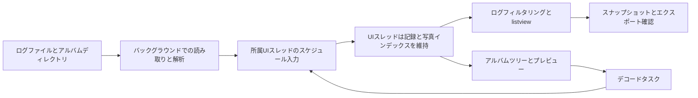

# VRChatのインスタンスログと写真管理

本プロジェクトでは、部屋のイベントとローカル写真を同じVRワークスペースに配置しています。ログと写真は独立したページを使用しています。前者は増分収集と条件フィルタリングを先に解決し、後者はインデックスとサムネイルプレビューを先に解決します。ユーザーはウィンドウに入った後、ヘッドマウントディスプレイを離れることなく発生したイベントを確認し、エクスポートが必要かどうかを確認した後、写真に切り替えることができます。ディレクトリ、ユーザー名、プレイヤー名、写真には個人情報が含まれる可能性があります。本文のスクリーンショットには架空のイベントと合成写真が使用されており、実行時には自分のファイルソースを選択する必要があります。VRChatのWindows上のデフォルトのログ保存場所と保持動作は、クライアントドキュメントで説明されています。[VRChatローカルストレージ](https://docs.vrchat.com/docs/local-vrchat-storage) [VRChatログ出力](https://help.vrchat.com/hc/en-us/articles/9521522810899-Where-do-I-find-my-Output-Logs-and-Crash-Dumps)

## 要求の分解とインターフェース契約

第一の要求は最近のイベントです。ページを開くと、読み取りソースと現在の数値が表示され、新しいイベントが追加され、背景でログファイルを切り替えた後、読み取りが続けられます。第二の要求は、空間内でビューを迅速に縮小することです。ユーザーは全てのイベント、入場、退出、および部屋やプレイヤーに基づくフィルタリングを区別できる必要があります。第三の要求は写真の表示です。アルバムツリーは月またはカテゴリに基づいてグループ化され、ファイルを選択するとプレビュー、名前、および失敗原因が表示されます。第四の要求はエクスポートと削除です。エクスポートは凍結された集合を使用し、ユーザーは保存をキャンセルできます。削除にはファイル認証と独立した確認が必要であり、通常のプレビュー操作ではトリガーできません。

既存の完全なC++、Python例程は、入場と退出を主とするフィルタリング、カテゴリツリー、画像の読み込みとエクスポートを提供しています。それらが読み取る基本行は、時間、アクション、プレイヤーで構成されています。記事内の部屋とプレイヤーの組み合わせフィルタリング図は、拡張されたモデルを示しており、部屋のソースは既に検証されたこのバージョンのクライアントログから取得される必要があります。関連する部屋の記録がない場合は、「未知の部屋」を保持するか、プレイヤーフィルタリングのみを開放します。削除は独立した拡張操作であり、このセクションではエクスポートモダルウィンドウを使用して実際の保存前の確認段階を示しています。

|状態|ログページに表示されるべきです|アルバムページに表示されるべきです|
|---|---|---|
|カテゴリが存在しない|ソースが見つからず、サンプルを読み込んだりカテゴリを切り替えたりすることが依然として許可される|説明パスが使用できないため、ファイル選択の入口を保持する|
|書き込みを待っている|既存の記録は読み取り可能に保持される|写真は現在のページに残される|
|解析に失敗した|その他の有効な行が続けて追加され、カウントは診断に使用できる|前のページを保持し、デコードできないことを示す|
|フィルタリング結果が空である|条件を保持し、0行を表示する|独立したブラウジング|
|ユーザーが保存中である|凍結された記録のスナップショットが提供される|ページを切り替えても現在の選択が保持される|

デフォルトでは、入室と退室の間の欠落をユーザーの部屋を離れると解釈しません。観察可能な項目からのみタイムラインを構築します。元の解析結果と表示ラベルを分離します。例えば、モデル保存`Joined`、インターフェース表示は「加入」です。フィルタリングはモデル値を比較するもので、言語によって変わる表示文を参照しません。並べ替えも時間または収集番号に基づくべきで、ニックネームや時間形式に直接依存しません。重複する名前がある場合、同名のプレイヤーはログ内で利用可能な安定した識別子によって区別する必要があります。安定した身元が確定できない場合、フィルタリング条件を「表示名前」と明確に呼びます。

## VRレイアウトとフォント

2つのタブを同じ平面に大量のリストと画像を同時に配置するよりも、読みやすいです。ログページでは、分、秒、アクション、プレイヤー名を優先して表示し、部屋に加入する列では、各列の制限を先に決定します。左揃えの名前を使用してスキャンを容易にし、固定行高さを使用してユーザーが選択行を正確に指すことを保証します。アルバムは狭いツリーと広いプレビューで配置し、写真を等倍で表示します。タブの高さはヘッドマウント内の命中範囲を決定し、低すぎると最初のフィルター項目に触れやすくなります。元のルーチン820×520のロジックピクセルは約0.82×0.52メートルの展開サイズに対応し、視野の一側に固定するのに適しています。物理サイズはロジックサイズに`physical_scale`を乗じてメートルに換算し、特定のロジック幅をすべての人の視野の大きさとして直接記述することはできません。

片手で操作する場合、フィルタリングは表頭に近い位置に置くことが一般的で、ページを切り替える際に交差操作は必要ありません。フォントの調整では、狭い列内の句読点、ラテン名、マルチバイト文字をチェックする必要があります。完全な長い名前を見る必要がある場合は、下の専用エリアで表示し、水平スクロールに依存して完全な時間と名前を同時に確認することを避けます。プレビューは大きな面積を占有するため、削除とエクスポートの入力は独立したコマンドエリアに置くことができ、画面を覆わないようにします。`body`または`world`からの位置確認を推奨し、リストのフィルタリングとカテゴリツリーの展開時にはウィンドウを安定させます。ハンドルを使用して迅速にページをめくる場合、アクションには独立したフォーカスフィードバックが必要で、写真の開く動作と選択された写真を区別するためです。

## スレッド、データ、所属

バックグラウンドでディレクトリを読み取り、ログを追跡し、大きな画像をデコードする際には、異なる遅延が発生します。受信モデルは、ログ収集バッチ、写真インデックスバッチ、一枚のプレビュー結果に分けることができます。UIスレッドはアプリケーションモデルとすべてのコントロールを保持し、不変の結果のみを受け入れます。各結果には、日付、アクティビティファイル、現在の写真選択番号などのソース世代が含まれます。パスを切り替える際には世代番号を上げ、待機中に得られた古いデータは捨てることができます。非同期の完了が別のディレクトリに置き換えられたリストに引き続き書き込むことを許さないでください。



元C++例程は`jthread`を使用して增量ファイルを読み取り、`window->begin_invoke()`を使用してバッチをマージします。Python例程はバックグラウンドスレッドを使用してログを読み取り、各解析結果を`listview`のUIコールバックに送信します。SDK内部は`connection::get_dispatcher()`を使用して所属接続のスケジュールエントリを保存し、アプリケーションは`begin_invoke()`を使用してアクセスします。ワークスレッドでは、任何の`tree_node`の所属、`listview_item`の集合、またはウィンドウの通常の属性を操作しないでください。これには、ワークスレッドからウィンドウの閉じるフラグを読み取ることも含まれます。プロダクション版では、UIの閉じるパスで`stop_token`または`threading.Event`を設定し、バックグラウンドはこのスレッドセーフ信号のみを監視します。デコードが完了した後、UIのチェックレベルで、コントロールがまだ存在している間にリソースを割り当てます。

## 第一ステップ：2ページの制御可能な仮データを構築する

まず`menubar`、`tabcontrol`、ログ`tabpage`、およびアルバム`tabpage`を構築します。`window.menu`はメニューを受け取り、サイドページは`page_list`によって管理され、ページ内の通常のコントロールは対応する`control_list`に入ります。ウィンドウフレームはメニューレイの高さに応じてコマンドエントリを配置し、ページの矩形はアプリケーションによって設定されます。リストのタイトル、フィルター条件、スクロールバーに予約スペースを確保します。まず固定の4つのデータでテーブルを埋め、スクロールとタイトルのレイアウトを確認した後、実際のファイルスキャンに進みます。固定データには2種類のアクション、2つの部屋、2つの架空の名前が含まれており、フィルタリングの変化を観察しやすくなります。

列の定義は`listview_column`として作成され、各行は`listview_item`によって文字列セルが保持されます。一連のデータを書き込む際には、新しいアイテム集合を構築し、その後統一して置換します。単一の追加は頻度の低い更新に適しており、頻繁な更新時には繰り返しクリアや行ごとの選択の復元は不要です。両言語ともに、アプリケーションのデータモデルを保持した後、フィルタリングされたオブジェクトを表示集合にマッピングすることができます。非同期のバッチ更新が必要な場合は、一度処理した後、一度だけインターフェースの更新を要求し、スクロール位置の繰り返し計算を避けます。


## 第二ステップ：新しいログの確実な追跡

サンプルは`output_log_*.txt`を探します。C++ではディレクトリの探索と最新ファイルの確認を`find_latest_log`、行の解析を`parse_log_row`に分けます。毎回、読み取り可能な最新ファイルを調べます。ファイルを切り替えるときは、先に古いストリームを閉じ、新しいストリームを開きます。末尾の行が改行で終わっていなければ、読み取り位置を戻し、次の巡回で完全な行を読み込みます。短いPythonサンプルは最新ログを一度選び、ファイルの先頭から読み込みます。ログがローテーションする運用では、C++と同様にファイルの同一性を確認し、ストリームを閉じ、読み取り位置を復元できます。ファイルへの書き込みはアトミックではないため、1回の読み取りで完全なイベントを得られるとは限りません。

ファイルのヘッダーから最近の記録を読み出すためのデータを保持しますが、ファイルが非常に大きくなる可能性があります。アプリケーションは、起動時に限られたウィンドウを表示するか、末尾から新しいイベントを待つかを決定する必要があります。固定上限は、スキャンするバイト数、処理待ちの行数、UIに保持される行数をそれぞれ計算します。大きなファイルを読み終える前に、すべての履歴を保持し続けて、UIで古い記録を削除すると、バックグラウンドメモリが枯渇する可能性があります。C++では現在、100件のデータを保持していますが、プロダクション版では各ラウンドの追加バッチを制限する必要があります。合理的な時間予算で次のデータを読み出し、退出信号やパス変更がタイムリーに適用されるようにします。

ログ行の解析は、検証されたイベントマーカーにのみ焦点を当てます。抽出時には、元の行内の時間情報を保持し、ファイルの変更時間を各イベントの発生時間として使用してはいけません。エンコーディングエラーに遭遇した場合は、行をスキップし、失敗数を増やすことができます。Pythonのデモンストレーションでは、不正な文字に対して寛容なデコードを行い、C++では完全な文字列の変換後に記録を追加します。これら2つの戦略は、アイデンティティに与える影響が異なります。もし破損部分がプレイヤーの名前に含まれている場合は、不完全な記録として表示する方が、安定したプレイヤーキーを作成するよりも良いでしょう。

ログのローテーションは、新しいファイルの検出、オープン、継続読み取り、切り詰めの検出、ファイルの再選択に分けられます。ファイル名が同じでもサイズが小さくなっていれば、読み取り位置が無効になった可能性があります。ストリームを開き直し、末尾へ移動するか決めます。ファイルが一時的にロックされている場合、処理待ちのレコードはそのまま保持し、次の巡回で再試行します。状態表示には現在のファイル名と読み込み件数を出せます。原因を調べる場合は、最後に正常に読めた位置を記録します。新しいディレクトリを選んだら旧ソースの状態を消去し、UIは現ソースの識別子が付いたバッチだけを受け付けます。新しいファイルを開けなかった場合に、旧ファイルのレコードを新しいファイルの結果として扱わないようにします。

## 第三ステップ：フィルタリングの順序とルームの関連性

既存のコードでは、`combobox`を使用して「全部」「のみ追加」「のみ離脱」を選択し、リフレッシュ関数は元の記録から現在のアクションに属する行を抽出します。元の行は保持され、条件を変更する際にはディスクを読む必要はありません。互換性のある実装では、まずアクションに選択可能な述語を適用し、次に解析されたルームIDとプレイヤーIDの交差を適用します。どの条件も「全部」に設定すると、その条件のみが削除され、他の条件には影響を与えません。ソートまたはフィルタリング前に現在の選択オブジェクトの安定したキーを保存し、リフレッシュ後にそのキーに基づいて復元します。一部のフィルタリングは0件にまで狭められており、全部に戻す際にも利用可能である必要があります。

一部のログには、プレイヤーの行の前に発生する、インスタンスへの入場のコンテキストイベントが含まれています。解析器はセッションレベルで活動中のルームを維持し、確認可能なルームキーを新しいイベントに付け加えます。ルームが変更された場合は、関連状態を先に更新し、その後でプレイヤーのアクションを記録します。古いログファイルの終わりに遅れたイベントは、新しいセッションのルームに付け加えられません。検証時には、少なくとも同じプレイヤー名を持つ2つのルームを用意し、名前とアクションのみを持つ、ルームのコンテキストがない記録を1つ追加します。フィルタリング結果が正しい場合、未知のルームは全部のビューに保持され、2つの既知のルームに誤って分類されることはありません。


## 第四ステップ：写真インデックスと高解像度プレビューの構築

アルバムページで`treeview`と`image`を作成します。カテゴリグループは`tree_node`を使用して月やフォルダ名を表示し、写真ノードの`tag`は読み出し可能なパスを保存します。選択通知を受け取った後、葉っぱかどうかをチェックし、ファイル拡張子とパスが許可されたソースに合致しているかを確認します。既存の例では、カテゴリスキャンを通じてノードを埋め込みます。両言語バージョンでは、画像の読み取りに失敗した場合に説明を更新します。より完全な実装では、時間のかかるカテゴリの一括処理と低解像度化をUIスレッド外で行うべきです。解析されたカテゴリ説明を通常のリストとしてUIに返し、その後でツリーノードを集中して作成します。画像リソースの作成方法はSDKインターフェースに依存しているため、バックグラウンドでピクセルデータを生成し、関連するスレッドでコントロールに割り当てることができます。

高解像度写真はファイル内で非常に小さく圧縮されている可能性がありますが、デコード後のメモリはピクセル数にチャンネル数を乗じて計算されます。1600×900のRGBAは約5.76MBのサイズが必要で、4K画像はより多くのリソースが必要です。迅速な切り替え時には、すべての大きな画像をコントロール内に永続的に保存すべきではありません。サムネイルとプレビューの二段階戦略を選択し、同時にデコードする数を制限します。非同期タスクが開始される際には、ノードの識別子とソースファイルの最終変更データを記録し、終了時に選択が依然として同じファイルを指しているかをチェックします。ファイルが移動されたり破損した場合はエラーを表示し、バックグラウンドの結果が新しく選択された別の写真を置き換えることを防ぎます。インターフェースは前の写真を表示し続け、その状態を表示して、誤った素材が現在選択されている項目のように見えないようにします。

`image.stretch_mode.contain`はフルサイズの表示に適しており、`cover`は視野を埋めるサムネイルプレビューに適しています。前者を使用する場合、端の空白は比率調整の一部です。良い検証ステップは、16:9横画面、縦画面、正方形を別々に読み込み、ピクセルが元の比率を保持しているか、境界を超えていないか、タイトルが切り替え後も読み取れるかを記録することです。画像にエラーが発生した場合は、コマンドエリアとタブの切り替え機能を保持する必要があります。WARPのスクリーンショットは1600×900の合成画像を使用し、デコードとスケーリングのレイアウトの期待される効果を再現します。


## 第五ステップ：スナップショットのエクスポートと危険操作の確認

`file_save_dialog`を開く前に、現在のフィルタリング結果と条件説明をコピーします。ダイアログボックスはネストされたUIループを使用し、バックグラウンドログが引き続き到達する可能性があります。直接リストを読み取って返すと異なる結果が得られます。明確なエクスポート行動は、ユーザーがクリックした時にどのデータセットを見るかによって、そのセットのスナップショットをエクスポートすることです。UIは記録数、時間範囲、列を提示することができます。既存の例では、エクスポートには全キャッシュが使用されていますが、フィルタリングエクスポートに拡張する場合は、データソースを切り替える必要があります。削除のシナリオも同様で、選択されたファイルの識別子を保存し、確認時にパスが依然として同じオブジェクトを指しているかを再チェックします。

TSV形式にシリアライズする際には、フィールド内のタブスペースと改行をクリアするか、明確なエスケープルールを定義する必要があります。エクスポートの書き込みに失敗した場合は、状態を説明し、インターフェースを保持します。半製品を防ぐために、まず同じディレクトリ内の一時ファイルに書き込み、完全性を確認した後で目的の置換を実行します。ユーザーがキャンセルを選択した場合は、ファイルを作成しません。上書きは、ダイアログとアプリケーションの共通のルールに従う必要があり、一度確認したからといって後続のファイルの同一性判断を無視してはなりません。削除には回収戦略がある場合は、復元可能なパスを優先し、確認前にファイル名を表示します。アプリケーションは、アルバムディレクトリの権限範囲内のファイルのみを操作し、短縮された名前を表示しても、ファイルの同一性が短縮された名前で比較できるわけではありません。


## 受け入れ、メンテナンス、および障害の再現

|動作の再現|観察項目|位置決め方法|
|---|---|---|
|最初に一部のログ行を書き込み、後で改行を書き込む|完全な前には欠落行が出現しない|未送信の末尾行のオフセットとデコードの確認|
|VRChatを再起動する|アプリケーションが活動ファイルを切り替える|元のパス、ファイルの時間、実際の開き状態を比較する|
|フィルタ項目を切り替えながら記録を追加する|条件は依然として有効で、数量は正しい|データの追加とビューでのフィルタリングを別々にカウントする|
|2枚の大きな画像を迅速にクリックする|最後の画像を保持する|プレビューのレベルが古い結果を覆うかどうかを確認する|
|ディレクトリや写真が移動された|古い選択がクリアされ、ソース状態が現れる|エラー処理が現在のリソースにのみ影響することを確認する|
|エクスポートダイアログが開いた後も収集を続ける|書き込み内容は、クリック時のスナップショットに対応している|凍結時と2回目の提出前のカウントを比較する|
|ツールを閉じた後でディレクトリを再開する|古いタスクは終了した|観察停止信号、ファイルハンドル、セッションの解放を確認する|

ファイルの同一性を確認した後、イベントの解析と送信キューをチェックし、最後にコントロールのレイアウトをチェックする。短いサンプルを使ってページを繰り返し切り替え、項目ごとに通過した後でローカル実際のログを使用する。スクリーンショットを共有する前に、ユーザーディレクトリ、実際のプレイヤー、または画像コンテンツが持ち込まれていないかを確認する。実際のデプロイメントでは、設定可能なログディレクトリと写真ディレクトリを提供し、「データが読み取り中」「マッチング記録がない」「パスが使用できない」という3つの独立したフィードバックを明確にする。再現可能なテストサンプルを維持し、2つの言語がページング、フィルタリング、画像のスケーリング、および異常通知の一致性を比較することができる。

## データモデルを長期の読み取りを支えるようにする

メンテナブルなイベントモデルには少なくとも4種類の情報が必要です。第1の情報は元の同一性で、セッションファイルとバイト位置を含み、重複を排除し再現するために使用されます。第2の情報は表示データで、イベントの時間、アクション、プレイヤー名、確認可能なルームを含みます。第3の情報は関連情報で、現在の活動ルームと解析ルールの出所を含みます。第4の情報は処理状態で、成功、無視、部分的に読み取れる、または読み込みに失敗したことを含みます。同じリストを読み取り、フィルター条件を切り替える際、UIは元の記録を書き換えずにのみ条件を変更します。イベントの同一性を保持することで、選択された行を復元したり、エクスポートと現在の表示が同じデータセットから来たかどうかを確認することができます。

同じログファイルで複数のソースから情報を読み取る場合、解析はファイルのレベル内でコンテキストを保持し、ファイルを切り替えたり最初に開いたりする際に初期化されます。欠落した情報がある場合は、空のフィールドを保存し、表示可能な列に「未知」と統一して表示します。これにより、ルーム列に内容が見えないために記録が失われることがありません。初期化と再スキャンは一貫した戦略を選択し、同じセッションを最初に開いた時に一部のイベントが見えるが、更新後に同一性がないことを避けます。ファイルの位置と行の内容の要約を組み合わせて重複を排除する識別子を作成できます。異なるログファイルからの同じニックネームについては、テキストが同じであるからといって同じイベントと見なすべきではありません。統合する必要がある場合は、まず時間とセッションの同一性を確認し、それから実際に重複しているかどうかを判断します。

### バッチ、容量、およびフラッシュ制限

C++のワークスレッドはまず`added`を生成し、その後全体のバッチをUIコールバックに移動します。拡張する際には、固定の行数またはタイムスライスで送信でき、ホールド時にはオフセットを記録し、できるだけ早く停止チェックに戻ります。Pythonの例は現在行ごとに送信されており、頻繁に使用されない場合は十分ですが、連続して書き込みを行う場合はバッチに変更できます。バッチはソースの識別子と読み取れる行数を提供し、UIが受け取った後、単一のコールバックでモデルと統計を更新します。フィルター条件を切り替える際には、まず条件を設定し、その後送信されたモデルを使用して新しいビューを計算します。キュー内の次のバッチは、その時の最新のフィルター条件を使用します。バックグラウンドはリストの現在のスクロール位置を知る必要がなく、UIに基づいて結果をフィルタリングして収集範囲を調整する必要もありません。

容量制限は、ファイルのバイト数、UIへの反映待ちの作業、表示済みの行で分けて考えます。直近100行だけを表示しても、500MBのログを最初に読み取って全件の一致を集める場合のメモリ使用量は抑えられません。バックグラウンドでは区切って読み取り、増分で解析し、キャッシュ件数を制限します。UIモデルでは上限のあるキューで直近の行を保持し、エクスポート範囲は明示的に選びます。履歴を見たい場合に備え、履歴専用の読み込み操作と進捗表示を用意します。ユーザーが末尾の画面だけを見ているからといって、その画面だけをエクスポートすることは避けます。出力する件数、現在のフィルター条件、時間範囲を示せば、生成ファイルの内容が分かります。

### スレッドの統合とビューのアンカー

リアルタイムリストの更新後、スクロールバーが異なる位置に停止することがあります。最新のデータを見ている場合は、自動的に下部に追従するのが適切です。以前の記録を確認している場合は、視覚的アンカーを保持する必要があります。現在の最上層のイベントIDまたは選択項目をアンカーとして使用し、バッチ処理後にそれがまだ表示結果に表示されているかを確認します。古いイベントが容量で排除された場合は、簡単な説明を表示し、適切な新しいアンカーを選択します。リストのスクロールはログ収集のスレッドとは共有されません。UIスレッドで選択とスクロールの状態のみを読み取り、解析コールバックがバックグラウンドでカーソルの位置を直接決定することはできません。

クエリが複雑な場合、スナップショットをバックグラウンドで候補キーを生成するために渡すことができますが、最終結果はUIアプリケーションが決定します。バックグラウンドで取得したクエリのレベルと入力データのバージョンは、返される値と共に送り返される必要があります。別のページに切り替えた後、編集中のフィルター条件をクリアしないでください。ログページに戻ったとき、以前のビューであるか、新しいバッチが適用されたかを説明できるようにします。2つの意図的に乱序で完了したフィルターリクエストを使用してテストし、最初の結果が2番目の結果を誤って覆い隠すかどうかを観察します。このような問題はクラッシュを引き起こすことはありませんが、偽の「現在のフィルター」状態を表示し、明示的なエラーよりも調査が困難です。

## ディレクトリ情報からプレビューリソースまで

アルバムノードには、大量のデコード済み画像を含めないでください。説明オブジェクトは、表示名、実際のパス、変更日時、およびディレクトリかどうかを保存できます。インデックス作業スレッドはこれらの説明を返し、UIは`tree_node`を作成する際にビジネス関連のキーを`tag`に書き込みます。パス自体も初期キーとして使用できますが、ファイル名を変更したり移動した後、そのキーは無効になります。パスを開く前に、存在し、選択したルートディレクトリに属しているかを再確認してください。パスの表示にはファイル名を使用し、実際に読み取るには完全なパスを使用します。これらは交換できません。異なるディレクトリ名の写真はツリー内で同時に表示されることがありますが、モデルは依然として独立したアイデンティティを保持します。

解析とデコードは、タイムアウトまたはキャンセル意図を別々に維持します。ファイルを読み取る前にサイズと拡張子をチェックし、この形式をサポートする可能性があることを示しますが、実際のサポートはデコーダによって確認されます。エラーブランチを準備する際には、ファイルの欠落、ロード失敗、形式のサポート不可、およびファイルが書き換えられたかを区別します。前の画像を保持する際は、文字でそれが前の画像であることを明記する必要があります。これにより、ユーザーが削除コマンドがその画像に対して行われていると誤解するのを避けます。実際のプレビュー結果が到着した後、まず現在の選択を確認し、次に表示オブジェクトにロードします。2つのテストサンプルで迅速に選択を繰り返す場合、最終的に表示される名前、ピクセル、およびソースIDは同じ写真に対応している必要があります。

バックグラウンドでプレビューのサイズを変更する際には、元の縦横比を保持し、GPUリソースの回収を組み合わせて、大きな画像が常に保持されることを避けるべきです。通常の写真プレビューでは、各ピクセルを複数のキャッシュにコピーする必要はありません。必要な場合は、低解像度のサムネイルと現在のプレビューを維持し、詳細モードでより大きなリソースをデコードします。最大辺のサイズと総ピクセル予算を一致させることで、片側が非常に狭いにもかかわらず、非常に長い画像が多くのリソースを占有することを避けます。珍しい画像の方向については、デコーダが方向情報を適用しているかを確認し、画像内の座標が`image`の目標矩形に関係ないことを確認します。プレビューモードが変更される際には、アルバムツリーの現在の選択を保持し、ユーザーは切り抜き効果を比較するだけです。

## 拡張シナリオの受け入れ可能な実装

部屋のフィルタリングの進化は、2つの小さなコミットで完了できます。まず、モデルに空の部屋キーと表示ラベルを追加し、静的なサンプルで述語を検証します。次に、実際のログ解析を接続し、新しいデータが到着する前に部屋状態のマッピングを準備します。切り替えが発生した場合は、期待されるIDを入力し、ファイルのローテーションによる古いコンテキストを無視します。通常の「参加のみ」フィルタリングは依然として利用可能であり、部屋が関連しないために利用可能な基本クエリを減らすべきではありません。受け入れ用の簡素化されたログは、未知の部屋、同名のプレイヤー、2回の入場イベントをカバーする必要があります。各選択には予想される数を記録し、自動比較を行い、スクリーンショットから正しいかどうかを推測するのではなく。

エクスポートと削除は、トランザクションモデルで実装するべきです。エクスポートでは、記録のスナップショットとタイトルをキャッシュし、目標を確認した後でバックグラウンドで書き込み、終了後にUIに結果を報告します。空の集合からエクスポートを開始する際には、明確な数値を表示し、表のヘッダーのみのファイルを保存するか、直接拒否するかを事前に定義する必要があります。削除では、ファイルの現在のIDを保存し、確認ダイアログを開き、ユーザーの同意が得られた後にパスとソース状態を再検証します。複数の選択が交差する場合、古いダイアログは新しい選択を削除できません。リサイクルパスを追加する場合は、実行後にディレクトリモデルを更新し、プレビューを有効に保持するか、空にリセットします。読み書きエラーが発生した場合は、選択を保持し、再試行を提供し、テーブル内で静かにファイル項目を削除しません。

付随する再現可能なテストは、小さなサンプルから始めるべきです。ログファイルを構築する際には、最後の行を2回に分けて半分書き込むようにシミュレートし、最初のセクションを読む際には、ページを事前に作成せずに不完全なプレイヤーを作成しないようにします。破損したPNGと正常な画像を準備し、切り替え時にエラーメッセージと選択されたIDを確認します。保存テストでは、一時ディレクトリを使用し、ファイルがない場合をテストし、書き込みが成功し、目標が書き込めないブランチをテストします。ディレクトリの実際のユーザー名を断言の基準としてはいけません。シナリオは、ユーザーの写真がない場合でもアルバムツールが機能することを示す必要があり、メンテナーが独立した環境でシナリオを再現するのに便利です。

## 完全なプロジェクトと構築

まず、[インストールと環境設定](/ja/basics/01_install_and_setup)でEngineを起動します。チュートリアルリポジトリのルートディレクトリのx64デベロッパーCMDで以下のコマンドを実行し、SDKのパスを実際のインストール場所に変更します。Visual Studioジェネレーターを使用する場合、実行ファイルはReleaseサブディレクトリにあります。

```bat
cmake -S examples/projects/02_vrc_log_and_gallery/cpp -B .work/vrc_log_and_gallery -DEASYVRUI_ENGINE_INTERFACE_ROOT=D:/Tools/EasyVRUI/sdk
cmake --build .work/vrc_log_and_gallery --config Release
.work\vrc_log_and_gallery\Release\vrc_log_and_gallery.exe
set "EASYVRUI_SDK_ROOT=D:\Tools\EasyVRUI\sdk"
examples\projects\02_vrc_log_and_gallery\python\run.cmd
```

### C++

<<< ../../../examples/projects/02_vrc_log_and_gallery/cpp/main.cpp

### Python

<<< ../../../examples/projects/02_vrc_log_and_gallery/python/vrc_log_and_gallery.py
