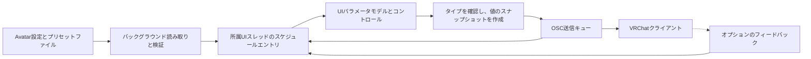

# VRChatアバターのOSCパラメーター調整とプリセット

本プロジェクトは、ヘッドアップレット内でAvatarパラメータを観察、調整、保存する必要がある開発者を対象としています。左側の`grid`にはパラメータ名、タイプ、現在のローカル値が表示され、右側には連続調整、精密調整、リアルタイム送信、プリセットの保存のための入力があります。リアルタイム送信が有効でない場合、パネルは独立して動作し、例データを表示できます。VRChatで公開されたAvatar設定は、ローカルユーザーとAvatar識別子によって保存され、入力定義のアドレスとタイプによってクライアントが受け入れるデータが決定されます。[VRChat Avatar OSCパラメータ説明](https://docs.vrchat.com/docs/osc-avatar-parameters)

## 要求とデータセマンティクス

パネルは編集可能なパラメータと読み取り専用のIDを分離する必要があります。各パラメータには、設定定義、アプリ内の現在の値、送信を待つ値、および遠端からのフィードバックがあります。数字はテーブルセルに残り、ローカルで受け入れられたことを示します。リアルタイム送信をチェックした後、編集送信によってOSCデータメッセージが生成されます。遠端の状態が独立したソースがない場合は未知として保持されます。基本ルーチンでは送信パスのみが表示され、表示値はローカル編集とサンプルから来ています。拡張受信時には、UI上で遠端の最新値と時間を別途表示し、未確認のローカル値がデバイス状態を偽ることを防ぎます。

|タスク|開始条件|観察可能な結果|
|---|---|---|
|設定の読み込み|ソースが存在し、少なくとも一項目が編集可能|表示名に基づいて宣言タイプを表示|
|値を編集|編集可能なセルを選択|検証後にローカルモデルを更新|
|連続調整|適切なFloatパラメータを選択|新しい有限値を受け入れる|
|リアルタイム送信を有効にする|ユーザーがスイッチを明確にオンにする|有効な送信後にのみデータメッセージを生成|
|プリセットを保存|有効な名前を入力し、確認する|一貫したローカルスナップショットを保存|
|Avatarを切り替える|新しいアイデンティティを取得し、新しい設定を読み込む|古いセッションの値が新しいオブジェクトに書き込まれるのを防ぐ|

部屋内のプレイヤーは複数の公開されたAvatarを使用する可能性があり、パネルの診断タスクは現在読み込まれているヘアアイアムを明確にする必要があります。基本ルーチンでは最初に読み取れる設定ファイルを選択し、見つからない場合は固定パラメータを使用します。正式なパネルはユーザーにAvatarを選択させるか、クライアントの`/avatar/change`メッセージを処理し、ファイル名と宣言のアイデンティティを確認した後にモデルを置き換えます。切り替え前に現在の編集と送信待ちの状態を無効にします。特に複数のアカウントがWindowsユーザーディレクトリを共有する場合には、「最新の変更されたファイル」を唯一の信頼できるアクティブヘアアイアムとして直接使用しないでください。

## VRレイアウトと操作

元例程ウィンドウは740×480ロジックピクセルです。デフォルト1.0スケーリング時は約0.74×0.48メートルです。左側にはパラメータ名、タイプ、値が同時に表示され、浮動小数点数、整数、ブールを区別するのに役立ちます。毎回調整する際に異なるページでタブを探す必要はありません。右側には上からリアルタイムオン/オフ、`slider`、`numericupdown`、およびプリセット操作が配置されています。リアルタイム調整用のコントロールは、大きなヒットエリアを持ち、2つの数値入力間に間隔を設けて、手を上げて調整する際に誤ってリアルタイム送信を選択することを防ぎます。長いパラメータ名は英語環境ではより多くの幅を占めることがあります。実際の設定を使用する場合は、最も長い数名をテストした後、横スクロールを許可するか、完全な名前指示エリアを設けるかを決定します。

パネルは`world`または`body`に適しており、操作者がデバッグする際にハンドルと一緒に移動するのを避けます。フォントサイズを増やすと、行の高さ、表のヘッダー高さ、列の幅を同期して調整し、小数点、マイナス記号、値の範囲にスペースを確保します。セルをダブルクリックすると、目標の近くのトリガー可能なコントロールが減少します。右側の状態説明は一行に固定でき、エラーの詳細は別の説明に記載します。片手での検査では、一行を選択してから右側を操作し、現在のパラメータ名が常に表示されることを確認します。実際のシナリオでは近距離テストを行い、ユーザーにリアルタイム送信のオン/オフの違いを直接比較させます。

## アーキテクチャとスレッドの相互作用

UIにはパラメータモデル、選択、下書き、および現在のAvatar世代があります。カタログの読み書き、OSCのエンコーディング/デコーディング、およびオプションのフィードバック受信はバックグラウンドで処理できます。バックグラウンドタスクは、検証済みの数値と目標アドレスを受け取り、UIに構造化された結果を返します。異なるタスクが返される際は、対応するAvatarとパラメータのみに関連付けられ、まず世代を確認し、次に表示を更新します。短い例程では、ファイルスキャンはウィンドウを開く前に行われ、送信はコントロールのコールバックで同期して完了し、単一データのテストが容易になります。複数のファイルスキャン、頻繁な更新、またはOSCの受信を行う場合、スレッドの境界が重要になります。



SDK内部では`control_base`で構築される際に`connection::get_dispatcher()`を通じて所属接続のスケジュールエントリを保存します。アプリケーションはC++またはPythonで`begin_invoke()`を呼び出し、UI更新を発行します。バックグラウンドでパラメータ設定を読み取る際は、通常のデータのみを提供し、UIのコールバック内でテーブルとコントロールを更新します。解析器がたった一つの値を読み取ったとしても、バックグラウンドで`grid.selected_index`を読み取って現在のパラメータを推測することはできません。バッチにはビジネスID、出所、時間が含まれるべきです。ユーザーがリアルタイム送信を一時停止すると、新しいタスクが送信キューに入るのを停止し、策略に従ってキューに入ったが送信されていないタスクを処理します。

## 第一ステップ：設定を読み取り、コンプライアンスのある例を準備する

まず、静的な行からレイアウトと編集を検証します。例のデータは`EarFlop`、`TailWag`、`CoatToggle`でそれぞれ浮動小数点数、ブール値、整数を表します。C++の`load_avatar_rows`はユーザーディレクトリ内のOSC設定をスキャンし、ファイルのエラーをキャプチャまたは解析します。Pythonの`load_avatar_params`は`Avatars`下のファイルを検索し、入力定義を抽出します。正式な実装では、欠落したディレクトリ、ファイルが読み取り不可能、解析構造のエラー、編集可能なパラメータがないことを区別する必要があります。どのようなエラーが発生しても、安全なオフライン状態を維持し、デモ行か有効な設定かを明確にマークする必要があります。

設定の読み取りでは、アイデンティティ、表示名、OSCアドレス、タイプを区別する必要があります。例では`/avatar/parameters/`とパラメータ名を結合し、デフォルトの同名アドレスに適用します。高度な設定では、異なる`input.address`を明確に指定でき、この場合は表示名でアドレスを再構築することはできません。入力定義がある項目のみを選択することで、フィードバックのみを送信する設定を編集可能なパラメータとして扱うことを避けます。読み取り後、タイプが`Bool`、`Int`、または`Float`であることを検証し、他のフィールドには操作不可能な状態を表示します。入力アドレスは有効でOSCの規約に合致していなければならず、内蔵NULや欠落したアドレスがある項目にはエラーチェックを表示し、半分のアドレスを生成することを避けます。

多くのキャッシュされた設定がある場合、バックグラウンドでは候補のパスと時間を一覧表示し、UIは必要なマークのみを表示します。ユーザーが選択した後に完全なファイルを解析します。ウィンドウが起動すると、空の状態またはデモ行をレンダリングし、同じラウンドで読み込みが完了した後にモデルを原子的に置き換えます。ある行を選択した後に2回目の読み取りを開始すると、新しい非同期コールバックに古い行のポインタを残さないようにします。解析結果はファイルの識別子、アバターのアイデンティティ、収集世代を使用します。ゲーム設定が読み取り中に書き込まれている場合は、一度遅延して再試行し、繰り返し失敗するファイルには診断を表示します。元のファイルの権限と内容は、ユーザーとVRChatの管理に任せます。


## 第二段階：テーブルのスキーマと編集可能な境界

`grid`を作成した後、パラメータ名、タイプ、現在の値の3列を設定します。C++の`grid_column_t`では列に`editable`を設定することができます。基本的なC++例では最初の2列を読み取り専用に設定し、Pythonの例ではチェッカーを使用して値でない列を拒否します。実際のプロジェクトでは、2箇所で共に制限を行い、インターフェースのフィードバックとデータのルールを一致させることができます。パラメータオブジェクトを独立したモデルに保存し、`set_data_provider`のリーダーは行と列に応じて値を返します。リーダーはレイアウトのレンダリング時に複数回呼び出され、そのためテーブルを検索するだけで、ファイルを開いたりソケット操作を行ったりしません。

値の送信は、編集、標準化、検証、書き込み、およびビジネス通知のプロセスを経ます。Pythonの例では、列と数値型を`set_edit_validator`でチェックし、エラーは二値の戻り値で診断を返します。C++のデータ書き込み器は、モデルを更新する前に`encode_avatar_packet`で型を検証し、専用の検証器に置き換えることもできます。どちらの方法も、検証に失敗した場合に旧値を保持することを確実にします。エラーが発生した位置を表示するには、`grid_cell_event_args_t`の行とエラーテキストを読み取り、再編集の入口を提供します。ビジネス層は`on_edit_committed`で送信し、各編集文字からデータメッセージを生成しません。ブールセルには、現在の値が文字列ではなく論理量であることをユーザーに知らせるための明確なオン/オフコントロールを使用します。

送信検証時には、整数と浮動小数点数の違いに注意する必要があります。整数は文字列が完全に解析され、符号付き32ビット範囲内にあることを要求します。浮動小数点数は有限の数を受け入れ、32ビット浮動小数点数として表現できます。`NaN`と無限値の送信は拒否されます。ブールは、`0`、`1`、`false`、および`true`などの制御された文字集合を使用し、それを実際のブールデータに変換します。Pythonの`bool`は`int`のサブクラスであるため、コーディングの分岐はまずブールをチェックします。C++の整数は`from_chars`で末尾をチェックし、余分な文字を持つ入力を有効なプレフィックスとして扱わないようにします。統一された標準化された値は、表示、比較、およびプリセット保存に使用できます。

## 第三ステップ：調整とスイッチを使用してリアルタイムパスを構築する

右側の`slider`は0から100の論理範囲を使用し、0.0から1.0の浮動小数点数値に変換します。その後、`numericupdown`を使用して精密なステップサイズを表現します。ドラッグは現在選択されているFloatパラメータにのみ適用され、整数またはブールはタイプが一致する入口を使用する必要があります。スライダーを調整する前に、現在のパラメータと許容範囲を表示する必要があります。プログラムによるコントロールの同期をユーザーの変更から分離します。行を切り替える際には、右側の値と上下限を一時的に抑制して送信するか、または同期状態のマーカーを保持します。そうでない場合、スライダーと数値フィールドの更新は、実際のユーザー操作のような送信結果を生み出します。

基本的なルーチンは`slider.on_value_changed`と`numericupdown`を接続し、後者はモデルを更新します。数値フィールドがスライダーを逆方向に更新する場合は、双方向更新によって引き起こされるフィードバックループを管理する必要があります。標準化された後に実際に変化した値のみをモデルに書き戻し、同期プロセス中に一度だけローカルコンテキストを使用します。変更を選択する際には、色とエラーメッセージも新しいパラメータに基づいてリセットする必要があります。短いコントロール操作の場合、ユーザーは整数またはブールの明確な確認を使用できます。大量の連続的な変化の場合は、UIに最新の値を表示し、バックグラウンドでキーをマージして送信待ちの更新を行います。

データを送信する際、OSCアドレスとタイプマーカーは順番に整列します。ブール型のマーカーは`T/F`で値のバイトは不要です。整数は32ビット符号付き大端形式を使用し、浮動小数点数は32ビット大端IEEE値を使用します。C++では`bit_cast`を使用して浮動小数点数のビット表現を取得し、ビットシフトにより4バイトを順番に出力します。Pythonでは`struct.pack`の大端形式を使用します。送信前に値のタイプと設定の入力タイプを比較します。UIのリアルタイムオプションをオンにした後、合法的な変更のみが送信関数に渡されます。送信が成功したとは、ローカルインターフェースがデータを受け入れたことを意味し、状態エリアに遠端が実行されたことを表示させることはできません。

スライダーの頻繁なインタラクションに対して、プロダクト版ではパラメータに基づいて末尾を統合することができます。キューキーはアバターのレベルとパラメータアドレスで、連続する同じキーの変更は最新の値のみを保持します。ドラッグが終了したら最後の値を更新します。ブールスイッチの順序を強調する場合は、明確なオンとオフを戦略的に一度に統合するのではなく、個別に処理する必要があります。失敗した場合はローカル値を保持し、未送信と表示します。ユーザーは再試行できます。クライアントからのフィードバックを続けて読み取る場合は、フィードバックによるインターフェースの同期とユーザーの送信を区別し、遠端のフィードバックを無効にして循環を発生させることを避けます。


## 第4ステップ：プリセットスナップショットの作成、命名、および適用

基本プロセスでは、モーダルウィンドウを使用してプリセット名を編集します。ユーザーが「保存」をクリックすると、ダイアログは`dialog_result_t::ok`で終了します。外側の関数は名前をチェックし、現在のパラメータスナップショットをユーザーディレクトリのJSON Linesファイルに書き込みます。C++は`save_avatar_preset`を使用して一行のレコードを書き込み、Pythonは名前とパラメータ値のマッピングを構築した後、追加します。保存に失敗した場合はエラーを報告し、現在のパラメータを保持します。この章のスクリーンショットにある`combobox`は、拡張可能なプリセット選択を示すために使用され、「カスタマイズ」は編集中の値と名前付けされたスナップショットを区別しています。実際のコードは現在保存可能であり、ロードとパッケージの切り替えはこのセクションで拡張する必要があります。

プリセットモーダルを開く前に、ビジネス上の意味に基づいて凍結のタイミングを選択します。ポップアップ中に他のコールバックでパラメータを更新することが許可されている場合は、ポップアップ時にスナップショットを凍結し、意味を明確にします。確定をクリックして最新の値を保存する場合は、外側に戻って現在のAvatar世代と編集状態をチェックします。ユーザーがキャンセルするとプリセット集合は変更されません。名前は前後の空白を除去し、長さを制限する必要があります。同名の場合は、新しいバージョンを作成するか、上書きするか、拒否するかを説明する必要があります。安定した識別子と表示名を分離し、名前を直接のパスとして使用することを避けます。名前を入力したからといってファイルの書き込みが成功したわけではなく、書き込みが成功した後に記録が選択可能なプリセットに入ります。

プリセットを読み取る際には、アバターの識別、パラメータのアドレス、タイプの三重のチェックを行います。プリセットを適用する際には、差異リストを構築し、欠けているパラメータ、タイプが一致しないもの、変更予定の値を表示します。確認後、一括でEngineを更新し、各パラメータについて最大1回の送信を割り当てます。未知のパラメータについては問題報告を保留し、クライアントにないオプションを自動的に作成しないようにします。順序依存のパラメータはアプリケーション内で明確にし、例えば一つのモードを有効にした後に数値を設定する必要がある場合などです。実際に依存する操作は、独立した確認インターフェースを待つべきであり、UDP送信キューはトランザクションの代わりにはなりません。プリセットファイルが破損した場合は、解析不可能な行をスキップし、読み取り可能なバックアップを提供することができますが、すべての歴史データを削除する必要はありません。


## 第五ステップ：切断、エコー、および状態の再構築

OSCはUDPを使用し、基本的に持続的な接続を確立しません。ここでの「切断」には二つの意味があります。EasyVRUIのセッションが切断された後、アプリケーションはEngineとの接続を再確立し、UI関連の状態を復元する必要があります。OSCのターゲットが使用できない場合、現在のメッセージには遠端の確認がなく、クライアントのフィードバックのタイムアウトを組み合わせて、相手が到達できない可能性を判断できます。これらはそれぞれ診断のために表示されます。Engineを復元した後、インターフェースデータを再構築できますが、前の世代の残ったリアルタイム操作をデフォルトで再送信することはできません。OSCのターゲットを復元する際には、ユーザーが現在の状態を同期するかどうかを明示的に決定する必要があります。

自分自身のエコーを受け取った後に再送信することを避けるために、モデルに入る際には更新の源を記録します。例えば、ユーザーの編集、プリセットの適用、遠端のフィードバック、またはセッションの初期化などです。ユーザーが承認した操作のみが送信タスクを生成することができます。フィードバックが到着した時点でローカルに更新がまだ処理待ちの場合、どのようなルールで値と時間を比較するかを決定します。信頼できるシリアル番号が欠けている場合、フィードバックは参考としてのみ使用されます。パネルは表示される値の源を明確に示し、最後に受け取った色やスイッチでユーザーが明確に行った操作を覆い隠さないようにします。

## プロジェクトの検証

|入力または操作|予想される結果|診断ポイント|
|---|---|---|
|存在しない設定を開く|デモンストレーション行を表示し、リアルタイム送信をオフにする|ディレクトリの欠如と解析の失敗を区別する|
|Int列に範囲を超える数字を入力する|元の値を保持し、エラーを報告する|完全な解析、記号、および範囲をチェックする|
|Float列に不正な値を入力する|送信をキャンセルし、送信タスクがない|限られた値と単精度の範囲を検証する|
|sliderを迅速にドラッグする|インターフェースの連続したフィードバック、バックグラウンドで最新の値を保持する|マージルールと最終的な送信をチェックする|
|Avatarを切り替えた後、古いタスクが戻る|新しいアバターモデルを保持する|比較タスクとUIレベル|
|プリセット名前付け後に取消|書き込みやドロップダウン状態の変化なし|モーダルな返信と書き込みポイントの確認|
|リアルタイム送信を閉じてから編集|ローカルモデルのみ変更|統一された送信ポイントとスイッチングの判断の確認|

静的なサンプルで各種タイプをテストし、回環受信端でメッセージのアドレス、タイプマーク、バイト順を確認する。実際のクライアント連携では、観察可能で復元しやすいパラメータを使用する。送信前後のローカル値、クライアントの動作、手動で元の値を復元する必要があるかどうかを記録する。プリセットの永続化とリアルタイム送信は別々に検証可能で、ファイルの書き込み成功はネットワーク同期成功とは等しくない。これらの境界を明確にした後、デバッグパネルはアバターを変更したり接続方法を変更したりしても、説明可能な結果を提供できる。

## パラメータチェックを独立した関数に分割する

書き込みポイントは表示文字列で実際のパラメータタイプを決定すべきではない。まず入力を3つの制御された分岐に変換し、その後解析結果をタイプ化されたデータにカプセル化する。C++では、モデルはタイプマーク付きの値や`variant`で合法な結果を表現でき、エラーは別の結果として返される。Pythonでは、ブール値を通常の整数解析から明示的に除外し、出力端でパッケージ可能な範囲を確認する。キーボード編集、ドラッグ、プリセットの適用は最終的に同じチェックを呼び出し、同じ有効な値を得る。コントロールを調整すると正の数値しか入力できない場合、設定で負の値が許可されている場合は、右ペインのマッピングを調整するか、右ペインの処理範囲のみを許可するか、合法な負の値を0にして送信することはできない。

解析が成功したからといって、その値をターゲットに書き戻すことが自動的には意味しない。例えば、パラメータが現在のテーブルに存在しても、現在のアバターに属しているかどうかが確認されていない場合がある。ビジネスポイントは形式のチェックだけでなく、アバターのアイデンティティ、ターゲットアドレス、送信モード、パラメータの制約も確認する必要がある。グラフィックコントロールは原因を反映できる。例えば、パラメータがオフラインになっている、読み取り専用に設定されている、現在選択されているタイプがドラッグをサポートしていないなどである。個別に制限を表示することで、ユーザーはチェックに失敗したのか、適切なオブジェクトを選択していないのかを知ることができる。状態タブの長さは固定で、完全なパラメータ名は専用のテキスト欄に置かれ、既に確認されたモデル値を覆うことはしない。

### 具体的な編集プロセス

まず3つの有効なサンプルでタイプ変換が実行可能かを確認する。ブールクリックで選択した後、実際のブール値が生成され、OSCマークが余分なバイトを持たないことをチェックする。整数サンプルは最小と最大の端値を使用し、境界を超える文字列を試す。浮動小数点サンプルは複数の小数位と異常なテキストを使用し、フォーマットチェックが認識できることを確認する。浮動小数点のスケーリングでは、UI表示の切り捨て精度、通常の保存値、送信されるバイナリ浮動小数点の意味が一致することを確認する。デバッグのためにより高い精度を保持する場合は、詳細欄に原始記録を表示し、一般的なリストは読みやすい短い値を保持する。文字が四捨五入されただけで同じであるため、2回の業務上の値が完全に同じであると判断することはできない。

再テストするプログラムの書き込みパスを確認します。まず一行を選択し、プログラムが右側の入力コントロールを同期させ、自動的に送信されないことを確認します。同じ行に同じ値を入力し、状態が実際に変化した場合のみ業務送信をトリガーします。ある値が他のコントロールの連動によって変化した場合は、更新源をマークし、元の源がループしてトリガーされるのを防ぎます。この判断を統一送信エントリポイントに記述し、各ボタンに分散させないようにします。新しいプリセットアプリケーションを追加したり、デフォルト値を復元したりする際に、合法性チェックとエラー処理を再利用できます。バッチ更新時には、どのパラメータを送信すべきかを記録し、すべての値が確認された後に再調整を行います。最初の列を更新する際に、まだ完全に設定されていないコンフィギュレーションをクライアントに送信することを避けます。

## 組み合わせ状態：ブラウズ、編集、送信、保存

パネルは「選択されたパラメータ」と「プリセット選択」を管理でき、それぞれ保存されます。既存のプリセットを選択すると、プリセットの概要を先に表示し、ユーザーが適用をクリックするまで項目ごとに更新しません。現在のパラメータをドラッグすると、プリセット状態をカスタムに切り替え、古い名前で新しい値が表示されるのを防ぎます。新しいプリセットを保存した後にのみ、カスタムを新しい名前のプリセットに変更します。ユーザーが編集中の状態はプリセットリストから独立しており、ドロップダウンメニューによって再読み込みされることで予期しない入力がキャンセルされることがないようにします。ドロップダウンメニューをクリックして同じ項目を選択しても、重複して送信すべきではありません。機能拡張を研究する際には、まず選択と概要を完了し、実際の適用の分岐を実現し、最後にネットワーク同期を追加します。

|操作|状態の変化|設定が必要な戦略|
|---|---|---|
|テーブル行の切り替え|右側のエディターが現在のパラメータに追従する|プログラム同期が送信をトリガーするかどうか|
|プリセットの選択|内容の概要表示|即時アプリケーションするか、独立したコマンドで確認するか|
|単一値の変更|カスタム状態に変わる|保存と送信のフィードバック方法|
|保存に失敗|作業スナップショットを保持する|プリセット名を保持して再試行するかどうか|
|Avatarの変更|プリセットとキューはアイデンティティによって制限される|古いアイデンティティのローカルスナップショットを保持するかどうか|
|Engineの再接続|UIが新しいセッションで復元する|ユーザーが明確に再同期する必要があるかどうか|

設定ファイルのレベルでは、プリセットはバージョン、アバターのアイデンティティ、およびアドレスとタイプが一致する値を保存するべきです。後で単一値のログや比較機能を追加する場合は、プリセットのスナップショットに混在させないでください。タイプが不足している古い記録を読み取る際には、現在の設定を実際に確認し、移行できないエントリには説明を出します。毎回の書き込みが成功した後にのみ、ドロップダウンリストを更新します。同時使用時はファイルごとに書き込みをシリアル化し、2回の保存が互いに上書きしないようにします。JSON Linesを追加する場合は、最後の行が不完全な場合でも読み取って報告します。ファイル全体を置き換える場合は、同じディレクトリ内に一時ファイルを作成し、完全に書き込んだ後に目標ファイルを置き換えます。どちらも、スペース不足や権限拒否を模倣するための独立したテストディレクトリを使用します。

## 送信キューでの再現実験

浮動小数点の調整には、持続的なハンドルの操作よりも安定した比較が可能な分时スナップショットテストを使用します。1秒以内に複数の固定サンプルを入力し、各サンプルには連続した番号を付け、遅い送信間隔で検証を行います。UIではサンプリングが即座に反応し、キューには送信すべき最新の値のみが保持されます。ドラッグを終了した時点で最終値を送信キューに渡します。その後、別の行で別のパラメータをドラッグし、バックグラウンドキーの次元がパラメータのアドレスとセッションの代次であることを確認します。最初の行の歴史は2番目の行を上書きしてはなりません。リアルタイムを停止した後、1周期待ってから、キャプチャ側は定義されたクリーニング戦略に従って新しいパケットの受信を停止します。

ループバックの受信側で各パケットのアドレスとタイプを記録します。Pythonのパッケージング結果とC++のシフト出力を比較し、統一された入力データを使用して不必要な形式のノイズを避けます。時間、データグラムの数、最後のビジネス値を同時に記録でき、完全なゲームセッションの内容を保持する必要はありません。クライアントがローカル送信と一致しない場合は、まず入力設定がカスタムアドレスを指定しているかを確認し、次にターゲットモードを確認します。サーバーがそのアドレスを受け入れることを確認した後のみ、問題を調整コントロールに帰属させます。複数のデータソースが同時に更新される場合は、まず疑わしいソースを一時停止し、選択した行を観察して、デバッガーが有効なフィードバックを上書きするのを避けます。

## リリース前の移行と復元実験

偽のAvatar切り替えイベントを使用して**世代**の変化をテストし、作業中の保存や書き込みのコールバックが新しいモデルを変更しないようにします。準備する旧プリセットには、正常なパラメータ、削除されたパラメータ、タイプが変更されたパラメータを含めます。読み込み後には、確認可能な差異リストが得られる必要があります。ユーザーは有効な部分を適用するか、全体のトランザクションをキャンセルすることができます。検証では古いファイルをクリアしないようにし、元のスナップショットを保持して修正を待つことができます。書き込みに失敗した場合は、現在の状態が依然としてカスタムとしてマークされているか、ユーザーが名前を変更して再試行できるかを確認します。インデックスドキュメントのデータファイルは非常に短いパスを使用でき、エラー状態のテキストはデータソースの名前を保持しつつ、個人パス全体を公開しないようにする必要があります。

デバッグが成功した後、**HMD**内の持続的に観察する必要のある行の幅と現在の**タイプラベル**を再調整する必要があります。片手でドラッグと選択の2つの動作を交互に行うテストを行います。コントロールが遠距離で誤ってタッチされる可能性がある場合は、フォーカスエリアと安全距離を優先して拡大します。状態、現在の値、送信予定のヒントが同時に識別できるかを確認します。プリセット操作の確認ボタンには、「命名スナップショットを保存する」や「選択したパラメータを適用する」といった明確な動詞が含まれるべきです。ユーザーは、現在のアプリケーションがどのモードにあるかを推測することで、ゲーム内の**アバター**が変更されるかどうかを判断してはなりません。受け入れ条件と視覚的な効果を記録することで、実際のゲームデータがない状態でも、ほとんどのロジックを再現することができます。

## 完全なプロジェクトとビルド

[環境構築・ビルド・インストール](/ja/basics/01_install_and_setup)に従ってEngineを起動します。チュートリアルのリポジトリのルートでx64用の開発者コマンドプロンプトを開き、次のコマンドを実行します。SDKのパスは実際のインストール先に置き換えてください。Visual Studioジェネレーターでは、実行ファイルはReleaseサブディレクトリにあります。

```bat
cmake -S examples/projects/03_vrc_avatar_osc/cpp -B .work/vrc_avatar_osc -DEASYVRUI_ENGINE_INTERFACE_ROOT=D:/Tools/EasyVRUI/sdk
cmake --build .work/vrc_avatar_osc --config Release
.work\vrc_avatar_osc\Release\vrc_avatar_osc.exe
set "EASYVRUI_SDK_ROOT=D:\Tools\EasyVRUI\sdk"
examples\projects\03_vrc_avatar_osc\python\run.cmd
```

### C++

<<< ../../../examples/projects/03_vrc_avatar_osc/cpp/main.cpp

### Python

<<< ../../../examples/projects/03_vrc_avatar_osc/python/vrc_avatar_osc.py
