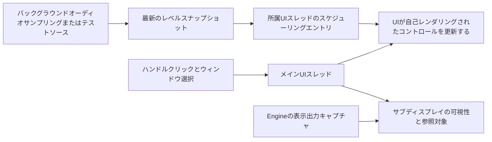

# 手首HUD、screen、レベルメーターの描画

本プロジェクトでは、2つの原生`window`を使用してVR監視ワークスペースを構築しています。1つは左手に沿って移動し、コンパクトなマイクレベルとサブスクリーンエントリを表示します。もう1つはコンピュータ出力を表示し、身体の参照下で読みやすい空間位置を維持し、設定に応じて曲がります。基本プログラムは、アンカリング、表示/非表示、ディスプレイ選択、および自動生成のコントロールを担当します。レベルは例示値でデモンストレーションされます。WARP画像は、32%と78%のテストサンプリングを使用し、更新後のレイアウトの変化を表示します。ヘッドレスサブスクリーンはプレースホルダーコンテンツを使用し、実際の出力は収集能力のあるEngineによって提供されます。

## 要求、メインウィンドウとインタラクションの選択

「状態を確認する」と「画面を読む」を分離します。手首HUDは短時間のスキャンに適しており、レベル、ソース状態、サブディスプレイコマンドを1つずつ表示できます。サブディスプレイは長時間の視聴に適しており、より大きな物理幅、より安定した姿勢、および独立した表示と**スリープポリシー**が必要です。ユーザーは手首を見るだけの場合、サブディスプレイを継続して見る必要はありません。再開時には、レイアウトが予測可能である必要があります。ディスプレイの切り替え、トラッキングの失敗、マイクの欠如はそれぞれ処理され、どのような異常も他の操作を妨げてはなりません。

|使用シナリオ|手首ウィンドウ|サブスクリーンウィンドウ|
|---|---|---|
|VRに入った後でレベルを確認する|現在のサンプリングと利用可能性をコンパクトに表示する|隠したままにする|
|デスクトップを表示する|エントリが視覚的な状態を提供する|設定された姿勢で表示する|
|左手を素早く動かす|コントロールが参照に沿って動く|独立した参照対象で位置を決定する|
|ディスプレイを変更する|収集状態の変化を通知する|目標領域を保持し、新しい画面を待つ|
|トラッキングが利用できない|状態が読み取れるか、戦略に従って戻る|参照は復帰後に再計算できる|
|メインツールを閉じる|サンプリングと更新待ちのタスクを停止する|アプリケーションのライフサイクルに応じて隠すか閉じる|

手首上の表面は主に右手のレーザーで操作される。スイッチを手首の関節から離れた位置に置き、手を離す、手を上げる、自然に頭を下げるの3つの姿勢をテストします。左利きのユーザーは参照と位置をミラーし、ボタンを動かす前に2つの持ち方が安定して見えるかを確認します。手首上のコントロールは複数のタブを積み重ねるべきではなく、移動するウィンドウ上で長いテキスト入力を行うことは避けるべきです。明確なテキストとグラフィックを組み合わせて使用し、レベルの変化はバーで表し、データの収集状況はテキストで説明します。サンプリングとサンプリングの等しい場合は、状態上で区別されるべきです。前者はソース状態であり、後者は測定値です。

## 物理サイズ、フォントサイズ、アンカーポイント

例えば、腕部の表面の論理サイズ260×220で、物理スケール0.65の時、展開幅は約0.169メートル、高さは約0.143メートルです。コントロールの論理フォントサイズ16は、この比率での名目上の物理高さは約10ミリメートルですが、実際の文字の見える高さはフォントと視点の角度によって影響されます。ウィンドウを手に近づけて軽く傾けると、自然な視線が水平線をちょうど通過するようになります。ディスプレイは約960×560論理ピクセルで、観察距離が遠い場合、文字はより大きくなければなりません。サブディスプレイの初期スケールがソースから継承される場合、腕部の0.65が小さくなる可能性があります。明確なサブディスプレイの目標サイズを得るためには、最初の表示前に自分の`physical_scale`を明示的に設定する必要があります。

`left`と`right`はコントローラーの位置と向きに従います。腕部の`position`は、参照対象に対するメートル単位の位置で、例では手の幾何学と観察方向を保持するために3つの成分が使用されています。回転は度で指定され、C++の`vec3_t`とPythonの`vec3`は同じ単位を使用します。設定時には、まず単軸回転を校正し、その後回転を組み合わせます。サブディスプレイは`body`を使用して人体の平行移動に従い、校正された向きを保持するか、または`world`に固定することができます。短時間のユーザーに近い提示は`head`に適していますが、大きなサブディスプレイは**長期間頭部に追従して世界を遮ることを避けるべきです**。

デバッグ時には、位置、比例、回転、曲率を段階的に設定します。まず平面から物理的な幅と高さが適切かどうかを確認し、その後目標距離を調整します。サブディスプレイの側縁を通じて、曲率がマウスやレーザーの相対位置に影響を与えるかどうかをチェックします。外観は非曲面のWARP画像で先に検証できますが、ヘッドマウントディスプレイ内で3D位置、両手のアクセス可能性、異なる姿勢での可読性を確認する必要があります。ヘッドなしのスクリーンショットのタイトルには空間属性値が説明されています。平面画像はSDKがレンダリングした表面のみを記録し、SteamVRでのトラッキングと曲面の組み合わせは別途検証されます。


## アーキテクチャとスレッドの責任

サンプリングソースは、オーディオキャプチャコールバックまたはテストジェネレーターであることができます。キャプチャスレッドはオーディオブロックを読み取り、0から1までのレベルに圧縮し、データ、タイムスタンプ、ソースレベルをスナップショットにパッケージします。UIスレッドは現在のソースと表示ウィンドウを維持し、最も最近のスナップショットを周期的に読み取り、自己レンダリングされたコントロールを更新します。画面キャプチャはEngine側のパスを通じて行われ、SDKは`screen_id`と目標矩形を送信します。オーディオデータの変更は自身の状態を適用し、デスクトップのレンダリングはレンダリングサービスから提供され、両者はサンプリングスレッドやGPUリソースを共有しません。



アプリケーションは公開された`begin_invoke()`を使用してUIスレッドに更新をスケジュールします。SDK内部の`connection::get_dispatcher()`は、接続のコールバックポイントを提供し、コントロールは構築時にそのポイントに渡す関数を保存します。このインターフェースはSDKの実装に属します。サンプル拡張は、アプリケーションを接続の内部キューにバインドするのではなく、C++またはPythonコントロールの公開送信インターフェースを通じて行われるべきです。サンプルブロックは数ミリ秒のオーディオに対応する可能性があり、すべてのブロックにUI更新を一度ずつ送信することはできません。原子的最新スロットまたは相互排他保護の単一レコードを使用して、キューに同時に存在する更新数を制限できます。実際の更新時には、現在のソースに一致するスナップショットを読み取り、その後UIがレベル、状態、色を変更します。

## 第一ステップ：blank予約レイアウトの使用

まず`window`を使用してタイトル、サイズ、位置を設定し、次に予定された位置に`blank`を配置して、自描画領域の座標源とします。Pythonのサンプルは`blank_meter`を作成し、そのローカル矩形を読み取り、実際の`mic_meter_control`に渡します。C++のサンプルは同じ矩形を直接使用して自描画インスタンスを構築します。ウィンドウデザイナーを使用する場合、レイアウト出力をコンポジットオブジェクトに封じ込め、初期化後にプレースホルダ矩形とインデックスを読み取り、実際のコントロールに置き換えます。SDKの`blank`は描画やフォーカスには関与しません。コントロールはカスタム描画タイプに使用され、ウィンドウを組み立てる際には引き続きコンポジット記法を使用できます。

位置に基づいてコピーする際には、ローカル`rect`を読み取り、絶対位置を同じ親コンテナに書き戻さないでください。プレースホルダ矩形は幅と高さ、相対位置を担当し、実際のレベルコントロールはスタイル、リフレッシュトリガー、ヒットルールを担当します。タイトルバー、セーフフレーム、サブスクリプトボタンの位置を確保し、ボタンはプログレスバーから分離します。まず固定レベルでバーフレームとフォントの完全な収容を確認します。ウィンドウの幅が縮小される場合は、自己描画領域の利用可能な内部幅と高さをチェックし、限られた状況下で状態のみ表示に降格することを許可します。モデルはテンプレート内のハードコーディングされた絶対座標に依存してはなりません。

## 第二ステップ：自己描画と値の変更の実装

カスタム`control`を使用して`render(context)`を書き換えます。C++では`context.get_rectangle(*this)`を使用して描画矩形を得て、Pythonでは対応するジオメトリを読み取り、背景とレベルバーを構築します。統一された内側余白を使用してトラックの長さを計算し、レベルの正規化値を最大長さに乗じます。まずトラックの幅と高さが正であることをチェックし、レベルがゼロの場合は背景とテキストのみを描画します。まず丸みを帯びた背景を描き、次にアクティブバーを描き、最後に数字を描画します。テキストは識別可能であり、アクティブバーの色に依存しません。必要に応じてテキストに安定した背景を使用し、全範囲とゼロ範囲の両方でコントラストを持たせます。

現在のPythonの`set_level`は0から1をクランプ、`invalidate()`を要求します。C++の基本例では静的な値と例文を保持し、クラスに同じ値の更新入力を追加し、実際のレベルに応じてパーセンテージを構築します。可視値や状態が変わる場合のみ、再描画を要求します。UIは固定のリズムで最新のレベルを消費し、収集と再描画の結合度を減らします。不適切な単位で更新すると、すべての値が満杯に近づく可能性があります。まず、正規化と表示マッピングを検証し、境界0、1、および非有限値をテストします。不正な数値は、描画計算に入る前に識別されるべきです。


### サンプリングのエンジニアリング実装

実際のオーディオ版を作成する際には、ピークかRMSかを明確に計算します。ピークは短い衝撃に対して迅速に反応し、RMSは持続的なエネルギーにより近いです。オーディオブロック内では、チャンネルごとに絶対ピークを取り出すか、二乗和の平均の平方根を計算することができます。ソース収集設定のサンプリングレート、サンプルフォーマット、チャンネル数は、表示ロジックとは別にします。入力フォーマットが変わると、新しいソースレベルを作成し、前の世代のサンプルを捨て、明確な初期状態を保持します。描画コールバックでオーディオデバイスを要求したり、読み込みバッファをブロックしたり、書き込み中の可変配列にアクセスしたりしないでください。

読み取りは、速い上昇と遅い下降の戦略で可読性を向上させることができます。閾値は実際のサンプリング周期で計算され、レンダリングフレーム数ではない場合、低フレームレートでの下降速度が変わります。デシベル表示に変換する前に、ゼロ値を明確に処理し、正の振幅値のみが対数に取れます。デバイスが接続されていない場合は、異なる状態テキストを保持し、「0%」が静音と誤解されるのを避けます。デバッグ時には、低、中、高、静音の固定シーケンスで各レベルをカバーし、入力からUIの変化までの遅延を記録します。実際のデバイスに基づいて、サンプリングが停止した後にインターフェースが待機状態に移行することを先に検証し、過ぎ去った値が常に高レベルで停止することはありません。

## 第三ステップ：screenとサブスクリーンのライフサイクルを管理する

第二の`window`を作成し、`screen`をその内容として使用します。実際の表示アドレスは、Engineが置かれているコンピュータの出力番号に依存します。リモートアプリケーションのファイルパスやディスプレイの数は、Engineの出力を推測することはできません。`screen_available`と2つの変化イベントを簡潔な状態に変換します。実際の表示画像がない場合は、同じレイアウトを保持し、プレビューエリアで待機状態を表示し、他のコマンドの位置を変更しないでください。例では0の出力を選択し、WARPキャプチャは無効な番号を使用して、実際のデスクトップをキャプチャするのを避けます。`screen`のセクションの可用性と番号処理を参照してください。

副画面の表示には`show()`を使用し、一時的な非表示には`hide()`を使用します。非表示時でもアプリケーションで定義されたレイアウト状態は保存されますが、実際に閉じるには新しいウィンドウを作成する必要があります。例えば、`visible`に応じてボタンが切り替わります。デプロイメントでは、メインウィンドウが閉じたときに副画面がどのように処理されるかを確認する必要があります。なぜなら、通常のウィンドウの可視性と閉じる数は、アプリケーションのループ終了条件に影響を与えるからです。メインウィンドウが閉じる前にサンプリングを終了し、副画面を明示的に非表示または閉じるように定義できます。これにより、メインウィンドウが閉じただけで副画面が空間に独立して残ることを避けることができます。副画面を長期間使用する場合は、独自の閉じる動作と再表示の入口を提供する必要があります。


## 第四ステップ：参照対象と曲率の切り替え

ウィンドウが初めて位置づけられるときは`startup_position.none`を使用し、アプリケーションで設定されたローカル位置と姿勢を使用します。手首と副画面で使用される参照対象をそれぞれ設定します。ウィンドウが既にシーン内にある場合、切り替え後も現在の位置を保持したい場合は`reparent(reference, keep_world = True)`を使用し、古いローカル座標を再解釈する必要はありません。目標参照が利用できない場合は、まず`is_tracking_available()`を検索し、提示します。デバイスが復元した後に実行します。例では、主要な参照設定を初期化し、拡張シーンにはボタンやドロップダウン入力を追加できます。現在の参照対象とモードの提示をユーザーが一目で見える位置に保持します。

`curvature`の単位はメートルの逆数です。これを展開幅に乗じて、弧度の意味での弧角の制約を得ます。範囲は`window`の属性とインタラクションに応じて処理されます。同じ展開幅で、曲率値が増加すると水平の円柱面が引き締まります。設定前に計算された論理幅と現在のスケールを確認し、値が適切かどうかを確認します。平面を復元する必要がある場合は0を設定します。曲率を切り替えた後、ハンドルで両側の端と中央のボタンを確認し、ヒット領域と外形を再確認します。アンカーポイントを変更する場合は、体を動かしたり頭を回したりして、平行移動と向きが選択した参照に合致しているかを確認します。スクリーンショットでは表面内の属性のみを比較しますが、実際の空間動作は追跡可能な環境で検証する必要があります。


## 第五ステップ：リソース、復元、Desktop登録

レベルコントロールは少量の状態を保持し、バックグラウンドでサンプリングソースを維持します。非表示状態ではUIの更新頻度を下げることができますが、サンプリング作業を停止するかどうかはビジネスニーズに依存します。スイッチが再表示されるときは、現在のソースの最新値で一度更新し、残留する期限切れのレベルを避けます。デバイスが削除されたり、番号が切り替わったりすると、ソース状態を再構築します。新しいウィンドウを変更する場合は、古いセッションの最後のコールバックでは行わないでください。ウィンドウが閉じる際には、ワークスレッドの停止シグナルを使用し、リソースが解放された後にコントロールの所属をクリーンアップします。読み込み中のソースについては、結果にソースのレベルを含めて、期限切れの作業を捨てることができます。

Desktopでの登録時、リストは名前、アイコン、起動方法を担当し、空間姿勢はアプリケーションコードで設定されます。実行可能ファイルやスクリプトをインストールルートの`app/wrist_watch/`に置き、リストのパスを基準にエントリーポイントを設定し、その後リストのパスをDesktopのユーザー設定に追加します。DesktopがSDKを通じてPythonバージョンを起動する際は`sdk/api/python/`を使用します。CMDで直接実行する場合も同じインストールされたSDKを使用します。リモートEngineは独立した接続パラメータを使用し、収集されるスクリーン番号はそのEngineに属します。手順は[空間位置、カスタムグラフィック、Desktop登録](/ja/guide/08_spatial_drawing_deploy)を参照してください。

## 受け入れと障害の再現

|環境の変化|目標のチェック|処理方向|
|---|---|---|
|固定サンプルが低値から高値に跳ねる|条長と数字が同時に変化する|UIが最新のサンプルを消費し、効果的に再描画されることを確認する|
|音声ブロックが取得されない|表示待ちまたはソースの異常|欠損とゼロ信号を区別する|
|副画面を2回開閉する|可視性が回復し、設定が保持される|ライフサイクルが再利用可能な表面を閉じているかを確認する|
|出力デバイスが退出する|収集エリアの表示状態|`screen_available`と番号を確認する|
|ウィンドウを別の参照に移動する|世界の姿勢が保持されるか、予期通り再解釈される|呼び出し前後の座標基準を比較する|
|曲率を大きくするとボタンの端が命中しにくくなる|実際のレイアウトが触れることができる|スケーリング、位置、曲率を別々に校正する|
|プログラムを終了した後、バックグラウンドを確認する|タイムリーに退出し、収集が停止する|未処理のタスクとリソース参照があるかを確認する|

まずWARPで矩形、グラフィック、状態テキストを検証し、実際のデバイスで振幅、空間トラッキング、副画面の内容を確認する。音声レベル、GPU画面状態、参照対象の状態をそれぞれ記録することで、デバイスが停止したか、接続が変わったか、UIが送信されなかったかを特定することができます。明確な位置、デバイス、観察距離を確認した後、ユーザーは同じシーケンスで問題を再現でき、どの移動がウィンドウの跳ね返りを引き起こしたかを推測する必要はありません。

## 振幅を安定して読み取り可能なフィードバックに変換する

サンプリング前に表示対象を確定する必要があります。短時間のピークを表示する必要があるか、持続的な平均レベルを見る必要があるか、または静音、正常、超過の区別だけが必要かを判断します。チームメイトとのコミュニケーションを目的としたHUDは、通常、自分が話しているかどうかを表示する必要がありますが、測定器のように常に更新する必要はありません。設計の基準化層では、入力信号の単位と出力モデルを明確に記述します。まず1分間の固定サンプルを生成し、低レベルから高レベルへと上昇し、再び静音に戻り、途中でソースが失われる状態を挿入します。これらのサンプルを使用して表示をチェックすると、実際のデバイスを調整するよりも再現性があります。

### 静的な数値から最新値スロットへ

基本ルーチンは、自作タイプに固定値を与えます。第一ステップは、ノーマライズデータとサンプリングの有効性を受け取る独立した数値設定関数を追加します。この関数では、前回表示可能だった値と比較し、表示精度を超える変化がある場合にのみ`invalidate()`を呼び出します。第二ステップでは、ソースデータをバックグラウンドに置き、最新のスナップショットのみを保存します。スナップショットには、アクティブなソース番号、サンプリング完了時間、値、および有効性を維持することができます。UIは自身のペースで現在のスナップショットを消費し、ソースが変更された後は古い番号のデータを拒否します。第三ステップでは、更新頻度の上限を加え、実際の消費に基づいて測定し、特定のサンプリングデバイスのブロックサイズを視覚的な更新頻度にハードコーディングしないようにします。

単調なクロックを使用してUIを更新する場合、期限が来たらスナップショットスロットから値を取ります。サンプリングスレッドの読み取り速度がUIよりも速いことが一般的であり、すべての記録をバッキングすると遅延が増加し、不必要な中間値が保持されます。最新値スロットは現在のレベルを表示するのに適しています。歴史的な折れ線を表示する必要がある場合は、固定長のサンプルキューを別に作成し、定期的にグラフ用の歴史的集団を計算し、歴史的な保存が現在のレベルのフィードバックを決定することができません。ソースを一時停止した後、インターフェースがタイムリーに未知の状態に切り替わるかどうかを確認します。バックグラウンドでは、デバイス診断、サンプリングカウント、振幅のみを記録し、オリジナルのオーディオを保存しないことで、ほとんどのデバッグを完了できます。

C++は、デバイスのコールバック内で軽量な数値計算を行い、長時間ロックを保持しないようにするべきです。更新される値をワークスレッドまたは独立したキューに渡した後、コントロールを通じてUIに返します。Pythonでは、ロック付きのデータオブジェクトまたはスレッドセーフなキューを使用してスナップショットを保存し、次に`begin_invoke()`を呼び出します。イベントオブジェクトを直接使用して、オーディオコールバックで複用されている可変配列を渡さないでください。一連の状態を更新する必要がある場合は、まずUI内で実際の値を送信し、次に複数のコントロールを更新します。現在のウィンドウの可視性を下げて更新頻度を減らす場合は、再表示前に最新のスナップショットを一度読み取り、現在のソースに対応させます。

### フィルタリングとサンプリングの変化の実習

ピークと減衰には共通の時間尺度を使います。0から固定の高い値に跳ね上がる入力で、表示をもっと速く立ち上げる必要があるか確認できます。徐々に下がる列で、減衰時間が見やすいか確認します。小さな揺れのたびに再描画すると、表示位置が前後するだけです。表示精度に合わせて丸めてから更新の要否を決めれば、バックグラウンドのサンプリング値そのものは維持できます。デバイスの状態変更は、振幅のフィルターに埋もれないようすぐ反映します。1.0を超える値と負の値は範囲内に収めます。非有限値は、先にデータが無効であることを報告します。デバイスを利用できない状態とレベルがゼロの状態は、別々に表示します。描画コールバックは同じUI値を読み、1回の状態更新から色、バーの長さ、数字を決めます。

## 空間位置を第二の状態機械として扱う

通常のアプリは、デフォルトの追跡、ユーザーの移動、ハンドルの喪失、参照対象の切り替えに直面する。`left`を選択すると「左手の参照にバインドする」と解釈されるが、これは左手の情報がその時点で利用可能であることを意味するわけではない。完全なツールでは、期待される参照対象、最後に解析可能だった姿勢、現在の回復戦略を維持することを推奨する。左手が一時的に使用できない場合は、必要に応じて手首を隠したり、最後の状態を一時的に凍結したりすることができる。回復後、参照の利用可能性を再確認し、世界位置を保持するかどうかを決定する。同じ局所座標を新しい参照に即座に適用すると、ウィンドウが手元から部屋の反対側に飛ぶ可能性がある。ユーザーは、自分が選んだのは元の位置を保持するか、新しい参照に基づいて再配置するかを明確に理解する必要がある。

|操作|読み取りが必要|予想される変化|
|---|---|---|
|初期追従の設定|目標参照の利用可能性と局所姿勢|明確な最初の位置決めの確立|
|元の位置を保持する切り替え|旧世界の姿勢と新しい参照|基準を変更するだけで、世界の外観はできるだけ維持する|
|再位置決めの切り替え|新しい参照と新しい局所オフセット|予定されたレイアウトの適用|
|デバイスが追跡を失う|元の状態と最後に利用可能だった値|隠すか安定して待つに降格|
|平面表示の回復|現在の幅と曲率|外形を変更し、ビジネスレイアウトを維持する|

ユーザーがウィンドウに手を近づけ、手首を回し、視野を切り替えるとき、ウィンドウが常に適切な位置にあるかを観察する。開発時は世界参照から始め、まずウィンドウの内容を検証し、次に左手と身体の参照を加え、最後に曲面を加える。これにより、UI座標の誤り、軌道位置の計算誤り、空間追跡の誤りを分離して排除できる。サンプルスクリーンショットのbodyまたはworldの文字は現在の設定を報告しているが、平面PNGが実際の3D局所姿勢を表しているわけではない。空間位置を検証する際には、ヘッドマウントとハンドルの状態を記録し、同じ初期姿勢でステップを繰り返す。

### サブスクリーン出力のライフサイクルと観察コスト

画面出力には、起動中、利用可能、一時的に利用できない状態、ソースが変わった状態があります。補助画面を開いた直後は待機中と表示し、ソースの復旧通知を受けてから説明を更新します。出力番号を変更したときは、古い画像を新しい番号のまま表示し続けないようにします。比較のために直前のフレームを保持する場合は、「前の画面」と明記します。ソースに依存しないレイアウトと操作は維持し、画面の内容部分だけをプレースホルダーに切り替えます。非表示中に必要な描画はアプリの要件に合わせて減らします。実テクスチャはSDKとEngineが管理し、アプリは現在表示すべき出力を指定します。

補助画面は、手首HUDより広い空間を使い、視線を移す負担も増えます。まずデスクトップを1面だけ表示し、文字が十分に読める状態にしてから、曲率が左右に与える影響を調べます。幅が大きすぎると何度も首を振ったり、端の操作を見失ったりします。小さすぎるとデスクトップの内容を読み取れません。よく使う1行のテキストで、テーマのコントラストと操作対象の大きさを確かめます。操作できる環境では、手首HUDから補助画面を切り替える操作、ディスプレイの切断・復帰、ウィンドウの寿命を検証します。アプリを終了する前に音声処理を停止して、設計どおりに2つのウィンドウを閉じます。バックグラウンドスレッドと2つのウィンドウ面の所有関係を明確にし、最後に通知を受けたウィンドウがその作業の所有者だと仮定しないようにします。

## 拡張版の構築順序

既存のC++の`mic_meter_control`とPythonの同様の実装から始め、第一ラウンドでは安定したレベル状態のみを導入します。両方の側でコントロールに同じ近似値の更新入口を提供します。第二ラウンドではテスト生成器を接続し、固定シーケンスをシミュレートし、更新ルールを検証します。第三ラウンドでは実際のデバイスの初期化と解放を追加し、テスト入力の切り替えを保持します。第四ラウンドでは、互いに干渉しないコマンドをそれぞれ副画面の表示、復元平面、および参照の切り替えに接続します。最後に遠隔Engineおよびディスプレイの選択の違いを処理します。新しいインターフェースを一度だけ導入し、無頭レンダリングを実行した後、新機能をヘッドセットで検証し、実機で同時にいくつかの未知のシステムを調整することを避けます。

「グラフィックは動くが値が変わらない」場合は、表示レベルとモデルレベルが同じスナップショットから来ているかを比較します。「値は変わるがバーが動かない」場合は、軌道計算とクランプが0から1に処理されているかを確認します。ウィンドウが表示できるが実際の画面がない場合は、現在のEngineが対応する番号を収集できるかを確認し、目標ホストがどれであるかを確認します。手首の空間が正しくない場合は、まず`world`に一時的に切り替えて二次元コンテンツを確認し、その後別の参照系に戻って姿勢を比較します。この順序により、診断はデータ、レンダリング、収集、および空間変換の明確なパスに分かれて行われます。

## 完全なプロジェクトと構築

まず[インストールと環境設定](/ja/basics/01_install_and_setup)でEngineを起動します。チュートリアルリポジトリのルートディレクトリのx64デベロッパーCMDで以下のコマンドを実行し、SDKのパスを実際のインストール場所に変更します。Visual Studioジェネレーターを使用する場合、実行ファイルはReleaseサブディレクトリにあります。

```bat
cmake -S examples/projects/04_vrc_wrist_hud/cpp -B .work/vrc_wrist_hud -DEASYVRUI_ENGINE_INTERFACE_ROOT=D:/Tools/EasyVRUI/sdk
cmake --build .work/vrc_wrist_hud --config Release
.work\vrc_wrist_hud\Release\vrc_wrist_hud.exe
set "EASYVRUI_SDK_ROOT=D:\Tools\EasyVRUI\sdk"
examples\projects\04_vrc_wrist_hud\python\run.cmd
```

### C++

<<< ../../../examples/projects/04_vrc_wrist_hud/cpp/main.cpp

### Python

<<< ../../../examples/projects/04_vrc_wrist_hud/python/vrc_wrist_hud.py
