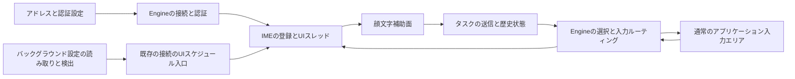

# リモート配置と顔文字入力

このプロジェクトでは、軽量な入力コンポーネントを別のコンピュータ上で実行し、レンダリングホスト上のEngineを通じてSteamVRに表示します。ユーザーは通常のアプリケーションで入力エリアを開き、絵文字IMEに切り替え、事前定義されたテキストを選択して送信します。コンポーネントを実行するコンピュータ、Engineが存在するコンピュータ、編集中のアプリケーションは異なる場合があります。デプロイメント時には、まずデータパスを確認し、次にウィンドウのインタラクションと切断後の復旧を設計します。完全なプロセスでは、最小限の絵文字送信と通常の入力転送を実現し、章内のリモート設定ウィンドウ、グループタブ、最近使用されたものは再現可能な拡張シナリオです。

## 要求と境界

3つの独立した検証を完了する必要があります。まず、リモートアプリケーションがEngineと認証されたセッションを確立することができます。次に、セッションがIMEとして登録され、現在の入力コンポーネントとして選択されることができます。第三に、1回のクリックで現在のアプリケーションの入力エリアにテキストを送信できることができます。いずれのステップも失敗した場合は、対応するステージの状態を表示する必要があります。リモートセッションが成功した場合、アプリケーションが編集中でない可能性があるため、顔文字インターフェースを隠すことができます。接続の確立は入力コンポーネントの選択を代替するものではなく、クリックして送信することもリモートセッションの生存の唯一の判断基準ではありません。

|ステージ|依存関係|観察可能な結果|
|---|---|---|
|位置情報サービス|正しいEngineホストとポート|ネットワークが目標に到達可能|
|身元確認|サーバーの公開鍵フィンガープリントとアクセスクレデター|クライアントが目標を受け入れ、セッション認証を完了する|
|登録|同一セッションのロールがIMEとして固定される|コンポーネントが適切な切り替え項目に表示される|
|アクティブ化|通常のアプリケーションが入力エリアを開いている|Engineが現在の状態を送信し、補助表面が表示する|
|送信|1回の明確な顔文字操作|`ime_submit`を通じて入力ルーティングに送信される|
|ドレインまたは切断|新しいタスクの受信を停止する|古い結果はハンドシェイクによって完了されるか拒否される|

固定顔文字のみを選択しても動作する。コンポーネントは他のキー入力に対して転送を提供し、ホストアプリケーションの通常の入力ロジックが引き続き有効であることを保証する。最小限のプロセスでは、顔文字を固定集合に保存し、バックグラウンドタスクの範囲は送信アクションによって定義される。さらにグループ化と最近使用された機能は、ローカル操作記録の意味を明確に保つ必要がある。保存に適しているのは、ユーザーが選択したプリセットの識別子であり、目標入力エリアに表示されるテキストではない。入力エリアを閉じた後は、アプリケーションのダッシュボードを保持せず、キーの収集も続行しない。

## VRレイアウトと補助表面

コントロールウィンドウは補助面です。Engineは入力エリアの位置とスケーリングに基づいてそれを配置し、コントロール内で通常のアプリケーションワンドウを別途選択したり、現在の入力所有者を移動させたりしてはなりません。元の例520×150は論理ピクセルで、520の幅を4個のボタンで割った後、各項は約118論理ピクセルです。フォントの異なる文字の形状をチェックする必要があります。なぜなら、一部の顔文字には日本語の假名、特別な句点、組み合わせ文字が含まれているからです。実際の表示サイズは、付属するアプリケーションワンドウの比率に影響されます。ボタンの幅が小さい場合は、短いエントリを配置する方が適しています。グループタブは現在のページのエントリ数を圧縮し、ユーザーはすべての顔文字を一度に読む必要はありません。

片手操作では、「入力エリアを指し、入力コントロールを選択し、グループを選択し、項目を選択する」という順序で行うことができます。グループタブは上部に配置されますが、元の入力エリアを遮るべきではありません。入力位置はホストとEngineの協議によって決定されます。ユーザーが目的のウィンドウを素早く切り替える場合、古い入力エリアの補助面は折りたたまれ、コントローラーのレーザーは新しいアプリケーションの選択を続けることができます。歴史エリアを増やす場合は、小さな独立ページまたは底部に表示させ、新たに送信されたフィードバックと位置を争わないようにします。メンテナンスまたは接続設定を開く必要がある場合は、通常のアプリケーション内の独立したインターフェースをツールの入口として使用します。IMEに登録されたセッションは入力コントロールの役割に属し、設定ツールはそのセッション内で通常のアプリケーションとして振る舞うべきではありません。

## 接続アーキテクチャとスレッドフロー

レンダリングホストはSteamVRとEngineを保持し、リモートホストはアプリケーションプロセスまたは入力コンポーネントを実行します。クライアントはEngineに接続し、証明書のフィンガープリントと認証を行い、ロールを登録します。初回デプロイメントでは、既知のアドレスと信頼できる方法で取得したフィンガープリントとクレデンシャルを使用します。状態と入力イベントはEngineによってルーティングされ、絵文字コンポーネントはSDKを通じて構造化イベントを送信します。現在のタスクを処理する際には、対応する接続と作業段階を記録します。切断後は古いコールバックを無効にし、セッションを再構築した後、順番に登録し、アクティブ化を待ちます。



SDK内部では`connection::get_dispatcher()`を通じて所属接続のスケジューリングエントリを作成します。アプリケーションはC++またはPythonで公開された`begin_invoke()`からUI変更を配送します。バックグラウンドでは設定ファイルを読み取ったり、ネットワークの到達性をチェックしたり、ローカルインデックスを準備したりできますが、`window`の状態をバックグラウンドで直接読み書きすることはできません。ハンドシェイクの結果と入力コンポーネントの状態は別々に処理されるべきです。なぜなら、セッションの正常性と表面上の表示が同じ条件ではないからです。遅れたバックグラウンドの結果を受け取った場合、まず現在の接続に属していることを確認し、既に閉じられたり置き換えられたりした補助パネルを変更することを禁止します。

## 第一ステップ：双方向接続の設定を確認する

まず、レンダリングホストでインストールセクションに従ってEngineを起動し、そのホストで通常の例でサービスが正常に動作することを確認します。次に、別のコンピュータで同様の例を起動し、アドレス、ポート、アクセスクレデター、サーバー公開鍵のフィンガープリントを追加します。リポジトリで定義されたパラメータ名はそれぞれ`--easyvrui-host`、`--easyvrui-port`、`--easyvrui-access-credential`、`--easyvrui-public-key-fingerprint`です。作業環境では、自分のアドレスと設定ファイルに従って入力します。実際のパラメータをスクリーンショットに書き込んだり、共有コードや診断コマンドラインに入力したりしないようにします。ユーザー名、アクセスクレデター、フィンガープリントの用途は異なるため、それぞれにデータソースとエラーメッセージを設計する必要があります。

以下の2つの図は、偽のアドレスとローカル状態イベントを使用してインターフェースを示しています。設定インターフェースは、接続を確立するために必要な情報を示しており、図のテストドメインに接続を試みません。「セッションが接続された」とは、ローカルフレームワークに注入されたデモ状態を意味します。実際のプログラムの連携では、ネットワークポートが到達可能か、サービス証明書が既知のフィンガープリントと一致しているか、認証が成功しているかを別々に確認する必要があります。TCP応答を受け取ったからといって、アプリケーションが接続されたとは言えません。接続エラーが発生した場合は、フォームの内容を保持し、ホストが見つからない、接続タイムアウト、フィンガープリントが一致しない、またはアクセスクレデターにエラーがあることを明確に指示します。


もし別のコンピュータ上でプログラムがVRChatを実行している場合、OSCの受信とEasyVRUIの通信は依然として2つの独立したパスです。リモート接続は、SDKがグラフィックコマンドと入力イベントを送信する対象を決定するだけであり、アプリケーションのローカルなループUDPを自動的に転送することはできません。追加アプリケーションがOSCを送信する場合は、VRChatプロセスの位置を明確にし、その実際のターゲットを選択する必要があります。EngineサービスのアドレスをOSCポートとして使用しないようにします。デプロイメントの検証では、最初に最小ウィンドウのみを実行し、遠隔地で入力と終了が正常に行われたことを確認した後に入力コンポーネントを追加します。

## 第二ステップ：ロールを登録し、実際の入力エリアを待つ

C++の例程は`input_provider`から派生し、補助的な構造を`window`で構築し`auxiliary = true`を設定します。Pythonも`input_provider`から派生したオブジェクトを使用してインターフェースインスタンスとコールバックを保存します。両方の実装はループに入る前にIMEを登録し、SDKがEngineに言語と名前を報告します。コンポーネントの状態は`active`で表されます。アプリケーションの入力エリアが閉じられたり他の入力コンポーネントに切り替わったりすると、状態コールバックが補助表面を隠します。再び顔文字IMEに切り替えると、同じ表面が表示されます。例では通常、通常のアプリケーションの入力エリアを自動的に開くことはなく、ホストウィンドウとEngineが担当します。

開発時には`textbox`を持つ通常のアプリケーションを目標として準備する必要があります。入力モードを期待される言語に切り替えた後、新しいIMEを選択し、入力バーにそのコンポーネントの名前が表示されるかを確認します。表示されない場合は、IMEが正しく登録されているか、現在の言語が適応範囲内かを確認します。名前が表示されるが表面が表示されない場合は、状態イベントに`active`の真値があるかを確認し、現在のアプリケーションの切り替えによって補助ウィンドウが隠されているかを確認します。すべての問題を「未接続」状態にまとめるべきではありません。ネットワークセッションは正常ですが、現在の入力エリアがそのコンポーネントの操作を許可しない場合、インターフェースは待機状態を維持します。

ウィンドウのレイアウトは構築時に通常のコントロールを追加し、入力イベントが開始する前にバインディングを完了させるべきです。各`process_state`は全体のツリーを再構築する必要はなく、既存のウィンドウを再利用し、グループ化と最近の使用をアプリケーションの定義された状態に保つことができます。キャンセルまたは停止を受け取ったら、ローカルタスクを停止し、切り替え後に候補UIが短時間再現されるのを避けます。入力エリアの実際の位置はEngineによって決定され、コンポーネントは表面とレイアウト内容のみを提出し、目標ウィンドウの世界座標を保存する必要はありません。

## 第三ステップ：ボタン集合からグループ化と履歴への拡張

最小の例程は4つの`button`を使用します。各エントリは自分のテキスト値を保存します。C++のループ内では値をキャプチャし、Pythonはデフォルトパラメータを使用して各ループの値を固定します。そうでなければ、複数の匿名関数がループの最後のオブジェクトを読み取る可能性があり、任意のボタンをクリックすると同じメッセージが送信されます。表示テキストは短いバージョンを使用でき、ビジネスコミット値は完全なままに保たれます。各グループの選択可能な内容は安定した識別子を持つレコードとしてモデル化し、`tabcontrol`と`tabpage`を使用して「挨拶」「応答」などのカテゴリーを表示します。タブの切り替えは選択可能な集合を変更するだけで、コミットを引き起こすことはできません。

ユーザーが候補項目をクリックした後、入力が有効な状態で一度コミットタスクを作成します。最近の使用はレコードの識別子と選択回数を記録し、リストの長さを制限します。履歴の更新は、一度のローカルコミットリクエストが実際に受け入れられた後にのみ行われ、履歴フィードバックはそれがローカルレコードであることを示します。送信中にセッションが失われた場合は、候補選択状態を保持し、プロンプトを出します。再接続後は、同じメッセージを別の入力エリアに自動的に送信するべきではありません。最近の使用インターフェースはユーザーが能動的に再選択できるようにします。一つのレコードが繰り返し現れる場合は、最近の順序でマージすることができます。長期保存戦略は実際の入力ログから独立しており、履歴のクリーニングは予設データを削除するべきではありません。


## 第四ステップ：送信と通常の入力転送

候補ボタンのコールバックで`begin_input_task()`を先に呼び出し、次に`input_event`またはC++の`input_event_t`を構築します。`event_type`を`ime_submit`に設定し、完全なテキストを`text`に書き込み、`send_event()`を通じて送信します。Pythonは`try/finally`を使用してペアリングの終了タスクを保証します。C++は成功と異常な場合の両方で`finish_input_task()`を呼び出します。これはペアリングが接続ドレインプロトコルの一部であり、例外を投げた後に漏らしてはなりません。実際の入力状態に入る前に、どんな投機的なテキストも送信しない。

`process_input`はこのコンポーネントが未使用の入力を担当します。最小例では、通常のイベントを転送し、候補ナビゲーションの実装を使用して単語選択のキーを使用し、他の`key_down`と`key_up`を規則に従って転送します。押しと離しは一致していなければならず、どちらか一方だけをフィルタリングしてはなりません。実際のテキスト送信には`ime_submit`を使用し、複数回のキーボードキーをシミュレートして組み合わせ文字を再構築してはなりません。受け入れ時には、通常のアルファベット、エンター、削除、および一度の顔文字選択を別々にテストし、通常の入力が繰り返されるか、選択が一度だけ挿入されるかを重点的に観察します。


## 第五ステップ：ドレインと再接続を明確なステップにする

入力パスを切り替える際は、シリアルドレイン処理を行います。旧レイアウトが完了した後、旧IMEがキューに入れられたタスクと送信予定の結果を処理し、その後Engineが新しいパスを有効にします。コンポーネントがドレイン状態になると、新しいクリックや新しい作業を受け入れるのを停止します。すでに開始された送信については、既定のイベントを送信するか、プロトコルに従ってタスクを終了します。接続がタイムアウトしたり切断された場合、旧接続の送信資格は取り消されます。この時点で遅れたコールバックは失効したタスクとして扱われ、新しい接続で送信を続けることはできません。この制約に基づき、履歴は「ユーザー選択」「ローカル送信完了」「入力領域が受信済みか」を区別することができます。

再接続テスト時には、旧ウィンドウが表示されている状態でサービスを切断します。インターフェースの状態は待機または隠れるように変更され、旧タスクは停止します。接続が復活した後、ロールを再構築し、新しいアクティブ状態を待ちます。新しい`active`を受け取る前に、前世代の送信を復活させることはできません。実際の再接続では、上限付きのバックオフを使用し、ユーザーにキャンセルオプションを提供することができます。証明書のフィンガープリントの変化については、デプロイヤーに新しいフィンガープリントの出所を確認させ、身元の誤りを通常のネットワークタイムアウトとして繰り返し試行するのではありません。証憑情報の誤りについては、設定が一致しないことを明確に示し、入力方法の切り替えの障害が誤った状態に隠されるのを避けます。

## 登録、運用、受け入れ

インストール時、入力コンポーネントは`app/layout/`または`app/ime/`に配置されます。Engineは`bin/config.json`の`provider_list`からロール、言語、プログラムエントリを読み取り、相対パスは`bin/`を基準にします。通常のアプリケーションはDesktopによって管理され、内蔵のリストは`app/desktop/config.json`に、カスタムリストは`%USERPROFILE%\easyvrui\desktop\config.json`に登録されます。Desktopはメモリ内でアプリケーションIDによって2つの設定を統合し、追加と削除はユーザー設定のみを書き込みます。この章のPythonコンポーネントをデバッグする際には、`python/run.cmd`を使用するか、CMDで本機の`sdk/api/python/`を`PYTHONPATH`に前置し、スクリプトを直接実行して引数を渡します。まず接続と実行時の登録を確認し、次に入力コンポーネントの切り替えを検証します。2台のコンピュータのログは時間と接続段階を照合し、診断は必要な状態のみを記録します。インストールパスと登録規則は[インストール説明](/ja/basics/01_install_and_setup)と[Engineプロトコル](/ja/reference/engine_protocol)を参照してください。

|シナリオ|受け入れ結果|優先的な診断|
|---|---|---|
|ホスト名またはポートエラー|接続が確立されていないが、設定は修正可能|ネットワークの可達性とターゲットサービスを確認する|
|指紋またはセキュリティ情報が一致しない|認証段階の明確な報告|設定と信頼できるソースを確認する|
|接続は成功したが、入力エリアが開いていない|パネルは隠されたまま|コンポーネントの選択と`active`を確認する|
|グループを切り替えたが、候補を選択していない|選択可能な項目のみを変更する|タブのイベントと送信エントリを確認する|
|顔文字を1つ選択する|1回送信してローカル履歴を更新する|コールバックのキャプチャとタスクのペアリングを確認する|
|ウィンドウを切り替える際に古いタスクがある|ドレインで古い結果を完了または拒否する|接続とタスクの段階を確認する|
|ネットワークが回復したらコンポーネントを再起動する|新しい入力エリアがアクティブになるのを待ち、履歴は独立している|再登録と状態の段階を確認する|

まず1台のマシンでロール、アクティブ化、送信を段階的に検証し、同じサンプルで2台のマシンのデプロイメントを検証する。ネットワーク、ID設定、または入力ルーティングの条件を1つだけ変更する。これにより、接続失敗、界面がアクティブ化されていない、テキストが送信されていないを個別に検証でき、最小のキーボードパネルからグループと履歴ツールへの進化も容易になります。

## 設定モデルと診断段階

より完全なリモートデプロイメントツールでは、設定をサービスアドレス、認証、コンポーネント設定の3つの小さなオブジェクトに分割することができます。アドレスはターゲットホストとポートを指定します。認証にはサービスフィンガープリントとアクセスクレデターが含まれます。コンポーネント設定には言語、表示名、ロール、ローカルカラーツールディレクトリが含まれます。フォームを保存する際、オペレーティングシステムのネットワーク状態はユーザー設定には含まれません。フォームを再開するとアドレスを再利用でき、前回の接続結果を直接現在の状態として扱わないようにします。有効な一度の接続結果には、接続レベルと完了時間が含まれ、遅れた結果がユーザーが変更したフォームを覆い隠すことを避けます。

「認証設定」と「実際の接続の確立」を区別することはテストに役立ちます。設定認証はホスト文字列、ポート範囲、必要なクレデターフィールドが揃っているか、入力されたフィンガープリントがクライアントの要求に合致しているかをチェックします。ネットワークスキャンはホストがアクセス可能かどうかのみを検出できます。サービス認証はSDKのハンドシェイキで完了します。ユーザーがどのようなアイデンティティフィールドを変更しても、古い認証状態は無効にされるべきです。複数のホスト設定を保存する場合、名前はアイデンティティコンテンツと結びつける必要があります。複数の証明書をマッピングする別名を使用せず、古い認証を引き続き使用しないでください。認可情報は信頼できるチャネルから配布され、短い状態エリアにコピーする際には敏感なフィールドの表示を避けてください。

|診断状態|判断に足る証拠|優先的に保持されるインターフェース行動|
|---|---|---|
|設定が有効|必要なフィールドのチェックが通過|ターゲットの変更はまだ許可|
|ターゲットがアクセス可能|基本的なネットワーク接続が完了|アイデンティティの確認を待ち続ける|
|セッション認証が成功|接続層が認証されたサービスを受け入れる|ロールの登録が表示されるかどうか|
|入力コンポーネントの登録が成功|エンジンがロールと言語を受け入れる|入力エリアの開放を待つ|
|現在のコンポーネントがアクティブ|有効な`input_ui_state.active`|操作を受け入れ、補助エリアを表示|
|リクエストの送信が完了|ローカルでの送信プロセスが終了し、現在のレベルに属する|ローカルの最近の使用を更新|

インターフェースがこれらの状態を明確に表示しない場合、ユーザーはリモートホスト上で名前を見た後に、入力がすでに転送されたと誤解しやすいです。コンポーネントは時には他の通常のアプリケーションを通じて接続状態をチェックする必要があります。例えば、入力方法の選択を排除するために最小のウィンドウを先に起動します。2台のマシンは専用テストから退出できる必要があり、テストパスは必要な監視のみを開放し、実際の運用中に追加のデバッグインターフェースを残さないようにします。セッションの作成証拠とロール状態を別々に記録し、ログの識別情報には実際のクレデターを含めないようにします。エラー情報が長すぎる場合は、短い状態をヘッドアップルに残し、ユーザーがデスクトップで確認できるステージコードを付録として提供します。

## レイアウトモデルがどのようにグループ化と最近の使用に進化するか

第一の実装では、4つの文字列を固定配列に保存し、その表示ラベルと送信テキストが同じになります。第二の実装では、各候補を安定した識別子、分類、表示ラベル、送信テキストとして記述します。表示ラベルは、フォントが不足している場合や、現在のボタンの長さを超えた場合に短縮でき、送信値は制御テキストを使用します。文字が似ているからといって、別の候補を上書きしてはいけません。ユーザーが言語を選択すると、アプリはまず対応する候補ディレクトリを選択し、各グループを`tabpage`にマッピングします。分類を変更すると、リストとフォーカスのみが更新され、`ime_submit`は構築されません。初回表示時には、選択された分類がない場合は、設定によって最初の項目を表示し、過去の選択を自動入力として誤って使用することを避けます。

その後、最近使用されたものを追加し、リストの識別子、順序、選択回数を記録します。永続化時には、アプリのプリセット識別子と必要な時間のみを保存し、実際のニーズに応じてデータを最小限に抑えます。ユーザーが記録された項目を明確に選択すると、現在のプリセットライブラリからその送信テキストを解析します。ユーザーが元のプリセットを削除すると、履歴は無効な項目を表示したり、リストから削除したりします。履歴のシーケンスの変更は、テキストの送信状態と区別されるべきです。例えば、一度の送信失敗は成功としてカウントされないが、前回の分類は保持されることがあります。送信のプレビューを表示する必要がある場合は、状態領域をタブの下やウィンドウの下部に配置し、履歴の新しい行が目標のボタンを押し出すことを避けます。

最もよく使用される候補を同じ列に配置することで、ハンドルを片手で操作する際に予測可能な位置を得ることができます。顔文字が2行以上または長すぎる場合は、短い説明を使用し、ハイライトプレビューを提供します。入力領域を繰り返し開く際に最近の分類を保持することで操作を減らすことができますが、別のアプリに切り替える前に前の選択の送信動作を復元してはいけません。補助ウィンドウの実際の占有スペースは、ホストアプリの入力領域と比較して観察する必要があります。編集領域が画面の下辺に近い場合、Engineは補助面を再配置する必要があるかもしれません。特定の位置では、ユーザーは候補の一部のみを見ることができ、背景と幅のテストが必要です。ヘッドアップレットのテストが成功した後、低解像度のスクリーンショットや通常の表示効果をチェックし、デスクトップでは読み取り可能だがヘッドアップレットでは操作が困難な状況を避けます。

## コードの進化：送信タスクはウィンドウのコールバックのライフサイクルではありません。

最小限のC++とPythonコードでは、ボタンのコールバック内で`begin_input_task()`と`finish_input_task()`を呼び出します。選択を非同期作業に拡張する場合、例えば項目の内容を読み取ったりローカル履歴を書き込んだりする場合、入力タスクのライフサイクルは全ての送信結果をカバーする必要があり、ボタンのチェックだけでは不十分です。タスクを開始した後、この選択がどの入力代次に属するかを保存します。バックグラウンド処理が戻ってきた際に、現在のタスクを完了できるかをチェックし、その後送信を呼び出します。正常に終了する場合でも、アクティブにキャンセルされる場合でも、またはエラーが発生する場合でも、開始されたタスクを終了する必要があります。バックグラウンドで履歴の読み取りに失敗した場合でも、テキストの送信は続行できますが、履歴領域はエラーを報告するか、元の記録を保持する必要があります。実際のテキストの送信に失敗した場合、履歴が既に成功して書き込まれたからといって送信が成功したと表示してはいけません。

C++では、デストラクションによるクリーンアップ責任を持つローカルオブジェクトを使用してタスクの終了を保証し、Pythonでは`try/finally`を使用して、例外が構築、送信、またはローカル状態処理から来るかにかかわらず、適切にクリーンアップを行います。UI非同期コールバックで共有されるタスク状態は、UIによってのみ変更されるか、スレッドセーフなキャンセルマークを通じて伝達されます。古い世代のコールバックは、新しい接続ハンドルを使用して作業を続けるべきではありません。送信内容を確認前に保存する場合は、その内容が現在の活動ページから独立していることを確認する必要があります。ユーザーが別のグループを再クリックした後でも、以前の操作は以前のグループで明確に選択されたものにのみ属します。キャンセルが発生した場合、送信されていないリクエストをキューから削除し、後続のユーザーがトリガーする際に一緒にリプレイされるのを避けます。

### 通常の入力と組み合わせ入力の検証

最小例では、消費されていないイベントを転送し、拡張候補ナビゲーション時にどの操作がコンポーネントに属するかを定義します。例えば、上下方向の変更は候補のハイライトを変更し、確認選択はテキストを送信し、通常の文字はルーティングを続けます。キーの押下と離陸の処理を考慮し、一つの方向キーが開始されて消費され、離陸時に通常のアプリケーションに渡されることはありません。入力エリアを切り替える際には、以前のキーの状態を復元する必要があります。テキストの送信はUnicodeの元の値で伝達され、キーボードを逐字でシミュレートする必要はありません。同じ顔文字が2つの言語のエントリーポイントで完全に送信されるかをテストし、通常のエンターが目標アプリケーションの既存の規則に従って発生することを確認します。

デバッグ転送時には、イベントの種類、ルーティング段階、および待ち数を記録し、入力バイトの記録を避けます。障害のキャプチャは、一度の押下に対して一度のリリース、一度の候補選択に対して一度の`ime_submit`を判断するだけで十分です。目標ウィンドウが通常のアプリケーションである場合は、テキストのみを表示するテストコントロールの観察結果を準備することができます。架空の入力を使用し、共有レポートにユーザーが実際に編集した内容を記録しないようにします。非同期例外に対しては、古い入力エリアが隠された後に持続的な入力の指示がないことを同時にチェックすることが最善です。テストホストのルーティングエラーがないことを確認した後、2台の実際のマシン間にタイムアウトや切断が存在するかを確認します。

## 切断、待機、および復元の一連のテスト

再接続テストは、2つの独立した段階で設計されるべきです。第一段階では、ポートがアクセスできないかサービスが停止していることをシミュレートし、すべての送信タスクがクリーンアップを完了しているか、補助面が隠されているかを確認します。第二段階では、同じサービスを復元し、新しいセッションを作成し、再登録、再選択、入力エリアの再開を確認します。ユーザーが復元中に表示された古いボタンをクリックしても、新しいウィンドウに渡されるべきではありません。Engineの規則に従って、古いセッションの送信資格を置き換える必要がある場合があります。同じ送信キューを使用して2つの異なるセッションに同時に送信しようとしないでください。ユーザーは現在の選択を再試行できますが、新しいビジネス操作を生成する必要があります。

証明書エラーと通常の切断には異なる復旧パスが適用されます。通常のネットワーク切断には上限付きの待機または再試行が適用され、ID不一致の場合はデプロイ設定を確認するために停止する必要があります。「サービスIDの確認が必要」という明確な短いメッセージを使用し、曖昧な通信エラーでフェーズを隠さないでください。接続が再確立された後も、アクティブな入力領域がない場合がありますので、新しい実際の状態が確認されるまでボタンを操作可能にしないでください。テスト時には、2つの異なるホストウィンドウを異なる位置に置き、頻繁に切り替えてアクティブウィンドウの識別子を測定します。送信対象が現在開いている入力領域に対応している場合のみ、リンクを安定していると見なします。

自動化されたユースケースとして書くべき内容には、同じグループ内の異なるオプションがそれぞれの内容を送信するか、入力エリアを閉じた後に送信が停止するか、切断後に古い結果が新しい世代に記録されるかが含まれます。リバースシーケンス環境で状態変更を注入することで、レイアウトとコールバックを検証できます。実際のリモート連携では、レンダリングホストが使用するアプリケーションとセッションを独立して確認する必要があります。セッションを開始する前に、アドレス、ポートなどのフィールドをデプロイメントステップと一つずつ照合し、状態の切り替えとローカル履歴を検証します。プリセット履歴の保持と接続の再構築を別々にテストし、一度のセッションエラーがプリセットを失わず、古い入力が誤って送信されることがないことを確認します。

## 完全なプロジェクトとビルド

まず[インストールと環境設定](/ja/basics/01_install_and_setup)をクリックしてEngineを起動します。チュートリアルリポジトリのルートディレクトリにあるx64デベロッパーCMDで以下のコマンドを実行し、SDKのパスを実際のインストール場所に変更します。Visual Studioジェネレーターを使用する場合、実行ファイルはReleaseサブディレクトリにあります。

```bat
cmake -S examples/projects/05_remote_and_kaomoji_pad/cpp -B .work/kaomoji_pad -DEASYVRUI_ENGINE_INTERFACE_ROOT=D:/Tools/EasyVRUI/sdk
cmake --build .work/kaomoji_pad --config Release
.work\kaomoji_pad\Release\kaomoji_pad.exe
set "EASYVRUI_SDK_ROOT=D:\Tools\EasyVRUI\sdk"
examples\projects\05_remote_and_kaomoji_pad\python\run.cmd
```

### C++

<<< ../../../examples/projects/05_remote_and_kaomoji_pad/cpp/main.cpp

### Python

<<< ../../../examples/projects/05_remote_and_kaomoji_pad/python/kaomoji_pad.py
