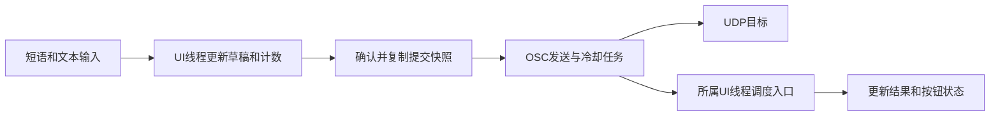

# VRChat OSC聊天工具

本项目把VR空间中的文本输入转换成VRChat Chatbox消息。用户可以先选择常用短语，再补充自己的内容，检查字数后显式发送。应用默认进入离线模式，先验证输入、选择和发送反馈，再接通实际OSC目标。VRChat限定144字符和最多9个展示行，显式换行与自动换行都会占用展示行。 [VRChat Chatbox接口](https://docs.vrchat.com/docs/osc-as-input-controller#chatbox)

## 需求与可观察结果

用户从接近窗口到完成发送，应能用一只手依次操作。最常见的路径是选句、调整草稿、确认消息、等待结果。偶尔需要在输入中途切换到其他窗口，回来时仍应看到原草稿。清空气泡和丢弃草稿是不同动作。前者影响VRChat中的显示，后者是本地编辑操作。将两者做成明确的命令，可以避免用户误以为清除了客户端内容，实际上只是删掉编辑区文本。

|操作|应看到的状态|数据归属|
|---|---|---|
|打开应用|离线模式，计数为0|窗口会话|
|选择短语|文本进入编辑区|短语集合与草稿分别保存|
|编辑或粘贴|计数与实际接受文本一致|编辑区|
|提交|显示本地发送结果，限制重复触发|一次提交的快照|
|取消清空|气泡和草稿保持|确认事务|
|关闭窗口|退出确认与任务释放|窗口和工作线程|

把验收划分为应用、操作系统与VRChat三个层级。应用验证生成正确OSC字段和UI状态，操作系统报告UDP调用是否成功交付给本机网络栈。实际气泡是否出现由客户端判断，UDP发送结果不能代表VRChat收到或显示。无头WARP截图只呈现控件、交互和本地模拟状态。联调时使用虚构短句记录提交序号、字数和目标，不需要复制玩家实际消息。

## 头显布局与单手操作

例程窗口为720×440逻辑像素。默认物理缩放1.0时，展开尺寸约为0.72×0.44米。首先在正常佩戴位置调整观看距离，以能同时看清编辑区和命中按钮为基准。若提高字体，必须同时复查行高及中文、英数、日语混排的最大宽度。控件外观按逻辑尺寸安排，实际视觉大小由物理缩放、位置和曲率共同决定。

左侧的短语列表更适合纵向排列短句。右侧需要较宽的编辑空间，下面放计数和发送按钮。将发送与清空拉开，状态放在操作区外侧，不因字数变化而改变命中位置。连按扳机时，按钮尺寸、邻接间距和禁用反馈应有明确区别。单手完成一轮测试，检查在打开候选界面、恢复普通按键和使用Tab切换时，焦点与激光仍指向预期的控件。

适合长期开放的窗口可以设为`world`或`body`，用适当距离和轻微下方偏移避免挡住主场景。手腕参考适合一个呼出入口，将宽编辑区固定在手柄上会随手移动。使用`head`模式时优先保持外围可见，避免转头时界面一直位于主视野。调试时不要同时调整物理缩放、坐标和参考对象，否则难以判断是哪项造成命中位置变化。

## 线程与事件流

示例在控件回调里执行短消息编码和UDP发送，再投递延时状态更新。增加多目标、重试或发送统计时，可把编码和发送交给单一后台工作线程。在UI线程建立快照，之后工作线程只读快照，返回发送结果、提交编号和冷却截止时间。UI保留对草稿、焦点和模式的唯一修改权。



SDK内部通过`connection::get_dispatcher()`取得所属连接的调度入口，`control_base`在创建时保存它。应用公开用法是C++的`begin_invoke()`或Python的同名方法。后台发送不能顺手读取`textbox.text`或访问窗口状态，必须在点击回调时捕获当前值。回到UI以后，核对提交编号、窗口生命周期和当前模式。若旧返回值晚到，保持最近提交的提示。相关约束见[强类型事件与多线程调度](/guide/07_events_dialogs_threading)。

## 第一步：从空窗口到可编辑草稿

先创建`window`和三类基本控件。左侧`listbox`存短语，右侧`textbox`存草稿，`label`反映状态。C++通过`get_control_list().add()`确定归属。Python例程把控件保存为`vrc_chatbox_window`的成员，再逐个加入`control_list`。用户操作事件要在添加控件前后保持一致。第一次显示前完成默认模式与空草稿配置。运行`show()`之后，SDK循环负责派发输入和提交更新。

列表选择通过`on_selection_changed`进入。读取索引前先检查是否为负数，选择为空时保持原草稿。将所选文字复制到文本区域，再请求焦点供继续编辑。列表刷新可能触发选择事件，因此更新集合时要决定是否保留原选中项。把选项索引长期用作业务键会在排序后指向别的短语，配置来源更复杂时宜为每条短语保留稳定身份。当前例程用固定词条，字符串列表足以完成基本流程。截图中的短语为供验证的虚构材料。


## 第二步：建立字数、换行和提交规则

先启用`multiline`再设置`max_length`。这两个值分别控制换行行为和码点预算。每一次文本改变读取SDK接受的实际值，再同步`progressbar`。当前例程用进度填充显示字数占用，生产版可额外显示数字。程序填入、普通输入、粘贴、选区替换和清空都要走同一条状态更新路径。设置大小写转换或行尾清理时，计数应基于最终准备发送的文本。若提交时进行额外转换，就在预览中表示转换后的内容，以避免用户看错发送结果。

C++的`u32string.size()`和Python的`len(str)`统计码点，不是UTF-8字节数。一个表情可能由多个码点组成。生产版截断首先限制可用长度，再回退到安全的字素簇边界，最后才编码。边界测试至少覆盖汉字、英文、重音组合、长表情和内含换行的句子。宽窗口中一行可容纳较多字符，VRChat中同样的文本可能自动折行。预览应把本地长度检查和远端展示预算分开，允许用户主动缩短消息。

两个版本把Enter拦截在`on_key_down`并标记`handled`。若需要保留普通换行，可把组合键作为明确提交命令。IME确认候选时，先保证候选已经提交，再响应应用发送。测试按位置而非只测按键名，区分候选窗活动、单行编辑、多行编辑、焦点位于发送按钮等情形。成功的行为是每次操作只触发当前焦点对应的命令，草稿和进度条指示同一份文本。


## 第三步：编码与调试OSC数据报

OSC字符串采用UTF-8、NUL终止符和四字节对齐。地址字段写入`/chatbox/input`，类型标记以逗号开始，字符串数据另行写入。立即发送与通知设置在标记中分别用`T`或`F`表示，每个布尔标记不带值字节。C++的`append_osc_string`负责每段填充，Python的`encode_osc_string`负责返回包含尾部填充的字节数组。增加可配置的声音与立即提交选项时，必须组合两个独立布尔状态，再测试四种组合。不要把所有字符串合在一起后只给整包补齐，否则接收端无法找到各字段边界。

编码前拒绝或规范化内嵌NUL。消息为空但用户明确选择清空时走单独分支，不与普通发送的空草稿检查混在一起。先使用回环接收端检查四字节边界、UTF-8文本和包的长度，再启用客户端OSC。IPv4默认发送到`127.0.0.1:9000`。程序与VRChat需要在正确的位置运行，远程EasyVRUI会话并不会改变程序的回环地址指向。需要与渲染主机分离时，把目标地址作为OSC配置的一部分单独处理。

C++初始化WinSock后创建套接字，最后清理套接字和WinSock。实际部署检查初始化结果、无效套接字、`sendto`结果和返回字节数。Python用`finally`释放套接字，发生`OSError`时给出简短提示并保留草稿。状态行避免拼接整段长文本，显示提交编号或固定长度的结果。连续失败时先回退到本地演示模式。排查工具独立记录报文长度和摘要，逐个区分负载的问题、系统调用问题及客户端显示条件。

## 第四步：把发送反馈演进为可验证的冷却

源码展示发送后延时恢复状态。要支持快速重复点击，在发送和Enter共用的入口加单调时钟检查。确认本次输入有效之后记录允许下一次操作的时间，控制发送命令的可用性。禁止期间保留用户编辑能力，不将每次点击都堆进待提交队列。若清空和发送共用限流，清空确认成功后也应重新核验此刻能否执行。用户可在冷却期间准备下一条消息。

为每次提交分配一个递增编号。延时结束的回调读取当前编号，只有仍是最近一次提交时才修改状态。如果用户换模式、窗口关闭或重新连接，则拒绝把旧的完成结果写入新一代界面。按设计选择使用单工作线程、可停止的定时器或带截止时间的队列。短例程里每次提交独立延时容易解释，长期运行要限制后台任务数量。测试可以让一次发送结果故意延迟，再进行第二次发送，验证旧结果无法覆盖最新显示。


## 第五步：清空与模态确认

清空建议先显示确认。用户接受后，执行一次明确的远端清除操作，本地草稿可由产品策略选择保留或清空。取消时既不发送空值，也不擦除草稿。在示例源码中清空命令直接提交空字符串，另一个确认出现在实时模式的窗口关闭时。截图中的清空确认是该工程的扩展场景，复用相同模态API。实际联调要验证目标客户端对空文本的处理，再决定提示措辞。

关闭回调使用`cancel_event_args_t`。用户选择不退出时修改`cancel`。模态等待使用同一UI线程的嵌套循环，因此可能收到定时状态更新。进入对话框前完成共享数据的建立并释放业务锁，返回时再依据快照执行清空或退出。窗口再次打开时创建新实例，应用关闭时停止工作并释放资源。设计不应仅在`run()`结束后等待一个仍持有UI锁的线程，避免退出路径形成循环依赖。


## 工程验收与故障定位

|测试输入或操作|预期状态|异常定位|
|---|---|---|
|选择第三条短语后粘贴两行|草稿与容量同时更新|比较实际接受文本和事件读取值|
|粘贴长串表情后发送|服务端限制以内，截断不拆坏文本边界|分别记录码点、字素和UTF-8字节长度|
|输入法转换时按Enter|只提交组合结果|检查IME路由和应用消费条件|
|连续触发发送|只允许首个有效提交|核对统一入口、单调时钟和允许时刻|
|改变模式后旧结果返回|状态仍属于当前模式|核对提交编号及关闭标记|
|网络调用报错后再试|草稿和重试动作仍可用|检查发送错误结果是否保留草稿|
|取消对话框后恢复编辑|原文字与当前焦点可继续操作|检查直接所有者与模态退出流程|

先逐项通过离线UI验证，再用回环监听核对包结构，最后打开实际VRChat做短句联调。每个阶段只更换一个变量。所有测试使用固定短语，以便比较两种语言的结果。在同一表面上观察预览后，进入真实空间复核可达性和自动换行。在测试报告中区分UI状态、局部传输与远端可见性，可以让后续维护者准确复现故障起点。

## 将提交过程实现为可测试的状态机

可把一次发送拆成“准备”“确认”“提交”“限流恢复”四个动作。准备收到输入快照和当前模式，检查空值、字数、显式换行和不允许的控制字符。业务策略需要用户确认时进入确认阶段，显示内容摘要而不是把完整长文本塞进窄对话框。提交阶段持有一份只读快照，允许本地草稿继续变化。限流恢复阶段用截止时间计算是否重新启用命令。状态改变只发生在UI线程，异步任务负责取得时间和系统发送结果。这样，模态对话框、旧回调和用户点击发生交错时，每个更新都可以按照来源辨认。

实践时可以在模型中存储当前草稿、最近操作编号、当前模式代次、下一次可发送时刻和简短反馈。还要定义每个字段在两个命令之间如何变化。普通编辑只改变草稿，使用短语会写入同一草稿字段。状态栏显示的最近一次结果可以继续保留。清空命令先根据业务规则获得确认，再生成空字符串快照。发送失败时不要把失败理由放回编辑器。失败的操作已经占用发送额度时可以保留短暂延时，也可以立即让用户修正后重试，关键是给出确定规则。

|阶段|入口检查|完成后保留的数据|
|---|---|---|
|准备草稿|窗口归属有效，文本已提交组合|规范化前后字数，原草稿|
|等待确认|快照和窗口身份已固定|操作种类及打开对话框时的代次|
|发送数据|目标配置有效，冷却截止已到|提交编号和开始时刻|
|处理失败|返回与当前任务相符|草稿及错误类别|
|恢复|当前代次仍匹配，截止已到|新的可用性和最近结果|

### 代码演进一：把重复的读取逻辑收敛到提交入口

C++源码从`button_send->on_click`和`textbox_chat->on_key_down`获取内容，Python有两个对应方法。扩展时先在两处分别找到“读文本、判断为空、发送、清理”的顺序，再把它提取成统一的`submit_chatbox`。入口接收操作种类，并使用同一预算函数产生已验证的内容。Enter分支只负责识别修饰键和设置`handled`，按钮分支只负责触发命令。若当前状态禁止提交，入口返回一个明确结果。调用者不应在失败结果后无条件清空内容。

在C++实现中可以使用结构体保存文本和序号，在创建它时复制`u32string`。该字符串随后可以安全移动进异步任务。Python只需传递不可变字符串和数字。两种实现都不把对`textbox`的访问留给异步发送部分。若改成持久的发送队列，应设容量，并定义满队列时拒绝或覆盖何种任务。聊天消息的语义是明确的人为提交，同步等待中的多条记录不应被静默合并。相比连续旋钮，聊天的合并策略通常更保守。一个简单的工程选择是只允许一项等待，用户编辑后可再次明确提交。

### 代码演进二：限长前后保持统一的预算报告

预算函数可返回四项内容：规范化后的文本、原始码点计数、可提交计数以及截断原因。编辑控件的`max_length`提供第一层限制。业务入口再处理来自配置文件的短语、外部脚本和编码方式，确保绕过编辑区的入口仍使用同一约束。如果文本中包含从剪贴板复制的多种行结束符，先统一换行形式，再进行行数和长度检查。只有在得到截断后的值时，才计算UTF-8字节数。不要先切字节，再把截断结果转回文本。任何跨字符边界的截断都会产生不可解码的字符串。

为边界用例准备固定文字组合。把普通汉字当作一个可见单位进行基础计量，再加入由不同码点组合的字形，观察长度和视觉数量分离。测试时记录输入内容准备好了多少码点、SDK接受了多少、实际准备发送的字节数。用同一组样本比较C++和Python入口。含一个长标点序列时对远端折行影响可能大于普通词句，应查看最大展示行反馈。把剩余空间显示成“已用数／预算”可以立即发现计量差异，进度条保留为快速视觉反馈。将实际截去的部分用独立提示说明时，不必在状态栏重复所有文字。

### 代码演进三：用本地接收端隔离报文错误

扩展发送函数为可注入目标，默认仍由应用设置交给VRChat。测试时选择与实际游戏分开的临时回环接收端，保存单个数据报用于断言。验证地址字段开始和结束的位置，接着检查类型标记每个字符，最后读取终止符前的UTF-8消息。将预期消息重新编码后与捕获值比较。用固定单字节文本、四字节边界文本和多字节文本三个样本逐一覆盖填充情况。接收端不需要识别游戏状态，就可以发现地址书写错误、布尔标记顺序错误和填充不正确。

同时检查本机网络异常如何影响草稿。Python模拟`sendto`抛出异常，断言界面状态仍可重试。C++可让发送服务返回失败并检查调用端是否误显示成功。状态更新最好在统一处理任务结果的位置执行。日志记录本地系统错误号和当前请求编号，不在UI上展示套接字内部细节。实际游戏验证只在本地编解码过关后进行，例如先发送一条由可辨视觉标记组成的短句，再测试立即发送和通知声音的设置。测试报告把这一步明确标记为客户端显示核验。

### 代码演进四：关系到模态对话框、模式切换和关闭的顺序

打开清空确认时，保存当前提交编号和窗口仍属于当前会话的身份。等待用户操作期间，后台状态回调可以继续进入UI。假如用户在其它入口关闭了窗口或切成非实时模式，确认返回后要重新检查可执行条件。当继续执行时创建新的操作编号，确保清空提交不会被上一次普通草稿的完成消息覆盖。取消时不要改变当前编辑器的生命周期，保持原来焦点并让用户继续编辑。记录业务事件时要区分“打开了清空确认”与“提交了清空命令”。

退出路径可先停止接受新发送，再结束已有后台任务。可以用停止标记和有界等待，确保工作线程不会无限驻留。由于运行时保护控件生命周期，过期回调可能不再执行，但应用仍需释放持有的套接字与线程。不要把任务最终清理全部塞进UI回调，否则窗口已关闭就无法执行释放。异步发送器负责拥有线程和套接字，UI负责发出停止意图并处理最后的可见状态。调用线程等待退出之前释放锁。需要剩余数据保留时，可另写本地草稿，不能把待确认历史当作已发送消息保存。

## 交付验证记录

用一张简短记录表管理测试，字段包括测试编号、操作路径、输入类型、预算、是否实际启用网络、结果来源和截图位置。先对照本章四个图验证布局，再对照状态迁移逐步点击。同一输入使用按钮与键盘两条路径提交，确认失败后的行为一致。使用离线演示验证长文本、短语替换及冷却，回环验证只看包结构，最后连接真实客户端验证气泡。若已经通过回环检查但VRChat没有显示，优先检查端口、协议参数和客户端设置。不要因为这个现象就修改UI逻辑或反复重发。最终验收要能从“预览的内容是什么”追溯到“发出去的是什么”，也要能解释哪一步只验证了本地结果。

清空确认另验收接受与拒绝两条路径。用户输入一条未发送草稿后打开清空对话框，选择取消再检查文本、计数和选择焦点。第二次确认后检查被发送的是空字符串操作，而不是草稿正文。对话框等待过程中切换设备或改变模式，预期是旧操作不会穿过新的状态限制。用长时间暂停和窗口复用两种场景观察计时回调是否更新了已销毁的对象。上述试验有独立于视觉效果的判断条件，便于把结果写成自动化检查。

## 完整工程与构建

先按[安装与环境配置](/basics/01_install_and_setup)启动Engine。在教程仓库根目录的x64开发者CMD执行以下命令，将SDK路径换成实际安装位置。使用Visual Studio生成器时，可执行文件位于Release子目录。

```bat
cmake -S examples/projects/01_vrc_chatbox/cpp -B .work/vrc_chatbox -DEASYVRUI_ENGINE_INTERFACE_ROOT=D:/Tools/EasyVRUI/sdk
cmake --build .work/vrc_chatbox --config Release
.work\vrc_chatbox\Release\vrc_chatbox.exe
set "EASYVRUI_SDK_ROOT=D:\Tools\EasyVRUI\sdk"
examples\projects\01_vrc_chatbox\python\run.cmd
```

### C++

<<< ../../examples/projects/01_vrc_chatbox/cpp/main.cpp

### Python

<<< ../../examples/projects/01_vrc_chatbox/python/vrc_chatbox.py
