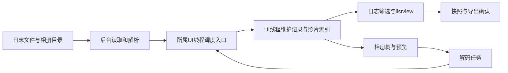

# VRChat实例日志与相册管理

本项目把房间事件和本地照片放进同一个VR工作区。日志和照片使用独立页面。前者先解决增量采集和条件筛选，后者先解决索引与缩略预览。用户进入窗口后可以在不离开头显的情况下查看刚发生的事件，确认是否需要导出，再切换到照片。目录、用户名、玩家名和照片都可能包含个人信息。本文截图使用虚构事件和合成照片，运行时应选择自己的文件来源。VRChat在Windows上的默认日志位置和保留行为由客户端文档说明。 [VRChat本地存储](https://docs.vrchat.com/docs/local-vrchat-storage) [VRChat输出日志](https://help.vrchat.com/hc/en-us/articles/9521522810899-Where-do-I-find-my-Output-Logs-and-Crash-Dumps)

## 需求拆解与界面契约

第一组需求是最近事件。打开页面时显示读取来源和当前数量，新事件追加，背景中切换日志文件后继续读取。第二组需求是空间内快速缩小视图。用户应能区分全部事件、进入、离开，以及是否按房间或玩家限定。第三组需求是查看照片。相册树按月或按目录分组，选择文件时显示预览、名称和失败原因。第四组需求是导出与删除。导出使用一个冻结集合，用户可以取消保存。删除需要文件身份验证和独立确认，不能由普通预览动作触发。

现有完整C++、Python例程提供以进入和离开为主的筛选、目录树、图片载入和导出。它们读取的基础行由时间、动作和玩家构成。稿件中的房间与玩家联合筛选图展示扩展后的模型，房间来源必须由已验证的本版本客户端日志取得。没有可关联的房间记录时，保留“未知房间”或只开放玩家筛选。删除是独立扩展操作，本节用导出模态窗口展示实际保存前的确认阶段。

|状态|日志页应显示|相册页应显示|
|---|---|---|
|目录不存在|来源未发现，仍允许载入样例或切换目录|说明路径不可用，保留文件选择入口|
|等待写入|已有记录保持可读|照片留在当前页|
|解析失败|其它有效行继续追加，计数可用于诊断|保持上一张，提示无法解码|
|筛选结果为空|条件保留，显示0条|独立浏览|
|用户正在保存|冻结将交付的记录快照|切换页后仍保留当前选择|

默认不把进入、离开之间的缺失记录解释为用户离开房间。只从可观察条目构造时间线。把原始解析结果与显示标签分开，例如模型保存`Joined`，界面显示“加入”。筛选应比较模型值，而不是随语言变化的显示文案。排序也应基于时间或采集序号，不直接依赖昵称和时间格式。有重复名称时，同名玩家需要由日志中可用的稳定标识区分。无法确定稳定身份时，把筛选条件明确叫“显示名称”。

## VR布局与字体

两个页签比在同一平面同时摆放大量列表和图片更容易阅读。日志页优先展示分钟秒数、动作和玩家名，加入房间列时先决定每列限制。用左对齐名称帮助扫读，用固定行高保证用户瞄准选中行。相册摆成窄树加宽预览，保留照片等比显示。页签高度决定头显内命中带，过低时容易点到第一个筛选项目。原例程820×520逻辑像素约对应0.82×0.52米的展开尺寸，适合固定在视野一侧。物理尺寸是逻辑尺寸乘`physical_scale`再换算成米，不能直接把某一逻辑宽度描述为所有人的视角大小。

一只手操作时，常用筛选靠近表头，切页时不要求交叉操作。字体调整要检查窄列中的标点、拉丁名和多字节字符。需要看完整长名字时，可在下方专用区域显示，避免依赖水平滚动同时看完整时间与名字。预览占用较大面积，删除和导出入口可放在独立命令区，不覆盖画面。建议从`body`或`world`定位验证，列表筛选和目录树展开时窗口保持稳定。配合手柄快速翻页时，动作必须有独立的焦点反馈，以区分打开照片和选中照片。

## 线程、数据与归属

后台读取目录、跟踪日志和解码大图会遇到不同延时。接收模型可划分为日志采集批次、照片索引批次、单张预览结果。UI线程持有应用模型和所有控件，只接受不可变结果。每种结果包含来源代次，例如日期、活动文件和当前照片选择编号。切换路径时提高代次，等待过程中得到的旧数据可以丢弃。不要让异步完成继续写入已经被另一个目录替换的列表。



原C++例程使用`jthread`读取增量文件，用`window->begin_invoke()`合并批次。Python例程使用后台线程读取日志，把每条解析结果投递到`listview`的UI回调。SDK内部通过`connection::get_dispatcher()`保存所属连接调度入口，应用通过`begin_invoke()`访问。不要在工作线程操作任何`tree_node`归属、`listview_item`集合或窗口的普通属性，包括从工作线程读取窗口关闭标志。生产版在UI关闭路径设置`stop_token`或`threading.Event`，后台只观察这个线程安全信号。解码完成后在UI检查代次，并在控件仍存在时赋资源。

## 第一步：搭起两页与可控的假数据

首先构建`menubar`、`tabcontrol`、日志`tabpage`和相册`tabpage`。`window.menu`接收菜单，侧边页由`page_list`管理，页中普通控件进入对应的`control_list`。窗口框架会根据菜单行高布置命令入口，页面矩形仍由应用配置。给列表标题、过滤条件和滚动条预留面积。先用固定的四条数据填表，确认滚动与标题布局，再进入实际文件扫描。固定数据应包含两种动作、两个房间和两个虚构名字，便于观察筛选变化。

列定义创建为`listview_column`，各行由`listview_item`持有字符串单元格。写入一批数据时先构造新的项目集合，再统一替换。单条追加适合低频更新，高频时不必反复清空和逐行恢复选择。两种语言均可以先保留应用数据模型，再把筛选后的对象映射到显示集合。需要异步批量更新时，处理一次后只请求一次界面刷新，避免反复重算滚动位置。


## 第二步：可靠跟踪新增日志

例程寻找`output_log_*.txt`。C++代码将目录迭代、最近文件检查和解析分为`find_latest_log`和`parse_log_row`。每轮查看最近可读文件，换文件时关闭旧流，再建立新流。读到没有终止符的最后一行时回退偏移，下一轮读取完整行。Python短例程选择一次最新日志后从文件头读取。实际具备轮换的部署可把C++的文件身份检查、流关闭和偏移恢复思路移植到Python。文件不是原子写入的，不能假定一次读取就能拿到完整事件。

从文件头读取便于回填最近记录，但文件可能很大。应用应决定启动时回看有限窗口还是从末尾开始等待新事件。固定上限同时约束扫描字节数、待处理行数和缓存在UI中的行数，三项各自计算。大文件读完前若一直保留所有历史，再在UI端裁去旧记录，仍可能耗尽后台内存。C++目前最终保留100条展示数据，生产版还应限制每轮追加批次。按合理的时间预算读取接下来的数据，让退出信号和路径变化都能及时生效。

日志行解析只关注已验证的事件标记。提取时间时保留原始行内的时间信息，不能拿文件修改时间代替每条事件发生时间。遇到编码错误时可以跳过单行并增加失败计数。Python演示对不合法字符做宽容解码，C++接受完整字符串转换后再加入记录。两种策略对身份的影响不同，如果损坏部分落在玩家名中，宁可把它作为不完整记录显示，也不要用它创建稳定玩家键。

轮换生命周期可拆分为发现新文件、打开、继续读取、发现被截断、重新选择。文件名称相同但大小变小，说明偏移可能已经无效，重建流并决定是否跳到末尾。文件短时被锁定时，对待处理记录保持原状态，下一轮重试。状态区可以展示当前文件名和读取数量，排错时记录最近成功偏移。选择新目录后清空旧来源状态，UI只接受当前来源标记的批次。不要在打开失败时继续把上一次文件中的记录标为新文件结果。

## 第三步：筛选顺序与房间关联

现有代码用`combobox`选择“全部”“仅加入”或“仅离开”，刷新函数从原始记录筛出属于当前动作的行。原始行保留，改变条件无需再读磁盘。在兼容实现中，可先对动作应用可选谓词，再对已解析的房间ID和玩家ID施加交集。把任何一项设置为“全部”只移除该条件，不能影响另一条件。排序或过滤前保存当前选择对象的稳定键，刷新后依据该键恢复。有些筛选窄到只剩0条，切换回全部后也应保持可用。

某些日志包含进入实例的上下文事件，可能发生在玩家行之前。解析器可以按会话代次维护活动房间，然后把能够确认的房间键附在新事件上。遇到房间变化时先更新关联状态，再记录后续玩家动作。旧日志文件收尾时迟到的事件不能被贴到新会话房间。验证时至少准备两个房间含相同玩家名的输入，再加入一条只有姓名和动作、没有房间上下文的记录。如果筛选结果正确，未知房间会保留在全部视图里，且不会被错误归入两个已知房间。


## 第四步：构建照片索引和高分辨率预览

在相册页创建`treeview`和`image`。目录组使用`tree_node`显示月份或文件夹名，照片节点的`tag`保存可重读路径。应用收到选择通知后检查是否是叶子，以及文件扩展名和路径是否符合允许的来源。现有示例通过目录扫描填充节点。两个语言版本均在图片读取失败后更新说明。更完整的实现应让耗时的目录枚举和降采样发生在UI线程之外。把已解析的目录描述作为普通列表传回UI，再集中创建树节点。由于图像资源创建方式依赖SDK接口，可在后台产生像素数据并在所属线程创建或赋给控件。

高分辨率照片在文件中可能压缩得很小，但解码后的内存按像素乘通道数计算。1600×900的RGBA大约需要5.76MB，4K图像需要更多资源。快速切换时不应把所有大图永久保存在控件里。选择缩略图和预览图两级策略，限定同时解码数。在异步任务开始时记录节点标识和源文件最后修改数据，结束时检查选择还指向同一文件。文件被移动或损坏时显示错误，不让后台结果把刚选择的另一张照片替换。界面可继续显示上一张并标注该状态，避免错误素材看起来像当前选中项。

`image.stretch_mode.contain`适合检视完整画幅，`cover`适合做填满视口的缩略预览。使用前者时，边缘空白属于比例调整。一个较好的验收步骤是分别加载16:9横图、竖图和正方形，记录像素是否保持原始比例、有无越界、标题是否在切换后仍可读。收到图片错误后应保留命令区和页签切换功能。WARP截图使用1600×900合成图，以便复现解码和缩放布局的期望效果。


## 第五步：导出快照与危险操作确认

在打开`file_save_dialog`之前，先复制当前筛选结果和条件说明。对话框采用嵌套UI循环，后台日志可能继续到达，直接读取返回时的列表会得到不同结果。清晰的导出行为是用户在点击时看到哪一批数据，就导出哪一批快照。UI可提示记录数量、时间范围和列。在原示例中导出使用全量缓存，若扩展成筛选导出则要切换取数来源。删除场景同理，保存所选文件标识，确认时重新检查路径是否仍指向同一对象。

序列化为TSV时需清理字段中的制表符和换行，或者定义明确的转义规则。导出写入失败可以用状态说明并保留界面。需要防止半成品时，先写到同目录的临时文件，验证完整，再执行目标替换。用户选择取消时不创建文件。覆盖应遵循对话框和应用的共同规则，不能因确认过一次而绕过后续文件身份判断。删除若有回收策略，优先提供可恢复路径，并在确认前显示文件名。应用应只操作相册目录授权范围内的文件，展示截短的名称不意味着文件身份可以用截短名称比较。


## 验收、维护和故障复现

|复现动作|观察项|定位方法|
|---|---|---|
|先写一部分日志行，稍后写入换行|完整前不出现缺损行|核对未提交尾行的偏移与解码|
|重新启动VRChat|应用切换活动文件|比较原路径、文件时间和实际打开状态|
|切换滤项同时追加记录|条件仍生效，数量正确|将数据新增与视图筛选分开计数|
|快速点击两张大图|最后一张保留|检查预览代次是否覆盖旧结果|
|目录或照片被移走|旧选择被清理，出现来源状态|验证错误处理只影响当前资源|
|在导出对话框打开后继续采集|写入内容仍对应点击时的快照|比较冻结时与提交前两次计数|
|关闭工具后重新打开目录|旧任务已退出|观察停止信号、文件句柄和会话释放|

排查先确认文件身份，再检查事件解析和提交队列，最后检查控件布局。先用短样本反复切换页面，逐项通过后再使用本地真实日志。分享截屏前检查是否带入了用户目录、真实玩家或图片内容。实际部署应提供可配置日志目录和照片目录，明确“数据仍在读取”“无匹配记录”“路径不可用”三种互相独立的反馈。维持一个可重复的测试样本，可以比较两种语言在分页、过滤、图像缩放和异常提示上的一致性。

## 让数据模型支撑长期阅读

一个可维护的事件模型至少需要四类信息。第一类是原始身份，包括会话文件及字节位置，用于去重和重现。第二类是显示数据，包括事件时间、动作、玩家名和可确认的房间。第三类是关联信息，包括当前活动房间和解析规则来源。第四类是处理状态，包括成功、忽略、部分可读或载入失败。通过读取同一列表切换筛选项时，UI只修改查询条件，不改写原始记录。保留事件身份还便于恢复选中行，以及确认导出与当前显示是否来自同一批数据。

如果在同一个日志文件中读到多个来源，解析应在文件代次内保留上下文，文件切换或首次打开时初始化。缺失信息时可以保存空字段并在可见列中统一显示“未知”。这样不会因为在房间列看不到内容就把记录丢掉。初始化与重新扫描应选择一致策略，避免同一会话首次打开看到某些事件，而刷新后它们又没有身份。可以使用文件位置与行内容摘要组合创建去重标识。对于来自不同日志文件的相同昵称，不应因文案相同就视为同一事件。需要合并时，先验证时间和会话身份，再判断是否确实重复。

### 批次、容量与刷新限额

C++的工作线程先生成`added`，再把整个批次移动到UI回调里。扩展时可以按固定行数或时间片提交，挂起时记录偏移并尽快回到停止检查。Python示例目前逐行投递，低频使用足够，若面向连续写入可改为批次。批次应带来源标识和可读行数，UI收取后在单个回调中更新模型与统计。切换筛选条件时先设置条件，再用已提交模型计算新视图。队列中的下一批仍使用当时最新的筛选条件。后台无需知道列表当前滚动位置，也无需根据UI过滤结果调整采集范围。

容量限制要区分文件字节、待提交工作和已显示条目。只保留最近一百行，并不能限制首次在五百兆日志中收集所有匹配项的内存。后台应逐段读、增量解析并只缓存有限数量。UI模型可以用有界队列保存最近若干条，导出的范围则由显式选择决定。需要查看历史时提供单独加载路径和进度。导出动作不应因为用户只看最后一屏，就自动只写最后一屏。使用条数、当前筛选条件和时间范围说明可交付的文件内容。

### 线程合并和视图锚点

实时列表更新后，滚动条可能停在不同的位置。用户正在看最新数据时适合自动跟随底部，正在检查前面的记录时应保留视觉锚点。可以把当前最上方的事件身份或选中项作为锚点，应用批次后检查它是否还在可见结果中。若旧事件被容量淘汰，显示一条简短说明，并选择合适的新锚点。列表滚动与日志采集不共享线程。只在UI线程读取选择和滚动相关状态，不能让解析回调在后台直接决定光标位置。

查询很复杂时，可以将快照交给后台生成候选键，但由UI应用最终结果。后台拿到的查询代次和输入数据版本必须随返回值一并传回。切换到另一页后不要清空已在编辑的筛选条件。回到日志页时，要能解释是否仍是先前视图，或者已经应用了新的批次。用两个故意乱序完成的筛选请求测试，观察第一个结果是否错误覆盖第二个。此类问题虽然不会导致崩溃，但会显示伪造的“当前筛选”状态，比显式报错更难排查。

## 从目录信息到预览资源

相册节点中不要携带大量已解码图像。描述对象可以保存显示名、实路径、修改时间和是否目录。索引工作线程返回这些描述，UI在创建`tree_node`时把可用于业务关联的键写到`tag`。路径本身也可以作为初始键，但文件改名或移动后该键就会失效。打开路径前重新验证是否存在及是否属于选定的根目录。对路径显示使用文件名，对实际读取使用完整路径，两者不能互换。不同目录同名的照片在树中可以同时显示，模型仍保持身份独立。

解析和解码分别维护超时或取消意图。读取文件之前检查大小和扩展名，只说明可能支持这个格式，真正支持与否由解码器确认。准备错误分支时区分文件缺失、加载失败、格式不支持和文件被改写。保留上一张图时应在文字中标明它是上一项，避免用户以为删除命令针对这张图。实际预览结果到达后先核对当前选择，再装入显示对象。两个测试样本快速反复选择时，最后可见的名称、像素和源身份必须对应同一照片。

在后台改变预览尺寸时，应保留原始纵横比例，并结合GPU资源回收避免完整大图一直驻留。普通照片预览不需要复制每个像素到多份缓存。必要时维持一个低分辨率缩略图以及一张当前预览，详细模式再解码较大资源。设置最大边长和总像素预算要一致，避免极长图片即使另一边很窄也占用大量资源。对于不常见的图像方向，检查解码器是否已应用方向信息，图像中的坐标与`image`的目标矩形无关。预览模式改变时保持相册树当前选择，用户只是在比较裁切效果。

## 扩展场景的可验收实现

房间筛选演进可以分两个小提交完成。先给模型增加可空房间键与显示标签，用静态样例验证谓词。再接入真实日志解析，在新数据到达前准备一份房间状态映射。发生切换时填写期望的身份，忽略文件轮换带来的旧上下文。普通“仅加入”筛选依然要可用，不因为房间无法关联就减少可用的基础查询。验收用一份精简日志同时覆盖未知房间、同名玩家和两次进入事件。为各个选择记录预期数量，自动比较，而不是从截图猜测是否正确。

导出和删除宜以事务模型实现。导出先缓存记录快照与标题，确认目标后在后台写入，结束再回到UI报告结果。以空集合开始导出时显示明确的数量，允许保存一个只有表头的文件还是直接拒绝，应提前定义。删除则保存文件当前身份并打开确认，用户同意后重新验证路径和源状态。在多次选择交叉发生时，旧对话框不能删除新的选择。若添加回收路径，执行后刷新目录模型，预览保持有效或重置为空。发生读写错误时保留选择并提供重试，不在表格中静默移除文件项。

附带的可复现测试应从小样本开始。构造日志文件时分两次写最后一行模拟半写，读到第一段时页面不应提前创建不完整的玩家。准备一张损坏PNG和一张正常图，切换时核验错误提示与所选身份。保存试验使用一次性目录，先测试取消无文件，再测试写入成功与目标不可写的分支。不要拿目录的实际用户名作为断言。场景需要展示相册工具在没有用户照片时也能工作，便于维护者在独立环境复现场景。

## 完整工程与构建

先按[安装与环境配置](/basics/01_install_and_setup)启动Engine。在教程仓库根目录的x64开发者CMD执行以下命令，将SDK路径换成实际安装位置。使用Visual Studio生成器时，可执行文件位于Release子目录。

```bat
cmake -S examples/projects/02_vrc_log_and_gallery/cpp -B .work/vrc_log_and_gallery -DEASYVRUI_ENGINE_INTERFACE_ROOT=D:/Tools/EasyVRUI/sdk
cmake --build .work/vrc_log_and_gallery --config Release
.work\vrc_log_and_gallery\Release\vrc_log_and_gallery.exe
set "EASYVRUI_SDK_ROOT=D:\Tools\EasyVRUI\sdk"
examples\projects\02_vrc_log_and_gallery\python\run.cmd
```

### C++

<<< ../../examples/projects/02_vrc_log_and_gallery/cpp/main.cpp

### Python

<<< ../../examples/projects/02_vrc_log_and_gallery/python/vrc_log_and_gallery.py
