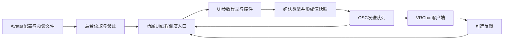

# VRChat Avatar OSC参数调试与预设

本项目面向需要在头显内观察、调节和保存Avatar参数的开发者。左侧`grid`列出参数名、类型和当前本地值，右侧提供连续调节、精确调节、实时发送和保存预设的入口。在未启用实时发送时，面板可独立运行并显示示例数据。VRChat发布后的Avatar配置按本地用户和Avatar标识存储，输入定义中的地址和类型决定客户端接受的数据。 [VRChat Avatar OSC参数说明](https://docs.vrchat.com/docs/osc-avatar-parameters)

## 需求与数据语义

面板要把可编辑参数与只读身份分开。每个参数有配置声明、应用中的当前值、等待发送值以及可能来自远端的反馈。一个数字留在表格单元里，仅表示本地接受了它。勾选实时发送后，编辑提交可以生成OSC数据报。远端状态如果没有独立来源就保留未知。在基础例程中只有发送路径，显示值来自本地编辑和样例。扩展接收时，可在UI上另外显示远端最近值和时间，避免用未确认的本地赋值冒充设备状态。

|任务|开始条件|可观察结果|
|---|---|---|
|载入配置|来源存在且至少一项可编辑|按可见名称展示声明类型|
|编辑一个值|选中允许编辑的单元格|验证后更新本地模型|
|连续调节|选择合适的Float参数|应用接受新的有限数值|
|启用实时发送|用户明确打开开关|只在有效提交后生成数据报|
|保存预设|输入有效名称并确认|保存一致的本地快照|
|切换Avatar|获得新身份并载入新配置|防止旧会话的值写进新对象|

房间里的玩家可能使用多个已发布Avatar，面板的诊断任务应明确当前加载的头像。基础例程可选第一个能读到的配置文件，找不到则使用固定参数。正式面板应让用户选择Avatar，或者处理客户端的`/avatar/change`消息，核对文件名与声明的身份后再替换模型。切换前使当前编辑与待发送状态失效。不要把“最新修改文件”直接作为唯一可信的活动头像，特别是在多账户共用Windows用户目录时。

## VR布局与操作

原例程窗口为740×480逻辑像素。默认1.0缩放时约0.74×0.48米。左侧能同时看到参数名、类型和值，有助于区分浮点、整数和布尔，不需要每次调节时在不同页面找标签。右侧从上到下放实时开关、`slider`、`numericupdown`及预设操作。用于实时调节的控件应具备较大的命中区域，两种数值入口之间留间距，避免抬手调节时误勾选实时发送。长参数名在英文环境下可占用更多宽度。若使用真实配置，先测最长的几个名字，再决定是否允许横向滚动或另设完整名称指示区。

面板适合`world`或`body`，避免操作者调试时随着指向手柄一起移动。增加字号时同步调整行高、表头高度和列宽，给小数点、负号及值范围预留空间。双击单元格时减少目标附近的可触发控件。右栏的状态说明可固定一行，错误细节放在额外说明中。单手验收时从选择一行开始，再操作右栏，检查当前参数名称始终可见。实际场景使用近距离测试，并让用户直接比较关、开实时发送时的差异。

## 架构与线程交互

UI拥有参数模型、选择、草稿以及当前Avatar代次。目录读写、OSC编解码和可选的反馈接收可以在后台处理。后台任务接收已验证的数值与目标地址，对UI返回结构化结果。不同任务返回时只关联对应的Avatar和参数，先核对代次，再更新显示。在短例程中，文件扫描发生在打开窗口前，发送在控件回调中同步完成，方便测试单条数据。进行多文件扫描、频繁更新或接收OSC时，线程边界更重要。



SDK内部在`control_base`构造时通过`connection::get_dispatcher()`保存所属连接的调度入口。应用在C++或Python中调用`begin_invoke()`发出UI更新。后台读取参数配置时只交付普通数据，在UI回调内更新表格和控件。就算解析器只读取一条值，也不能在后台读取`grid.selected_index`来猜当前参数。批次应带业务标识、来源和时间。当用户暂停实时发送，可以停止新任务进入发送队列，并按策略处理已入队未发送的任务。

## 第一步：读取配置、准备合规示例

先从静态行开始验证布局和编辑。示例数据用`EarFlop`、`TailWag`、`CoatToggle`分别代表浮点、布尔和整数。C++的`load_avatar_rows`扫描用户目录中的OSC配置，并捕获文件或解析错误。Python的`load_avatar_params`查找`Avatars`下的文件并提取输入定义。正式实现应区分缺失目录、文件暂不可读、解析结构错误和没有可编辑参数。收到任何一种错误，都应保留安全的离线状态，清楚标记是演示行还是有效配置。

配置读取要区分身份、显示名称、OSC地址和类型。示例拼接`/avatar/parameters/`与参数名，适用于默认同名地址。高级配置可以明确指定不同`input.address`，此时不能用显示名称重建地址。只选择含输入定义的条目，可避免把仅用于发送反馈的配置当成可编辑参数。读取过后验证类型是`Bool`、`Int`或`Float`，对于其它字段显示不可操作状态。输入地址应有效并符合OSC约定，对含内嵌NUL和缺失地址的条目给出错误提示，避免生成半截地址。

如果有很多已缓存的配置，后台可以先枚举候选路径和时间，UI只展示必要的标识。在用户选择后再解析完整文件。窗口启动时渲染空状态或预置演示行，同一轮完成载入后原子替换模型。选中某行后再启动第二次读取时，不要把旧行指针留给新的异步回调。解析结果使用文件标识、头像身份和采集代次即可。若游戏配置在读取时正被写入，可以延迟重试一次，对反复失败的文件展示诊断。原文件的权限及内容留给用户与VRChat管理。


## 第二步：表格骨架和可编辑边界

创建`grid`后设置参数名、类型和当前值三列。C++的`grid_column_t`允许为列设定`editable`。基础C++例程把前两列设为只读，Python示例通过校验器拒绝非值列。实际项目可在两处共同限制，使界面反馈与数据规则一致。把参数对象保存在独立模型，`set_data_provider`的读取器按行列返回值。读取器会在布局重绘时多次调用，因而只做查表，不在其中打开文件或进行套接字操作。

提交值经历进入编辑、规范化、校验、写入和业务通知。Python示例用`set_edit_validator`检查列和数值类型，错误用二元返回值带回诊断。C++的数据写入器在更新模型前调用`encode_avatar_packet`验证类型，也可以换成专门的校验器。两种方式都要确保校验失败时保留旧值。需要显示错误位置时读取`grid_cell_event_args_t`的行列及错误文本，并提供重新编辑入口。业务层在`on_edit_committed`才发送，不从每个编辑字符产生数据报。对布尔单元格可用明确的开、关控件，使用户知道当前值是逻辑量而非字符串。

提交校验时需要注意整数和浮点的差异。整数要求字符串完整解析并落在带符号32位范围。浮点接受有限数，并且能够表示为32位浮点。对`NaN`和无穷值拒绝提交。布尔使用受控的文字集合，例如接受`0`、`1`、`false`和`true`，再转成真正的布尔数据。Python的`bool`是`int`的子类，所以编码分支先检查布尔。C++整数用`from_chars`检查尾部，避免把带多余字符的输入当作有效前缀。统一规范化后的值可供显示、比较和预设保存。

## 第三步：用调节和开关建立实时路径

右侧`slider`采用0至100的逻辑范围，转换为0.0至1.0的浮点值。然后通过`numericupdown`表达精细步长。拖动只适用于当前选中Float参数，整数或布尔应使用类型匹配的入口。调整滑块之前应把当前参数和允许范围显示出来。把编程式控件同步与用户修改拆开。切换一行时，为右栏更新值与上下限时暂时抑制发送，或保留一个同步状态标记。否则更新滑块及数值字段会冒出一条类似真实用户操作的发送结果。

基础例程连接`slider.on_value_changed`与`numericupdown`，后者再更新模型。若让数值字段反向更新滑块，要管理双向更新引发的反馈环。只把规范化后真正变化的值写回模型，并在同步过程中使用一次性的本地上下文。选择改变时，颜色和错误提示也需要按新参数重置。对于短促的控制动作，用户可以用整数或布尔的明确确认。大量连续变化时，先在UI呈现最新值，后台按键合并等待发送的更新。

数据发送时，OSC地址和类型标记依次对齐。布尔类型标记为`T/F`且无需值字节，整数使用32位带符号大端，浮点使用32位大端IEEE值。C++使用`bit_cast`获得浮点位，再按位移写出四个字节。Python使用`struct.pack`的大端格式。发送之前比较值的类型和配置的输入类型。UI开启实时选项后，只有合法改动才交给发送函数。送出成功只表示本地接口接受数据，不能让状态区显示远端确已执行。

对于滑块高频交互，生产版可按参数做尾随合并。队列键为头像代次和参数地址，连续的同键变化仅留下最新值。当拖动结束时刷新最后值。布尔开关强调顺序时应单独处理，不能把明确的开启和关闭不经策略地合并成一次。失败时保持本地值并标识未发出，用户可重试。若继续读取客户端反馈，还要区分反馈引起的界面同步和用户提交，避免把远端反馈再原样发回产生循环。


## 第四步：预设快照、命名和应用

基础例程使用一个模态窗口编辑预设名称。用户点“保存”时对话框通过`dialog_result_t::ok`结束。外层函数再检查名称并将当前参数快照写入用户目录的JSON Lines文件。C++通过`save_avatar_preset`写一行记录，Python构造名称与参数值映射后追加。保存失败时报告错误并保留当前参数。本章截图中的`combobox`用于展示可扩展的预设选择，“自定义”表示正在编辑的值和已命名快照相区分。实际代码当前可保存，加载与套餐切换应按本节扩展。

打开预设模态之前，根据业务含义选择冻结时机。若弹窗期间允许其它回调更新参数，就在弹出时冻结一份快照并明确含义。若要保存点击确定时的最新值，回到外层后检查当前Avatar代次及编辑状态。用户取消时不改变预设集合。名称应清理前后空白并限制长度，同名时应说明是创建新版本、覆盖还是拒绝。将稳定标识和显示名称分开，避免把名称当作直接路径。输入名称并不意味着文件写入成功，只有写入成功后的记录才进入可选择预设。

读取预设时按头像身份、参数地址和类型三重校验。应用预设可以先构造差异列表，展示缺失参数、类型不符和将要修改的值。确认后批量更新模型，每个参数最多安排一次发送。对未知参数保留问题报告，不要自动创建客户端没有的选项。顺序依赖的参数应在应用中明确，例如需要先启用一个模式再设定数值。真正依赖回执的操作应等待独立确认接口，UDP发送队列不能代替事务。预设文件损坏时可以跳过不可解析行并提供可读备份，不需要删掉所有历史。


## 第五步：断线、回声与重建状态

OSC采用UDP，基本发送不建立持久连接。这里的“断线”有两种含义。EasyVRUI的会话断开后，应用需要重新建立与Engine的连接，并恢复UI相关状态。OSC目标不可用时，当前报文没有远端确认，可结合客户端反馈超时判断对方可能不可达。两者分别显示诊断。恢复Engine后可以重建界面数据，但不能默认重发前一代残留的实时操作。恢复OSC目标时，应由用户显式决定是否同步当前状态。

为了避免收到自己的回显后再次发送，进入模型时记录更新来源，例如用户编辑、预设应用、远端反馈或会话初始化。仅用户认可的操作允许产生发送任务。如果反馈到达时本地仍有更新待处理，决定以何种规则比较值和时间。缺少可靠序列号时，反馈只适合作参考。面板要清楚表示显示值的来源，避免用最后接收到的颜色或开关覆盖用户明确进行的操作。

## 工程验收

|输入或操作|预期结果|诊断点|
|---|---|---|
|打开不存在的配置|显示演示行，实时发送关闭|区分目录缺失与解析失败|
|在Int列输入超范围数字|保留原值并报告错误|检查完整解析、符号与范围|
|在Float列输入非法值|取消提交且无发送任务|验证有限值及单精度范围|
|快速拖动slider|界面连续反馈，后台保留最新值|检查合并规则和最终提交|
|切换Avatar后旧任务返回|仍保持新头像模型|比较任务与UI代次|
|预设命名后取消|无写盘及下拉状态变化|检查模态返回与写入点|
|关闭实时发送再编辑|只改本地模型|检查统一的发送入口和开关判断|

用静态样例测试各种类型，再以回环接收端检查报文的地址、类型标记和字节序。实际客户端联调先用一个可观察且便于恢复的参数。记录发送前后的本地值、客户端行为以及是否需要手动恢复原值。预设持久化和实时发送可单独验证，文件写入成功不等于网络同步成功。明确这些边界后，调试面板在更换头像或连接方式时也能给出可解释的结果。

## 将参数校验拆成独立函数

写入入口不应由显示字符串决定参数实际类型。可先将输入转换为三种受控分支，再把解析结果封装为类型化数据。在C++中，模型可以用带类型标记的值或`variant`表达合法结果，错误作为单独结果返回。Python则要显式排除布尔参与普通整数解析，在输出端检查可打包范围。键盘编辑、拖动和预设应用最终都调用同一验证，从而得到相同的有效值。如果调节控件只能输入正数，而配置允许负值，要么调整右栏的映射，要么只让右栏处理适用范围，不能直接把合法负值裁到零并发送。

解析成功并不自动代表该值可以写回目标。例如参数存在于当前表格，却还未确认属于当前活动Avatar。业务入口除了检查格式，还需检查头像身份、目标地址、发送模式和参数约束。图形控件可反映原因，例如参数已下线、配置为只读或当前选择类型不支持拖动。分别展现限制能够帮助用户知道改动是因为校验失败还是因为应用尚未选择正确对象。状态标签长度固定，完整参数名称放在专门的文本栏，错误不要覆盖已确认的模型值。

### 具体编辑流程

先用三个有效样本检查类型转换可以执行。布尔点击选中后生成真正的布尔值，验证OSC标记不携带多余字节。整数样本使用最小和最大端点，再尝试越界字符串。浮点样本用多个小数位和奇异文本，确定格式校验能识别。对浮点缩放，确认UI显示的舍入精度、正常保存值和发送的二进制浮点含义一致。若采样出于调试需要保留更高精度，可在详情区展示原始记录，常用列表保持可读短值。只因为文字经过四舍五入才相同，不能用它判断两次业务值完全相等。

再测试程序写入路径。先选择一行，程序同步右栏的输入控件，确认不会自动提交。在同一行中输入相同数值，只有状态真实变化才触发业务提交。若某个值因其它控件联动变化，标记更新来源并防止原来源回环触发。把这个判定写在统一提交入口，而不是分散在每个按钮里。这样添加新预设应用或恢复默认值时，可以继续重用合法性检查和错误处理。批量更新时记录哪些参数应发送，直到所有值都确认后再走一次调度。避免在更新第一列的时候向客户端发送尚未完整的配置。

## 组合状态：浏览、编辑、发送、保存

面板可管理一个“选中参数”和一个“预设选择”，两者分别保存。选中现有预设时，可先显示预设摘要，等用户点击应用才逐项更新。拖动当前参数后将预设状态切为自定义，避免标着旧名称却展示新值。保存新预设成功后，才把自定义变为新命名预设。用户正在编辑的状态要独立于预设列表，不要因下拉框重载而取消非预期的输入。点击下拉框并选择同一条不应重复发送。研究功能扩展时，可以先只完成选择和摘要，再实现实际应用分支，最后加入网络同步。

|操作|状态改变|需要设定的策略|
|---|---|---|
|切换表格行|右侧编辑器跟随当前参数|程序同步是否触发发送|
|选择预设|显示内容摘要|立即应用还是由独立命令确认|
|修改单值|变为自定义状态|保存与发送如何反馈|
|保存失败|继续保留工作快照|是否保留预设名称供重试|
|改变Avatar|预设及队列按身份限定|是否保留旧身份的本地快照|
|重新连接Engine|UI以新会话恢复|是否需要用户明确重新同步|

在配置文件层，预设应保存版本、头像身份以及地址和类型一致的值。如果以后添加单值日志和比较功能，不把它们混在预设快照里。旧记录缺少类型时，读取过程中按实际当前配置验证，可能无法迁移的条目给出说明。每次写入成功才刷新下拉列表。在并发使用时按文件进行写入串行化，避免两次保存互相覆盖。若选择JSON Lines追加，读取允许遇到最后一行不完整并报告它。若选用整文件替换，应在同目录用临时文件并在写入完整后替换目标。两者都要用独立测试目录模拟空间不足和权限拒绝。

## 发送队列的可重复实验

对浮点调节使用分时快照测试，比持续拖动手柄更容易稳定比较。在一秒内输入多个固定样本，每个样本带连续序号，选择较慢的发送间隔进行验证。UI可以看到采样立即响应，队列只保留应发送的最新值。结束拖动时确认最终值交给发送队列。随后换一行再拖动另一个参数，确保后台键维度是参数地址与会话代次，第一行历史不能覆盖第二行。停止实时后等待一个周期，捕获端应按照定义的清理策略停止收到新包。

在回环接收端记录每个包的地址与类型。对比Python的打包结果与C++位移输出，使用统一的输入数据避免不必要的格式噪声。可同时记录时间、数据报数量和最后一个业务值，不必保留完整游戏会话内容。若客户端显示与本地发送不一致，先检查输入配置是否指定自定义地址，再检查目标模式。只有确认服务端接受该地址时，才把问题归因于调节控件。多个数据源同时更新时，可先暂停可疑来源并观察所选行，避免调试器自己覆盖有效反馈。

## 上线前的迁移与恢复演练

用一个假的Avatar切换事件测试代次变化，确保工作中的保存或写入回调不能修改新模型。准备一个旧预设同时含有正常参数、删除的参数和改变类型的参数。加载后应得到可核对的差异列表。用户可选择应用有效部分或取消整个事务。验证不应清空旧文件，可保留原快照等待修复。遇到写入失败时，检查当前状态是否仍标为自定义，用户能否修改名字并重试。模拟索引文档的数据文件可使用极短的路径，错误状态文字需能容纳数据源名称而不暴露整个个人路径。

调试成功后再校准头显里需要持续观察的行宽及当前类型标识。测试一只手拖动和选择两种动作交替进行。若控件在远距离容易误点，优先扩大焦点区域和安全间距。检查状态、当前值、待发送提示是否能同时辨认。预设操作的确认按钮应带明确动词，例如“保存命名快照”或“应用所选参数”。用户不应通过猜测当前应用在何种模式来判断是否会改变游戏中的角色。记录接受条件和可见效果，可以让他人在没有真实游戏数据的情况下复现大部分逻辑。

## 完整工程与构建

先按[安装与环境配置](/basics/01_install_and_setup)启动Engine。在教程仓库根目录的x64开发者CMD执行以下命令，将SDK路径换成实际安装位置。使用Visual Studio生成器时，可执行文件位于Release子目录。

```bat
cmake -S examples/projects/03_vrc_avatar_osc/cpp -B .work/vrc_avatar_osc -DEASYVRUI_ENGINE_INTERFACE_ROOT=D:/Tools/EasyVRUI/sdk
cmake --build .work/vrc_avatar_osc --config Release
.work\vrc_avatar_osc\Release\vrc_avatar_osc.exe
set "EASYVRUI_SDK_ROOT=D:\Tools\EasyVRUI\sdk"
examples\projects\03_vrc_avatar_osc\python\run.cmd
```

### C++

<<< ../../examples/projects/03_vrc_avatar_osc/cpp/main.cpp

### Python

<<< ../../examples/projects/03_vrc_avatar_osc/python/vrc_avatar_osc.py
