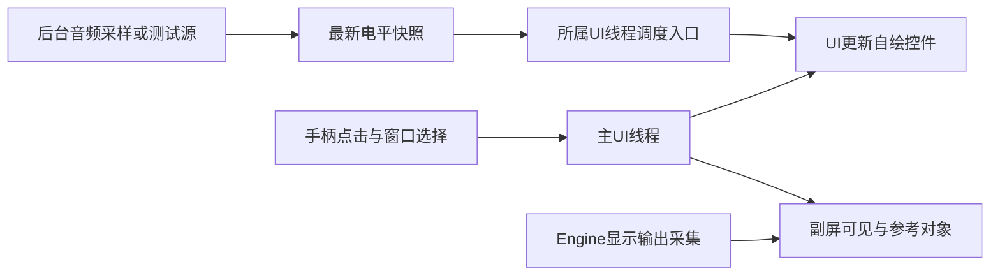

# 腕部HUD、screen与电平绘制

本项目用两个原生`window`组成VR监控工作区。一个随左手移动，显示紧凑的麦克风电平与副屏入口。另一个显示电脑输出，可以在身体参考下保持易读的空间位置，并按配置弯曲。基础例程负责锚定、显隐、显示器选择和自绘控件。电平用示例值演示。WARP图片分别使用32%和78%的测试采样，显示刷新后的布局变化。无头副屏使用占位内容，真实输出由有采集能力的Engine提供。

## 需求、主辅窗口与交互取舍

把“查看一个状态”和“阅读一块屏幕”分开。腕部HUD应适合短时间扫视，可放一个电平、一个源状态和一个副屏命令。副屏用于较长时间查看，需要更大的物理宽度、更稳定的姿态，以及独立的显示和休眠策略。用户只想看腕部时，不需要持续看到副屏；再次打开时，布局应可预测。显示器切换、跟踪丢失和麦克风缺失分别处理，任何一个来源异常都不应阻挡其它操作。

|使用场景|腕部窗口|副屏窗口|
|---|---|---|
|进入VR后查看电平|紧凑显示当前采样与可用性|保持隐藏|
|选择显示桌面|入口给出可见状态|按设定姿态显示|
|快速摆动左手|控件随参考移动|以独立的参考对象定位|
|更换显示器|提示采集状态变化|保留目标区域，等待新画面|
|跟踪不可用|状态可读或按策略退回|参考可在恢复后重新计算|
|关闭主工具|停止采样和待更新任务|按应用生命周期隐藏或关闭|

左手上的表面主要由右手激光操作。把开关放在远离手腕关节的区域，先测试松手、抬手和自然低头三个姿势。左撇子用户可以镜像参考和位置，移动按钮之前先验证两种持柄姿势是否都能稳定看见。腕上控件不宜积累多层页签，不应该让用户在移动的窗口上执行长文本输入。将清晰文字与图形组合使用，电平变化可以用条长，是否采集到数据用文字说明。没有收到采样与采样等于零应在状态上区别表现，前者属于来源状态，后者属于测量值。

## 物理尺寸、字号和锚点

示例腕部表面逻辑尺寸260×220，物理缩放0.65时展开宽度约0.169米，高约0.143米。控件逻辑字号16在该比例下的名义物理高度约十毫米，实际字形可见高度还受字体和观看角度影响。把窗口靠近手腕并轻度倾斜，可使自然视线刚好扫过电平。显示屏约960×560逻辑像素，观察距离较远，文字需要更大。副屏初始缩放如果由来源继承，则可能随腕部的0.65变小。要得到明确的副屏目标大小，可在首次显示之前显式设置自己的`physical_scale`。

`left`和`right`跟随控制器的位置与朝向。腕部的`position`是相对参考对象的米制位置，示例用三个分量留出手部几何和观察方向。旋转用度指定，C++的`vec3_t`与Python的`vec3`用同单位。配置时先校准单轴转动，再组合旋转。副屏可用`body`跟随人体平移并保留校准朝向，或固定为`world`。短时贴近用户的提示才适合`head`，大副屏避免长期跟随头部遮挡世界。

调试时把位置、比例、旋转和曲率分步设置。先以平面观察物理宽高是否合适，再调整目标距离。通过副屏侧缘检查曲率是否影响鼠标或激光相对位置。外观可用非曲面的WARP图先验收，但需要在头显中确认三维位置、双手可达性和不同姿态下的可读性。无头截图的标题会说明空间属性值，平面位图只记录SDK渲染的表面，SteamVR中的跟踪和曲面组合另行检查。


## 架构与线程责任

采样来源可以是音频采集回调或测试发生器。采集线程读取音频块并计算压缩到0至1之间的电平，将数据、时间戳、源代次打包成快照。UI线程维护当前来源和显示窗口，周期性读取最近快照，更新自绘控件。屏幕采集走Engine侧路径，SDK传入`screen_id`和目标矩形。音频数据修改应用自身状态，桌面纹理由渲染服务提供，两者不共享采样线程或GPU资源。



应用使用公开的`begin_invoke()`把更新调度到UI线程。SDK内部`connection::get_dispatcher()`提供所属连接的回调入口，控件在构造时保存可以向该入口提交的函数。这个接口属于SDK实现。样例扩展应通过C++或Python控件的公开投递接口，而不是把应用绑定到连接内部队列。一个采样块可能只对应几毫秒音频，不能对每块都投递一次UI更新。可以用原子最新槽或互斥保护的单条记录，限制队列同时存在的更新数。真正更新时，读取与当前源相符的快照，然后由UI修改电平、状态和颜色。

## 第一步：用blank预留布局

先用`window`配置标题、尺寸与位置，再在预定位置放置`blank`作为自绘区的座标来源。Python示例创建`blank_meter`，读取其局部矩形，交给真正的`mic_meter_control`。C++示例直接用同样的矩形构造自绘实例。使用窗体设计器时，可把布局输出封装为组合对象，在初始化后读取占位项矩形和索引，用真实控件替换。SDK的`blank`不参与绘制和焦点。控件继承用在自定义绘图类型上，装配窗口时可以继续使用组合写法。

按位置拷贝时读取局部`rect`，不要把绝对位置写回同一父容器。占位矩形负责宽高和相对位置，真正的电平控件负责样式、刷新触发和命中规则。留出标题栏、安全边距和副屏按钮位置，按钮脱离进度条。先运行一个固定级别验证边框和字形能完整容纳。若窗口宽度缩小，检查自绘区域的可用内部宽高，有限情况下允许降级为只显示状态。模型不应依赖模板中的硬编码绝对坐标。

## 第二步：实现自绘与值变更

自定义`control`重写`render(context)`。在C++中通过`context.get_rectangle(*this)`得到绘制矩形，Python读到相应几何后再建立背景和电平条。使用统一内边距计算轨道长度，将电平的归一值乘以最大长度。先检查轨道宽高为正，电平为零时可只绘制背景和文字。先画圆角背景，再画活动条，最后绘制数字。文字保持可辨，不依赖活动条颜色识别。必要时给文字使用稳定背景，使满量程和零量程都具备对比度。

当前Python的`set_level`会夹取到0至1并请求`invalidate()`。C++基础示例保留静态值与示例文字，可以给类添加相同的值更新入口，再根据实际级别构造百分比。只有可见的值或状态有变化时才请求重绘。UI可以按固定节奏消费最新一条电平，以降低采集与重绘的耦合。用不适当的单位更新会导致全部值趋近满格。先验证归一化和显示映射，测试边界0、1和非有限值。任何非法数应在进入绘图计算前被识别。


### 采样的工程实现

制作真实音频版时，明确计算的是峰值还是均方根。峰值对短暂冲击反应快，均方根更接近持续能量。一个音频块内可先按通道取绝对峰值，或对平方和取平均和平方根。源采集配置中的采样率、样本格式和通道数与显示逻辑分开。输入格式变化时建立新的来源代次，丢弃上一代采样，保留明确的初始化状态。不要在绘制回调中请求音频设备、阻塞读缓冲或访问正在写入的可变数组。

读数可用快速上升、较慢回落的策略提升可读性。阈值以实际采样周期而非渲染帧数计算，否则低帧率时的回落速度会变化。转为分贝显示前要对零值明确处理，只有正幅值才可取对数。为设备未连接保留不同的状态文字，避免“0%”被误解成静音。调试时用固定序列覆盖低、中、高和静音，记录从输入到UI改变的延时。基于真实设备前先验证采样停止后界面会转入等待态，过期值不会一直停在高档。

## 第三步：管理screen和副屏生命周期

创建第二个`window`，把`screen`作为其中的内容。实际显示地址取决于Engine所在计算机的输出编号，远程应用的文件路径或显示器数量无法推断Engine的输出。把`screen_available`与两个变化事件转换成简洁状态。没有真实显示图像时，保留相同布局并在预览区显示等待，不要改变其它命令的位置。示例选择输出0，WARP捕获使用无效编号，避免捕获真实桌面。参考`screen`章节的可用性与编号处理。

显示副屏可使用`show()`，暂时收起用`hide()`。隐藏时仍可保存应用定义的布局状态，真正关闭后需要创建新窗口。示例按钮根据`visible`切换。在部署中还要确认当主窗口退出时副屏如何处理，因为普通窗口的可见和关闭数量会影响应用循环退出条件。可以定义主窗口关闭先结束采样，再显式隐藏或关闭副屏，避免只退出了腕部表面而副屏仍独立留在空间。若将副屏作为长期工具，则应提供自己独立的关闭行为和再次打开入口。


## 第四步：切换参考对象和曲率

窗口初次定位选择`startup_position.none`时，使用应用配置的局部位置和姿态。把腕部和副屏使用的参考对象分别设定。如果窗口已在场景中，希望切换后仍保留当前位置，应使用`reparent(reference, keep_world = True)`，而不是重新解释旧局部坐标。目标参考不可用时先查询`is_tracking_available()`并提示，留到设备恢复再执行。示例主要配置初始参考，扩展场景可以加入按钮或下拉入口。把当前参考对象与模式提示留在用户一眼能看到的位置。

`curvature`单位为米的倒数。将它乘以展开宽度得到弧度意义的弧角约束，范围按`window`属性和交互分别处理。在同一展开宽度下，曲率值增大会收紧水平圆柱面。设置之前计算逻辑宽度和当前缩放，确认取值可接受。需要恢复平面时设置0。切换曲率后用手柄查看两侧边缘与中央按钮，复查命中区域与外形。改变锚点的场景还要移动身体或转头，确认平移和朝向分别符合所选参考。截图中只比较表面内的属性标注，实际空间行为需在有跟踪的环境验收。


## 第五步：资源、恢复和Desktop登记

电平控件保留少量状态，后台维护采样源。对隐藏状态可以降低UI更新频率，但采样工作应否停止取决于业务需求。开关重新显示时，用当前源最新值刷新一次，避免残留过期级别。设备移除与切换编号时重新建立源状态。不要在旧会话的最后一次回调中修改新窗口。处理窗口关闭时使用工作线程停止信号，等到资源释放后才清理控件归属。对正在载入中的来源，返回结果中应包含源代次以便丢弃过期工作。

通过Desktop登记时，清单负责名称、图标和启动方式，空间姿态由应用代码配置。可将可执行文件或脚本和清单放在安装根目录的`app/wrist_watch/`，通过相对于清单的路径配置入口，再将清单路径加入Desktop用户配置。Desktop经SDK启动Python版本时使用`sdk/api/python/`。在CMD直接运行时也使用同一安装的SDK。远程Engine使用独立连接参数，采集屏幕编号归属于该Engine。步骤参见[空间定位、自定义绘图与Desktop登记](/guide/08_spatial_drawing_deploy)。

## 验收与故障复现

|环境变化|检查目标|处理方向|
|---|---|---|
|固定样本从低值跳到高值|条长和数字同时变化|确认UI消费最新采样并有效重绘|
|没有取得音频块|显示等待或来源异常|区分缺失与零信号|
|打开和收起副屏两次|可见性恢复且保留配置|查看生命周期是否关闭了可复用表面|
|输出设备退出|采集区显示状态|核对`screen_available`及编号|
|移动窗口到另一参考|世界位姿保持或按预期重新解释|比较调用前后的坐标基准|
|增大曲率后按钮边缘难以命中|实际布局可触达|分开校正缩放、位置和曲率|
|结束程序后查看后台|退出及时，采集停止|检查是否还有待投递任务和资源引用|

先在WARP中验证矩形、绘图和状态文字，再用实际设备确认振幅、空间跟踪和副屏内容。将音频级别输入、GPU画面状态与参考对象状态分别记录，能帮助定位是设备停了、链接改变还是UI没有提交。明确地点、设备和观察距离后，用户可用同一序列复现问题，不必猜测哪一次移动引起了窗口跳变。

## 把振幅转成稳定可读的反馈

补齐采样前先确定显示目标。是否需要表示短时尖峰，是否需要看到持续平均水平，或者是否只需区分静音、正常与超限。一个面向队友沟通的HUD通常要能看到自己是否在讲话，不一定要像测量仪器那样持续刷新。设计归一化层时把输入信号的单位和输出模型写清楚。可先生成一分钟固定样本，依次从低电平上升至高电平，再回到静音，并在中途插入一次失去源的状态。用这些样本校验显示比调节真实设备更容易重复。

### 从静态数值到最新值槽

基础例程给自绘类型一个固定值。第一步增加独立的数值设置函数，接收归一化数据和采样有效性。在该函数中比较上一次可显示的值，变化超过显示精度时才调用`invalidate()`。第二步把源数据置于后台，只保存最新快照。可以为快照维护活动源序号、采样完成时间、值及是否有效。UI按自己的节奏消费当前快照，在来源变化后拒绝旧序号数据。第三步加入更新频率上限，实现时根据实际消耗测量，不将某个采样设备的块大小硬编码成视觉更新频率。

若使用单调时钟更新UI，到期时从快照槽里取值。采样线程读取速度高于UI是常态，积压每一条记录会增加延迟并保留本不必要的中间数值。最新值槽适合表示当前电平。若需要展示历史折线，可另建固定长度的采样队列，定期计算用于图形的历史集，不能让历史存储决定当前电平反馈。暂停源后看界面是否及时转入未知状态。后台只记录设备诊断、采样计数和幅值，不保存原始音频即可完成大部分调试。

C++应在设备回调里做轻量的数值计算，避免长时间持有锁。把待更新值交给工作线程或独立队列之后，再通过控件调度传回UI。Python可以用带锁的数据对象或线程安全队列保存快照，再调用`begin_invoke()`。不要用事件对象直接传递正在被音频回调复用的可变数组。需要刷新一批状态时，先在UI内提交实际值，再刷新多个控件。按当前窗口可见性降低更新频率时，重新显示前读取一次最新快照，使它立即对应当前源。

### 过滤与采样变化演练

对尖峰和回落采用统一的时间尺度。固定从0跳到高值的响应可以验证是否需要更快上升。逐渐下降的序列能检验回落时间是否符合观测习惯。低幅度抖动如果一直触发重绘，用户看到的只是位置来回抖动。可以按显示精度舍入后再判断是否更新，不影响后台实际采样。设备状态变更应立即反馈，避免被幅值过滤吞掉。对1.0以上或负值夹取，非有限值先报告数据无效。把设备不可用和电平为零独立呈现。绘图回调只读取统一的UI值，流经渲染的颜色、条长和数字都由同一次状态决定。

## 把空间定位当成第二个状态机

普通App会面对默认跟踪、用户移动、手柄丢失和参考对象切换。选择`left`说明“绑定左手参考”，并不意味着左手信息此刻可用。完整工具建议维护期望参考对象、最近一次可解析位姿和当前恢复策略。左手暂时不可用时，可按需求隐藏腕部或暂时冻结最后状态。恢复后重新验证参考可用性，并决定是否保留世界位置。如果立即把同一个局部坐标套给新参考，窗口可能从手边跳到房间另一侧。用户需要明确知道自己刚才选择的是保持原位换参考，还是按新参考重新摆放。

|操作|需要读取|预期改变|
|---|---|---|
|设置初始跟随|目标参考可用性和局部位姿|建立明确的首次定位|
|切换保持原位|旧世界位姿及新参考|只改解释基准，世界外观尽量保持|
|切换重新定位|新参考与新局部偏移|应用预定布局|
|设备失去跟踪|来源状态与最后可用值|降级到隐藏或稳定等待|
|恢复平面显示|当前宽度和曲率|改变外形，保持业务布局|

测试用户把手伸近窗口、转动手腕并切换视野时，要观察窗口是否还总在合适位置。开发时从世界参考开始，先只验证窗口内容，然后加左手和身体参考，最后加曲面。这样可以分开排除UI坐标错误、轨道位置计算错误和空间跟踪错误。示例截图中的body或world字样报告当前配置，并不意味着一张平面PNG能表达真实三维局部姿态。验收空间位置时可以记录头显和手柄状态，用同样的初始姿势重复步骤。

### 副屏输出的生命周期与观察成本

屏幕输出存在启动、可用、暂不可用和源改变。刚打开副屏时先给等待状态，真正收到来源恢复消息后再更新说明。切换输出编号后不要让旧画面一直用新编号显示。需要保留上一帧辅助用户对照时，要明确标注“上一画面”。优先保留不受源影响的布局，操作入口仍可用，屏幕内容区单独进入占位。按业务减少隐藏期间的画面需求，SDK和Engine管理真实纹理，应用只提供当前需要显示哪个输出。

副屏占用的空间和观察成本很容易高于腕部HUD。合理的调试方式是先只显示一张桌面内容，在文字可读性足够后再查看曲率对左右区域的影响。如果宽度估计过大，会频繁转头或找不到边缘命令。宽度估计过小则桌面内容不可辨。用常见的一行文字来检查主题 contrast 和目标大小。在可操作时测试主腕开关、显示器丢失、重新出现和窗口生命周期。程序退出前停止音频工作并按设计关闭两个窗口。后台线程与两个表面的归属都要清楚，不能把工作归属默认为最后收到的某个窗口。

## 扩展版的构建顺序

从现有C++的`mic_meter_control`和Python的同类实现出发，第一轮仅引入稳定电平状态。两边都给控件提供相同的近似数值更新入口。第二轮连接测试发生器，模拟固定序列并验证更新规则。第三轮加入实际设备初始化和释放，保留测试输入可切换。第四轮把互不影响的命令分别连接到显示副屏、恢复平面和切换参考。最后处理远程Engine及显示器选择差别。每次只引入一个新接口，先跑无头渲染再把新功能放进头显验证，避免在上机时同时调几个未知系统。

如果出现“图形能动但数值没变”，先比较显示级别和模型级别是否来自同一个快照。出现“数值变化但条没动”，检查轨道计算与夹取是否按0至1处理。若窗口能显示却没有实际屏幕，检查当前Engine是否能采集对应编号，并确认目标主机是哪台。腕部空间不正确时先暂时切到`world`验证二维内容，再回到另一参考系比较位姿。这个顺序让诊断分别落在数据、绘制、采集和空间变换几条清楚的路径上。

## 完整工程与构建

先按[安装与环境配置](/basics/01_install_and_setup)启动Engine。在教程仓库根目录的x64开发者CMD执行以下命令，将SDK路径换成实际安装位置。使用Visual Studio生成器时，可执行文件位于Release子目录。

```bat
cmake -S examples/projects/04_vrc_wrist_hud/cpp -B .work/vrc_wrist_hud -DEASYVRUI_ENGINE_INTERFACE_ROOT=D:/Tools/EasyVRUI/sdk
cmake --build .work/vrc_wrist_hud --config Release
.work\vrc_wrist_hud\Release\vrc_wrist_hud.exe
set "EASYVRUI_SDK_ROOT=D:\Tools\EasyVRUI\sdk"
examples\projects\04_vrc_wrist_hud\python\run.cmd
```

### C++

<<< ../../examples/projects/04_vrc_wrist_hud/cpp/main.cpp

### Python

<<< ../../examples/projects/04_vrc_wrist_hud/python/vrc_wrist_hud.py
