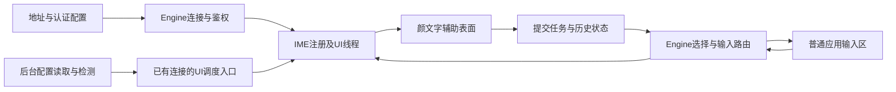

# 远程部署与颜文字输入

本项目把一个轻量输入组件放到另一台计算机运行，由渲染主机上的Engine呈现在SteamVR中。用户在普通应用打开输入区，切换到颜文字IME，选择预定义文本并提交。运行组件的计算机、Engine所在的计算机、正在编辑的应用可能各不相同。部署时先确认数据路径，再设计窗口交互和断线恢复。完整例程实现最小颜文字提交和普通输入转发，章节中的远程配置窗口、分组页签及最近使用是可复现的扩展场景。

## 需求与边界

应完成三种独立验证。首先是远程应用能与Engine建立经过鉴权的会话。第二是会话能注册为IME并被选为当前输入组件。第三是一次点击能提交文字到当前应用的输入区域。任何一项失败都要显示其对应阶段的状态。远程会话成功后可能没有应用正在编辑，因此颜文字界面可以隐藏。连接建立不能替代输入组件选择，点击提交也不能用作远程会话存活的唯一判断。

|阶段|依赖|可观察结果|
|---|---|---|
|定位服务|正确的Engine主机和端口|网络可以到达目标|
|身份确认|服务器公钥指纹和访问凭据|客户端接受目标并完成会话鉴权|
|注册|同一会话角色固定为IME|组件出现在适用的切换项中|
|激活|普通应用已打开输入区|Engine发送当前状态，辅助表面显示|
|提交|一次明确的颜文字操作|通过`ime_submit`提交到输入路由|
|排空或断开|停止接受新任务|旧结果按握手完成或被拒绝|

仅选择固定颜文字就可以工作。组件可为接到的其它按键提供转发，使宿主应用的普通输入逻辑继续生效。最小例程把颜文字保存在固定集合，后台任务范围由提交动作界定。进一步分组和最近使用功能要保持本地操作记录含义明确。适合保存的是用户选择的预设标识，而不是在目标输入区域看到的文本。关闭输入区后不保留应用草稿，也不继续采集按键。

## VR布局与辅助表面

组件窗口是辅助表面。Engine按输入区的位置和缩放安排它，不应在组件中另外选择普通应用窗口或挪动当前输入所有者。原示例520×150逻辑像素，520宽除以4个按钮后每项约118逻辑像素。字号需要检验不同字体的跨字符形状，因为某些颜文字包含日语假名、特殊标点和组合字符。实际显示大小受所附着应用窗口的比例影响，按钮宽度较小的情况下更适合放短词条。分组页签压缩当前页的条目数，用户无需一次扫读所有表情。

一次单手操作可以按“指向输入区、选择输入组件、选择分组、选择一项”的顺序完成。分组页签放在顶部，但不应遮挡原输入区域；输入位置由宿主与Engine协商。用户快速切换目标窗口时，旧输入区的辅助表面会收起，手柄激光应能继续选择新应用。增加历史区时让它出现在小面积的独立页或底部，避免与“刚提交”的反馈争位置。需要打开维护或连接配置时，使用普通应用中的独立界面作为工具入口。已经注册成IME的会话属于输入组件角色，配置工具不应在该会话中冒充普通应用。

## 连接架构与线程流

渲染主机持有SteamVR和Engine，远端主机运行应用进程或输入组件。客户端连接Engine，进行证书指纹校验和鉴权，再注册角色。首次部署使用已知地址和可信方式获得的指纹及凭据。状态和输入事件由Engine路由，颜文字组件通过SDK提交结构化事件。处理当前任务时记录对应连接和工作阶段。断开后让旧回调失效，重新建立会话后按顺序注册并等待激活。



SDK内部通过`connection::get_dispatcher()`创建所属连接的调度入口。应用从C++或Python公开的`begin_invoke()`投递UI修改。后台可以读取配置文件、检查网络可达性或准备本地索引，返回地址、诊断和任务代次，不能在后台直接读写`window`状态。握手结果和输入组件状态应分别处理，因为会话正常与表面当前应显示不是同一条件。收到晚到的后台结果时，先确认仍属于当前连接，禁止修改已经关闭或替换的辅助面板。

## 第一步：确认双机连接配置

先在渲染主机按安装章节启动Engine，在该机上用普通示例校验服务正常。再让另一台计算机启动同类示例，添加地址、端口、访问凭据和服务器公钥指纹。仓库定义的参数名称分别是`--easyvrui-host`、`--easyvrui-port`、`--easyvrui-access-credential`和`--easyvrui-public-key-fingerprint`。在工作环境中按自己的地址和配置文件填写。避免把实际参数写入截图、共享代码或诊断命令行。用户名、访问凭据和指纹的用途不同，应为它们分别设计数据源和错误提示。

下面的两张图使用假地址和本地状态事件展示界面。配置界面表示建立连接需要哪些信息，不会尝试连接图中的测试域名。“会话已连接”表示本地夹具注入的演示状态。实际程序联调需要分别核对网络端口是否能到达、服务证书是否与已知指纹一致，以及鉴权是否成功。能收到TCP响应还不能宣布应用已经连接。连接错误时保留表单内容，明确指出是找不到主机、连接超时、指纹不匹配还是访问凭据错误。


如果另一台计算机上程序也运行VRChat，OSC接收与EasyVRUI通信仍然是两条独立路径。远程连接只决定SDK发送绘图命令和输入事件的目标，不能自动转发应用本地的回环UDP。若要让附加应用发送OSC，明确VRChat进程所在位置并选择它的实际目标，避免把Engine服务地址当作OSC端口。部署验收可先只运行一个最小窗口，在远端看到输入和退出正常后再加入输入组件。

## 第二步：注册角色并等待实际输入区

C++例程派生`input_provider`，构造辅助`window`并设置`auxiliary = true`。Python亦使用`input_provider`的派生对象保存界面实例及回调。两个实现都在进入循环前注册IME，再由SDK向Engine报告语言和名称。组件状态以`active`表示。应用输入区关闭或切换到其它输入组件时，状态回调隐藏辅助表面。再次切到颜文字IME时则显示同一个表面。示例通常不主动打开普通应用输入区，激活由宿主窗口与Engine负责。

开发时可准备一个有`textbox`的普通应用作为目标。把输入模式切换到预期语言后选中新的IME，观察输入条是否显示该组件名称。若没有出现，检查是否正确注册为IME，以及当前语言是否在适配范围内。若名称出现但表面未显示，查看状态事件是否有`active`真值，核对辅助窗口是否因为当前应用切换而被隐藏。不要把所有问题合并成一个“未连接”状态。网络会话正常但当前输入区域不允许该组件操作时，界面保持待命。

窗口布局应在构造时加入普通控件，输入事件启动前完成绑定。每次`process_state`无需重建整个树，可复用已有窗口，使分组和最近使用保持应用定义的状态。收到取消或停用时停掉局部任务，避免候选 UI 在切换后短暂重新出现。输入区域的实际位置由Engine定位，组件仅提交表面及布局内容，不需要保存目标窗口的世界坐标。

## 第三步：从按钮集合扩展到分组和历史

最小例程使用四个`button`。每个条目都保存自己的文本值。在C++循环里用值捕获，Python回调用默认参数固定每次循环的值。否则多个匿名函数可能都读取循环的最后一个对象，点击任何按钮都发送同一条。显示文本可以用短版本，业务提交值保持完整。把每组可选内容建模为有稳定标识的记录，再用`tabcontrol`和`tabpage`展现“问候”“回应”等分类。页签切换只改变可选集合，不能触发提交。

用户点击候选项目后，在输入仍有效的情况下创建一次提交任务。最近使用可以记录条目标识和选择次数，限制列表长度。更新历史只在一次本地提交请求实际被接纳之后，历史反馈说明它是本地记录。若发送过程中会话丢失，则保留候选选择状态并提示，重连后不应自动把同一句话送进另一个输入区域。最近使用界面允许用户重新主动选择；一条记录重复出现时，可按最近顺序归并。长期保存策略独立于实际输入日志，清理历史不应删除预设数据。


## 第四步：提交与普通输入转发

在候选按钮回调中先调用`begin_input_task()`，再构造`input_event`或C++的`input_event_t`。将`event_type`设置为`ime_submit`，把完整文本写入`text`，通过`send_event()`提交。Python使用`try/finally`保证配对结束任务。C++在成功和异常路径都调用`finish_input_task()`。这对配对属于连接排空协议的一部分，不能在抛出异常后漏掉。进入真正的输入状态之前，不发送任何投机性的文本。

`process_input`负责该组件未消费的输入。最小范例将收到的普通事件转发，带候选导航的实现可消费用于选词的按键，并将其它`key_down`和`key_up`按规则转发。按下和松开要保持一致，不要只过滤其中一个。对于实际文本提交，应使用`ime_submit`，不应通过模拟多次键盘按键来重建组合字符。验收时分别测试普通字母、回车、删除和一次颜文字选择，重点观察普通输入是否重复，选择是否只插入一次。


## 第五步：把排空和重连做成明确阶段

切换输入路径要按串行排空处理。旧layout完成后，旧IME处理已入队的任务和待发结果，再由Engine启用新路径。组件进入排空后停止接受新点击和新工作。对已经启动的提交，要么完成既定事件发送，要么按协议结束任务。若连接超时或断开，旧连接的发送资格会被撤销。此时迟到的回调应被当作失效任务处理，不能拿新连接继续发送。基于这个约束，历史也可区分“用户选择”“本地提交完成”和“输入区域是否已接收”。

测试重连时让旧窗口正在显示，再断开服务。界面状态应转换到等待或隐藏，旧任务停止。连接恢复后重新建立角色并等待新的激活状态。不能在收到新的`active`之前恢复上一代提交。实际重连可以使用有上限的退避，给用户取消入口。对证书指纹变化应让部署者核对新指纹来源，不把身份错误当作普通网络超时反复重试。对凭据错误清楚提示配置不符，避免被错误状态掩盖输入法切换故障。

## 登记、运营和验收

安装时输入组件放在`app/layout/`或`app/ime/`。Engine从`bin/config.json`的`provider_list`读取角色、语言和程序入口，相对路径以`bin/`为基准。普通应用由Desktop管理，内置清单登记在`app/desktop/config.json`，自定义清单登记在`%USERPROFILE%\easyvrui\desktop\config.json`。Desktop在内存中按应用ID合并两份配置，添加和移除只写用户配置。调试本章Python组件时，可用`python/run.cmd`或在CMD将本机的`sdk/api/python/`前置到`PYTHONPATH`，再直接运行脚本并传入远程参数。先核对连接和运行时注册，再验证输入组件切换。两台计算机的日志可以对照时间及连接阶段，诊断只记录必要状态。安装路径和登记规则见[安装说明](/basics/01_install_and_setup)与[Engine协议](/reference/engine_protocol)。

|场景|验收结果|优先诊断|
|---|---|---|
|主机名或端口错误|连接未建立，仍可修正配置|看网络可达性和目标服务|
|指纹或凭据不匹配|清楚报告鉴权阶段|核对配置及可信来源|
|连接成功但输入区未开启|面板保持隐藏|查看组件选择与`active`|
|切换分组但未点候选|只改变可选项目|检查页签事件与提交入口|
|选择一个颜文字|提交一次并更新本地历史|检查回调捕获和任务配对|
|切换窗口时有旧任务|按排空完成或拒绝旧结果|核对连接和任务阶段|
|恢复网络后重新启用组件|等待新输入区激活，历史仍独立|检查重新注册和状态代次|

先在一台机器上逐步验证角色、激活与提交，再用相同样本验证两台机器的部署。每次只更换网络、身份配置或输入路由中的一个条件。这样能把连接失败、界面未激活和文本未提交分开排查，也便于将示例从最小按键面板演进到分组和历史工具。

## 配置模型和诊断阶段

较完整的远程部署工具可以把设置拆成服务地址、身份验证、组件配置三个小对象。地址描述目标主机和端口。身份验证包含服务指纹及访问凭据。组件配置包含语言、显示名、角色和本地颜文字目录。保存表单时，操作系统网络状态不属于用户配置。再次打开表单时可重用地址，不把上次连通结果直接当作当前状态。有效的一次连接结果应带连接代次和完成时间，避免晚到的结果覆盖用户已修改的表单。

将“验证配置”和“建立实际连接”区分开有助于测试。配置验证检查主机字符串、端口范围、所需凭据字段是否齐备，以及输入的指纹形式是否符合客户端要求。网络探测只能发现主机是否可达。服务认证由SDK握手完成。用户修改任何身份字段后，旧的鉴权状态应作废。若允许保存多个主机配置，名称需与身份内容绑定。不要使用一个别名映射到多个证书后仍继续采用旧校验。授权信息要由可信渠道分发，复制到简短状态区时避免显示敏感字段。

|诊断状态|足以判定的证据|优先保留的界面行为|
|---|---|---|
|配置有效|所有必要字段检查通过|仍允许更改目标|
|目标可达|完成基本网络连接|继续等待身份确认|
|会话认证成功|连接层接受已验证服务|显示是否注册角色|
|输入组件注册成功|Engine接受角色及语言|等待输入区开启|
|当前组件激活|有效的`input_ui_state.active`|接受操作并显示辅助区|
|提交请求已完成|本地发送过程结束且仍属当前代次|更新本地最近使用|

如果界面不写清这些状态，用户在远程主机上看到名称后容易误以为输入已经转发。组件有时需要通过其它普通应用检查连接状态，例如先启动一个最小窗口以排除输入法选择。两台机器都应能退出专用测试，测试路径尽量只开放必要的监听，不把额外调试接口留在实际运行中。将创建会话的证据与角色状态分别记录，日志的识别信息不用包含真实凭据。如果排错信息过长，把短状态留在头显中，并附录可供用户在桌面查看的阶段码。

## 布局模型如何演进到分组和最近使用

第一个实现可以把四个字符串保存在固定数组里，它们的显示标签与提交文本相同。第二个实现把每个候选写成稳定的标识、分类、显示标签和提交文本。显示标签在字体不足或长度超出当前按钮时可缩短，提交值用原始受控文本。不要因字符看起来相似就覆盖另一个候选。用户选择语言时，应用可先选对应的候选目录，再把每个分组映射到一个`tabpage`。改变分类只更新列表与焦点，不构造`ime_submit`。初次显示时如果没有已选分类，可按配置决定第一项，避免把历史选择误用作自动输入。

之后加入最近使用，记录条目标识、顺序和可选次数。持久化时只存放应用预设标识和必要时间；依据实际需求尽量减少数据。用户明确选择有记录条目时，先从当前预设库解析它的提交文本。如果用户删掉原预设，历史可展示已失效的项，或者从列表移除。历史序列的变更应与文本发送状态保持可区分。例如一次发送失败不可以被计为成功，但仍可以保留上次浏览的分类。需要显示提交预览时，把状态区放在页签下面或窗口底部，避免历史新增行后把正在瞄准的按钮挤出原位。

把最常用的候选放在同一排，有助于在手柄单手操作中获得可预测的位置。若颜文字包含两行或过长，改用简短说明并给出高亮预览。重复打开输入区时保留最近分类可以减少操作，但切换到另一应用前不应恢复上一选择的发送动作。辅助窗口的实际占用空间要对照宿主应用的输入区观察。编辑区靠近屏幕下边缘时，Engine可能需要重新排列辅助表面，某些位置下用户只能看见候选的部分内容，需配合背景和宽度测试。头显测试通过后再检查低分辨率采集截图或普通显示效果，避免在桌面可读但头显难以操作。

## 代码演进：提交任务不是窗口回调的生命周期

最小C++和Python代码在按钮回调内调用`begin_input_task()`和`finish_input_task()`。如果将选择扩展为异步工作，例如读取词条内容或写本地历史，输入任务的生命周期需要覆盖整个待发结果，不能只覆盖检查按钮。开启任务后保存这次选择属于哪个输入代次。后台返回时检查仍可完成当前任务，然后调用发送。无论正常结束、主动取消还是出现异常，都要结束已经开始的任务。如果后台读取历史失败，文本提交可以继续，但历史区应报告错误或保持原记录。若实际文本提交失败，不能因为历史已经写成功就显示发送成功。

C++可用具有析构清理责任的局部对象保证任务结束，Python用`try/finally`确保无论异常来自构造、发送还是本地状态处理都配对清理。任何在UI异步回调中共享的任务状态，要么由UI唯一修改，要么通过线程安全的取消标记传递。旧代次回调不应该使用新的连接句柄继续工作。如果在确认前保存准备发送内容，应确保该内容独立于当前活动页。用户重新点击另一个组后，之前的操作仍然只属于旧组的已经明确选择。取消发生时把未发送的请求从队列移除，避免后续用户触发时一起重放。

### 普通输入与组合输入的检验

最小示例转发未消耗的事件，扩展候选导航时先定义哪些操作属于组件。例如上下方向改变候选高亮，确认选择会提交文本，而普通字符继续路由。考虑按键按下与松开配套处理，不能因为一个方向键开始被消费，释放时又交给普通应用。切换输入区时应恢复对旧按键状态的管理。文本提交按Unicode原值传递，不需要逐字模拟键盘。测试相同颜文字在两种语言入口下是否能完整送达，并确保普通回车仍按目标应用现有规则发生。

调试转发时记录事件种类、路由阶段及等待数量，避免记录输入字节。捕获故障只需要判断一次按下对应一次释放、一次候选选择对应一次`ime_submit`。如果目标窗口是普通应用，可准备只显示文本的测试控件观察结果。使用虚构输入，不在共享报告中记录用户真正编辑的内容。对异步异常，最好同时检查旧输入区隐藏之后没有持续的输入指示。确认不是测试宿主路由错误后，再查看两台真实机器之间是否存在超时或断线。

## 断开、等待和恢复的一组测试

测试重连可设计为两个独立阶段。阶段一模拟端口不可达或服务停止，检查所有待发任务是否完成清理，辅助表面是否隐藏。阶段二恢复同一服务并创建新的会话，检查重新注册、重新选择、再次打开输入区。即使用户在恢复期间点击已显示的旧按钮，也不应交付到新窗口。按照Engine规则，可能需要置换旧会话的发送资格。不要尝试使用相同的出站队列向两个不同会话同时发送。用户可以重试当前选择，但必须产生新的业务操作。

证书错误与普通断开采取不同恢复路径。普通网络断开适合有上限的等待或重试，身份不匹配要停下来核对部署配置。可用明确的短文案表示“需要核对服务身份”，不要用模糊通信错误遮蔽阶段。连接重新建立后仍可能没有活动输入区，应等待新的真实状态再让按钮可操作。测试时把两个不同宿主窗口放到不同位置，反复切换并测量活动窗口标识。仅当提交目标确实对应现在打开的输入区时，才将链路视为稳定。

适合写成自动化的用例包括同一分组不同选项是否发送各自内容、关闭输入区后是否停止提交、断线后旧结果是否记入新一代。在回环环境中注入状态变化可验证布局和回调；真实远程联调需要独立确认渲染主机所使用的应用与会话。打开会话前把地址、端口等字段与部署步骤一项项核对，再验证状态切换和本地历史。将预设历史保留与连接重建分开测试，确认一次会话错误不会丢失预设，也不会让旧输入被错误提交。

## 完整工程与构建

先按[安装与环境配置](/basics/01_install_and_setup)启动Engine。在教程仓库根目录的x64开发者CMD执行以下命令，将SDK路径换成实际安装位置。使用Visual Studio生成器时，可执行文件位于Release子目录。

```bat
cmake -S examples/projects/05_remote_and_kaomoji_pad/cpp -B .work/kaomoji_pad -DEASYVRUI_ENGINE_INTERFACE_ROOT=D:/Tools/EasyVRUI/sdk
cmake --build .work/kaomoji_pad --config Release
.work\kaomoji_pad\Release\kaomoji_pad.exe
set "EASYVRUI_SDK_ROOT=D:\Tools\EasyVRUI\sdk"
examples\projects\05_remote_and_kaomoji_pad\python\run.cmd
```

### C++

<<< ../../examples/projects/05_remote_and_kaomoji_pad/cpp/main.cpp

### Python

<<< ../../examples/projects/05_remote_and_kaomoji_pad/python/kaomoji_pad.py
